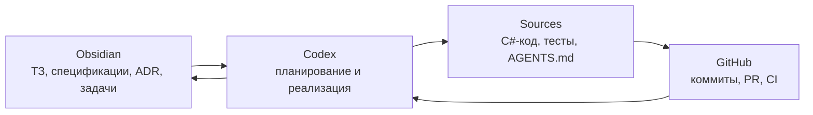

# Obsidian_Codex_Tasks — полная стенограмма, версия 1

[Открыть исходную задачу Codex](codex://threads/019fe223-5f49-77d0-a079-e26cef97d828)

В документ включены все видимые сообщения пользователя и Codex в хронологическом порядке на момент создания версии 1. Скрытые внутренние рассуждения модели и технические журналы инструментов не являются сообщениями чата и не включены.

## 1. Пользователь

привет


## 2. Codex

Привет! Что будем делать?

## 3. Пользователь

Создай для меня в документах папку, где будут шаблоны для Obsidian с MD файлами. И дай мне сразу же полный путь до неё, чтобы я вставил всё, что нужно, в непосредственно настройки Obsidian шаблонов. 


## 4. Codex — ход работы

Создам папку прямо внутри текущего хранилища Obsidian — только такие папки доступны встроенному плагину «Шаблоны». После создания дам и полный путь, и точное значение для поля настроек Obsidian.

## 5. Codex

Папка создана.

Полный путь:

`W:\obsidian\_parad\Документы\Шаблоны`

В настройках Obsidian → «Шаблоны» → «Расположение папки с шаблонами» вставьте относительный путь:

`Документы/Шаблоны`

## 6. Пользователь

Папки Документы и Шаблоны замени на английский


## 7. Codex — ход работы

Переименую обе папки в `Documents/Templates` и проверю итоговый путь.

## 8. Codex

Готово.

Полный путь:

`W:\obsidian\_parad\Documents\Templates`

В настройки Obsidian вставьте:

`Documents/Templates`

## 9. Пользователь

ok


## 10. Codex

Отлично. Папка для шаблонов готова.

## 11. Пользователь

добавь папку Chats в корень 


## 12. Codex — ход работы

Добавляю папку `Chats` в корень хранилища Obsidian.

## 13. Codex

Готово. Папка создана:

`W:\obsidian\_parad\Chats`

## 14. Пользователь

добавь папку Commands корень


## 15. Codex — ход работы

Добавляю папку `Commands` в корень хранилища.

## 16. Codex

Готово:

`W:\obsidian\_parad\Commands`

## 17. Пользователь

добавь папку Sources в корень


## 18. Codex — ход работы

Добавляю папку `Sources` в корень хранилища.

## 19. Codex

Готово:

`W:\obsidian\_parad\Sources`

## 20. Пользователь

Я планирую работать с кодексом вместе со связкой Obsidian.Мне нужен промпт, который найдет идеальное использование именно для моей задачи. Я архитектор и разработчик .NET-приложений на C#. Могут быть разные приложения: веб, десктоп, WPF. Промпт должен подходить под любое хранение source как исходников, так, документации, задач. Задачи должны переходить в код, код должен проверять, как выполнены задачи. Можно использовать у Obsidian  промты Task, Project. Код будет в Sources. А техзадание, спецификации, задачи, скиллы - это вопрос твоего исследования для проектов .Net, C#. Это исследование. Результет которого ты предоставишь в чате, а после обсуждения мы переведем его в структуру obsidian


## 21. Codex — ход работы

Использую навык `openai-docs`, потому что исследование затрагивает актуальные возможности Codex, его инструкции, навыки и рабочие процессы. Сначала сопоставлю официальные рекомендации Codex, Obsidian и .NET, затем предложу не просто структуру папок, а полный цикл «задача → код → проверка → обновление знаний». Пока ничего в хранилище менять не буду.

## 22. Codex — ход работы

Предварительно ключевой вывод уже виден: Obsidian не стоит превращать в «вторую копию репозитория». Он должен быть управляющим слоем с проверяемыми контрактами, а `Sources` — исполняемым слоем. Сейчас уточняю, какие инструкции Codex должны жить глобально, какие — рядом с конкретным проектом, и как сделать закрытие задачи зависимым от реальных проверок.

## 23. Codex — ход работы

Для универсальности веб/WPF/desktop я не буду зашивать один набор команд. У каждого проекта будет собственный «профиль проверки»: solution/project path, тип приложения, команды build/test/format и при необходимости UI‑проверка. Общим останется контракт задачи и правило: статус `done` выставляется только после зафиксированных доказательств выполнения.

## 24. Пользователь

учти, что можно использовать githib, как для хранения исходников так и obsidian


## 25. Codex — ход работы

Учту GitHub в двух ролях: как удалённое хранилище исходников и как резервируемое/версионируемое хранилище Obsidian. Отдельно сравню монорепозиторий, независимые репозитории внутри `Sources` и Git submodules — это важно, потому что текущий корень хранилища уже является Git‑репозиторием.

## 26. Codex — ход работы

Уточнение после проверки: текущий корень `W:\obsidian\_parad` ещё не инициализирован как Git‑репозиторий — наличие доступа в окружении не означало наличие папки `.git`. Это упрощает выбор: можно заранее развести отдельный приватный репозиторий хранилища Obsidian и независимые репозитории приложений в `Sources`. Ничего не инициализирую до нашего обсуждения.

## 27. Codex

## Результат исследования

Оптимальная модель для вас — разделить систему на четыре слоя:



Obsidian становится управляющим слоем и источником требований. Код и тесты остаются исполняемой истиной. GitHub предоставляет историю, ревью и независимую CI-проверку. Codex связывает эти слои.

Официальные рекомендации Codex предлагают описывать задачу через `Goal`, `Context`, `Constraints` и `Done when`, а постоянные правила переносить в `AGENTS.md` и навыки. Это почти идеально соответствует связке Project/Task в Obsidian. [OpenAI Docs: Codex best practices](https://learn.chatgpt.com/guides/best-practices)

### Какие документы действительно нужны

| Сущность | Назначение |
|---|---|
| `Project` | Паспорт приложения: репозиторий, solution, тип приложения, архитектура, команда проверки, политика завершения |
| `Specification` | Функциональные и нефункциональные требования, ограничения и внешние контракты |
| `Task` | Исполняемая единица работы с критериями приёмки |
| `ADR` | Архитектурно значимое решение, альтернативы и последствия |
| `Research` | Исследование технологии или подхода до принятия ADR |
| `AGENTS.md` | Постоянные правила работы Codex внутри конкретного репозитория |
| `Skill` | Повторяемая процедура, а не проектная документация |

ADR следует вести как журнал: принятые решения не переписываются, а заменяются новым ADR со ссылкой на предыдущий. Это соответствует рекомендациям Microsoft для архитекторов. [Microsoft: Architecture Decision Records](https://learn.microsoft.com/en-us/azure/well-architected/architect-role/architecture-decision-record)

Отдельный документ `Verification Report` по умолчанию не нужен. Доказательства лучше хранить непосредственно в задаче. Отдельный отчёт появляется только для крупных релизов, аудита или сложного ручного тестирования.

## Как задача должна переходить в код

Рекомендуемый жизненный цикл:

`draft → ready → in-progress → verification → done`

Дополнительные состояния: `blocked`, `cancelled`.

Задача получает статус `ready`, только когда содержит:

- цель;
- контекст;
- ограничения;
- критерии приёмки `AC-1`, `AC-2` и так далее;
- способ проверки каждого критерия;
- ссылку на проект и исходный репозиторий.

Во время реализации:

1. Codex читает `Project`, `Task` и `AGENTS.md` репозитория.
2. Проверяет текущее состояние кода.
3. Составляет план.
4. Реализует изменение и тесты.
5. Запускает локальную проверку.
6. Сопоставляет каждый критерий с доказательством.
7. Проверяет diff.
8. Создаёт или обновляет PR.
9. Записывает в задачу commit, PR и результат CI.
10. Только после обязательных проверок переводит задачу в `done`.

В теле задачи должна появляться матрица:

| Критерий | Проверка | Результат |
|---|---|---|
| `AC-1` | `OrderServiceTests.CreateOrder` | passed |
| `AC-2` | `dotnet build` | passed |
| `AC-3` | ручная проверка окна WPF | confirmed |

Таким образом, не «код формально связан с задачей», а автоматизированные тесты подтверждают критерии задачи. То, что нельзя автоматизировать, получает явно указанную ручную проверку.

## Универсальная проверка .NET-проекта

У каждого репозитория должна быть одна каноническая команда, например:

```powershell
pwsh ./eng/verify.ps1
```

Она находится внутри репозитория приложения, а не в общей папке `Commands`. Обычно сценарий выполняет:

```text
restore
build Release
unit tests
integration tests
dotnet format --verify-no-changes
анализаторы
проектные проверки
```

Для WPF он может дополнительно выполнять Windows-сборку, проверку упаковки и подготовку ручного UI-чеклиста. Для веб-приложения — integration/API tests. Для библиотек — тесты публичного контракта.

`dotnet test` собирает solution и запускает тесты, а `dotnet format --verify-no-changes` позволяет проверять форматирование и анализаторы без изменения файлов. [Microsoft: dotnet test](https://learn.microsoft.com/en-us/dotnet/core/tools/dotnet-test), [Microsoft: dotnet format](https://learn.microsoft.com/en-us/dotnet/core/tools/dotnet-format)

GitHub Actions должна запускать тот же `eng/verify.ps1`, чтобы локальная и серверная проверки не расходились. GitHub официально рекомендует использовать обычные `dotnet restore`, `build` и `test` в CI. Для важных репозиториев проверку можно сделать обязательной перед merge. [GitHub: Building and testing .NET](https://docs.github.com/en/actions/tutorials/build-and-test-code/net), [GitHub: Status checks](https://docs.github.com/en/pull-requests/reference/status-checks)

## Как хранить исходники и Obsidian в GitHub

Рассмотрены три варианта:

| Вариант | Плюсы | Минусы |
|---|---|---|
| Один репозиторий для Obsidian и всех приложений | Атомарные коммиты документации и кода | Все проекты связаны одной историей, правами и CI |
| Отдельный vault-репозиторий и независимые репозитории в `Sources` | Простота, независимые релизы и права | Commit кода нужно записывать в задачу |
| Git submodules в `Sources` | Vault фиксирует точную ревизию каждого приложения | Больше Git-операций, сложнее clone/update и CI |

Моя рекомендация: второй вариант.

- Приватный GitHub-репозиторий хранит Obsidian.
- `Sources/<Project>` содержит независимый Git-репозиторий приложения.
- Родительский репозиторий Obsidian игнорирует содержимое `Sources`.
- Task хранит `repository`, `branch`, `commit`, `pull_request` и `ci`.
- Ветки и PR содержат ID задачи, например `task/APP-0042-user-authentication`.

Submodules стоит применять только если вам принципиально важно, чтобы коммит vault фиксировал точную версию каждого проекта. Git действительно поддерживает отдельный репозиторий как подкаталог другого, но это добавляет обслуживание. [Git documentation: Submodules](https://git-scm.com/book/en/v2/Git-Tools-Submodules)

Текущий vault пока не является Git-репозиторием, поэтому схему можно выбрать без миграции.

У вас включён Obsidian Sync. Поэтому `Sources` нужно исключить в настройках Sync: исходники уже будут синхронизироваться через GitHub. Не следует одновременно включать автоматический Git pull/push на всех устройствах поверх Obsidian Sync. GitHub лучше использовать для контролируемого версионирования vault с основного компьютера. Obsidian поддерживает исключение папок из Sync и отдельно предупреждает о проблемах двойной синхронизации. [Obsidian: selective syncing](https://obsidian.md/help/sync/settings), [Obsidian: Sync troubleshooting](https://obsidian.md/help/sync/troubleshoot)

## Obsidian уже готов к такой модели

В вашем vault уже включены:

- Properties;
- Templates;
- Bases;
- шаблоны из `Documents/Templates`.

Этого достаточно для первой версии. Community-плагин Tasks пока не обязателен.

Properties дадут машинно-читаемые поля, Templates — `Project.md` и `Task.md`, а Bases — таблицы проектов и задач с фильтрами. В YAML не следует использовать вложенные объекты: Obsidian официально их не поддерживает. Сложные критерии и доказательства должны находиться в теле заметки. [Obsidian Properties](https://obsidian.md/help/properties), [Templates](https://obsidian.md/help/plugins/templates), [Bases](https://obsidian.md/help/bases)

## Роль `AGENTS.md`, Commands и Skills

Рекомендую разделить их так:

- `Commands/Project.md` — исследование и создание паспорта проекта.
- `Commands/Task.md` — превращение идеи в проверяемую задачу.
- Корневой `AGENTS.md` vault — общий цикл Obsidian → Sources → GitHub.
- `Sources/<Project>/AGENTS.md` — конкретные команды сборки, тестирования, архитектурные правила и ограничения приложения.
- Skills — только после того, как процесс несколько раз успешно пройдёт вручную.

Codex автоматически загружает `AGENTS.md`; более близкие к рабочему каталогу инструкции имеют приоритет. [OpenAI Docs: AGENTS.md](https://learn.chatgpt.com/docs/agent-configuration/agents-md)

Первая версия может обойтись тремя навыками:

1. `dotnet-project-bootstrap` — создаёт и анализирует проект.
2. `dotnet-task-execution` — реализует Task и собирает доказательства.
3. `dotnet-task-review` — независимо сверяет diff с критериями.

Навык должен описывать одну повторяемую процедуру и может включать собственные скрипты и справочные материалы. [OpenAI Docs: Skills](https://learn.chatgpt.com/docs/build-skills)

## Мастер-промпт исследования

Этот промпт можно сохранить как основу для повторного анализа системы:

```text
Ты — архитектор инженерного процесса, эксперт по .NET/C#, Codex,
Obsidian и GitHub.

Спроектируй проверяемую систему разработки, в которой Obsidian является
управляющим слоем для проектов, технических заданий, спецификаций,
архитектурных решений и задач; Codex реализует задачи; исходный код и тесты
находятся в Sources; GitHub хранит репозитории, pull requests и результаты CI.

Контекст:

- Корень Obsidian: W:\obsidian\_parad
- Исходники: Sources/<Project>
- Шаблоны: Documents/Templates
- Повторяемые пользовательские команды: Commands
- Рабочие итоги чатов: Chats
- Я архитектор и разработчик .NET-приложений на C#.
- Проекты могут быть ASP.NET Core, API, desktop, WPF, библиотеки,
  службы или многокомпонентные приложения.
- Каждый проект может иметь собственную версию .NET, архитектуру,
  тестовый фреймворк и способ развёртывания.
- GitHub разрешено использовать отдельно для vault и для каждого приложения.
- Obsidian Sync уже может использоваться для синхронизации заметок.

Главное требование:

Каждая задача должна преобразовываться в изменение кода, а критерии приёмки
задачи должны сопоставляться с автоматическими тестами, сборкой,
анализаторами, CI или явно указанной ручной проверкой. Задача не может получить
статус done без требуемых доказательств.

Проведи исследование на основе официальной документации OpenAI Codex,
Obsidian, Microsoft .NET и GitHub.

Обязательно:

1. Сравни монорепозиторий, независимые репозитории внутри Sources
   и Git submodules.
2. Определи единственный источник истины для требований и задач.
3. Раздели назначения Project, Specification, Task, ADR, Research,
   AGENTS.md, Commands и Skills.
4. Предложи минимальную схему свойств Obsidian без вложенного YAML.
5. Определи состояния задачи и допустимые переходы.
6. Определи Definition of Ready и Definition of Done.
7. Спроектируй связь Task ID с веткой, commit, PR, тестами и CI.
8. Предложи универсальный профиль проверки .NET с возможностью
   переопределения для web, WPF, desktop и библиотек.
9. Объясни, что должно находиться в корневом AGENTS.md, а что —
   в AGENTS.md конкретного репозитория.
10. Определи, какие процессы сначала оставить шаблонами, а какие после
    стабилизации превратить в Skills.
11. Учти безопасность, секреты, приватные репозитории, Obsidian Sync,
    исключение Sources из Sync и возможные конфликты.
12. Не изменяй файлы и настройки на этапе исследования.

Формат результата:

- краткий архитектурный вывод;
- рекомендуемая модель;
- рассмотренные альтернативы и компромиссы;
- жизненный цикл Project и Task;
- модель проверки и доказательств;
- стратегия GitHub;
- рекомендуемые шаблоны и skills;
- риски и меры защиты;
- решения, которые необходимо согласовать перед созданием структуры.
```

Перед созданием структуры предлагаю согласовать четыре решения:

1. Obsidian является источником истины для задач; GitHub Issues пока не дублируем.
2. Vault и приложения хранятся в отдельных приватных GitHub-репозиториях.
3. `Sources` исключается из Obsidian Sync и Git vault-репозитория.
4. Для каждого приложения вводится единая команда `eng/verify.ps1`, которую запускают и Codex, и GitHub Actions.

## 28. Пользователь

1. да 2 да 3. да 4.да


## 29. Codex

Решения зафиксированы:

1. Obsidian — источник истины для задач.
2. Vault и приложения — отдельные приватные GitHub-репозитории.
3. `Sources` исключается из Obsidian Sync и Git-репозитория vault.
4. Каждый проект использует `eng/verify.ps1` локально и в GitHub Actions.

Следующий этап — создать структуру Obsidian, шаблоны `Project`, `Task`, `Specification`, `ADR`, `Research`, корневой `AGENTS.md` и базовые представления Bases. Напишите «создавай структуру», и я приступлю.

## 30. Пользователь

ты собираешься использовать Project/Task в Obsidian?


## 31. Codex

Да. `Project` и `Task` будут основой системы именно в Obsidian:

- `Project` — карточка проекта: репозиторий, путь в `Sources`, solution, тип приложения, архитектура, команда проверки и требования к CI.
- `Task` — исполняемая задача: цель, контекст, ограничения, критерии приёмки и доказательства выполнения.

Они будут реализованы как Markdown-шаблоны в `Documents/Templates` с YAML Properties. Obsidian Bases будет показывать их как таблицы и доски по статусам.

При этом:

- `Project` и `Task` — данные и интерфейс работы в Obsidian.
- `AGENTS.md` — постоянные инструкции для Codex.
- Skills — повторяемые процедуры создания, реализации и проверки задач.
- GitHub — коммиты, PR и CI-доказательства.

То есть обычный цикл будет таким:

`Project → Task → Codex → код и тесты → GitHub CI → Task: done`

## 32. Пользователь

давай начнем с включение Project и Task и созданим их шаблоны 


## 33. Codex — ход работы

Начинаю с нативной реализации Obsidian: `Project` и `Task` будут типами Markdown‑заметок на базе Properties, Templates и Bases — без сторонних плагинов. Сначала проверю текущие шаблоны и конфигурацию, затем создам два рабочих шаблона, не затрагивая остальные материалы.

## 34. Codex — ход работы

Проверка завершена: Properties, Templates и Bases уже включены, а папка шаблонов настроена правильно и пока пуста. Создаю корневые папки `Projects` и `Tasks`, затем добавляю шаблоны с едиными статусами, критериями приёмки и обязательными доказательствами проверки.

## 35. Codex — ход работы

Шаблоны записываются. После этого проверю YAML, переменные Obsidian и наличие обеих папок, чтобы шаблоны сразу появились в команде «Insert template».

## 36. Codex

Готово. Нативные Project/Task настроены через Properties, Templates и Bases — сторонние плагины не требуются.

Создано:

- [Project.md](W:/obsidian/_parad/Documents/Templates/Project.md)
- [Task.md](W:/obsidian/_parad/Documents/Templates/Task.md)
- `W:\obsidian\_parad\Projects`
- `W:\obsidian\_parad\Tasks`

Как использовать:

1. Создайте заметку в `Projects` или `Tasks`.
2. Нажмите `Ctrl+P`.
3. Выберите `Templates: Insert template`.
4. Выберите `Project` или `Task`.
5. Дополните ID после последнего дефиса.

Шаблон Task уже содержит жизненный цикл, Definition of Ready, критерии приёмки, план проверки, доказательства и Definition of Done.

## 37. Пользователь

Как для примера я из Codex могу создать задачу - "завтра определится с типом проекта"


## 38. Codex

Да. Напишите Codex, например:

```text
Создай в Obsidian задачу «Определиться с типом проекта» на завтра.
Используй шаблон Task, сохрани заметку в папке Tasks.
Тип задачи — decision, статус — ready, приоритет — normal.
Критерий выполнения: тип приложения выбран, причины выбора записаны в Project.
Код не изменяй.
```

Поскольку сегодня 9 августа 2026 года, Codex поставит срок `2026-08-10`.

Для таких организационных задач стоит добавить в шаблон Task два свойства:

```yaml
task_kind: decision
due: 2026-08-10
```

Типы задач можно определить так: `decision`, `research`, `implementation`, `documentation`, `verification`. Не каждая задача обязана менять код: задача `decision` завершается обновлением Project или созданием ADR.

## 39. Пользователь

Я думаю на первом этапе использовать не те шаблоны, что ты предложила, а стандартные плагином **Obsidian Tasks** и плагином **Obsidian Project.** 


## 40. Codex — ход работы

Это меняет подход: тогда `Tasks` и `Projects` становятся рабочим интерфейсом, а наши Markdown-шаблоны — только дополнительным слоем для Codex. Проверю актуальное состояние и форматы обоих community-плагинов, чтобы не строить интеграцию на устаревших полях или синтаксисе. Ничего устанавливать и удалять пока не буду.

## 41. Пользователь

смени 


## 42. Codex — ход работы

Меняю подход на два community-плагина: `Tasks` (`obsidian-tasks-plugin`) и `Projects` (`obsidian-projects`). Важное уточнение: они не поставляют готовые Markdown-шаблоны в том виде, который я создала — Tasks хранит задачи как строки `- [ ]`, а Projects строит представления над заметками. Поэтому я установлю и включу плагины, затем заменю наши шаблоны на минимальный формат, совместимый с ними.

## 43. Codex — ход работы

Проверка показала, что Tasks уже установлен и включён в актуальной версии `8.3.0`. Устанавливать нужно только Projects; официальный последний релиз — `1.17.4`. После установки заменю наши тяжёлые Task/Project-шаблоны на минимальные заметки, которые плагины смогут использовать напрямую.

## 44. Пользователь

наши давай включим тогда, когда дойдем до их необходимости. Я пока учусь и хочу все шаги делать минимально необходимыми и понятными. Потом будем наращивать


## 45. Codex — ход работы

Согласна. Оставляем только минимальный фундамент: Tasks и Projects как готовые плагины, без наших схем, Definition of Done, дополнительных статусов и автоматизации. Сейчас уберу созданные мной шаблоны; собственные шаблоны и Codex‑правила добавим только после того, как в реальной работе появится понятная потребность.

## 46. Codex

Сделано минимально:

- Tasks `8.3.0` уже был установлен и включён.
- Projects `1.17.4` установлен и включён.
- Наши шаблоны `Project.md` и `Task.md` удалены.
- Пустые созданные нами папки `Projects` и `Tasks` удалены.
- Пользовательские данные не затронуты; удалённые заготовки можно восстановить позже.

Перезапустите Obsidian. Для начала достаточно двух команд:

- `Tasks: Create or edit`
- `Projects: Show projects`

Документация: [Tasks](https://community.obsidian.md/plugins/obsidian-tasks-plugin), [Projects](https://github.com/obsmd-projects/obsidian-projects).

## 47. Пользователь


# Files mentioned by the user:

## AGENTS.md — Obsidian Vault Instructions.md: C:/Users/Parad/Downloads/AGENTS.md — Obsidian Vault Instructions.md

## My request:
Давай создадим AGENTS.md , что бы Codex его читал и создавал задачи или со слов или из документов ТЗ или спецификаций. AGENTS.md лучше положить **прямо в корень vault**


## 48. Codex — ход работы

Использую навык `openai-docs`, потому что `AGENTS.md` — штатный механизм инструкций Codex. Сначала сверю актуальные правила загрузки `AGENTS.md`, затем полностью прочитаю ваш файл из Downloads и на его основе создам минимальную версию в корне vault.

## 49. Пользователь

Проанализируй файл. Может что-то подправить под нашу специфику


## 50. Codex — ход работы

OpenAI Docs подтверждает: корневой `AGENTS.md` автоматически применяется ко всему vault, а более локальные инструкции позже смогут уточнять правила отдельных проектов. Теперь разбираю ваш исходный файл и оставлю только то, что действительно нужно на текущем этапе: создание задач из речи и документов, совместимое с Obsidian Tasks/Projects.

## 51. Codex — ход работы

Файл хороший по смыслу, но для корневого `AGENTS.md` он избыточно длинный и местами рассчитан на более зрелую систему. Я сокращаю его и адаптирую под текущий этап: Tasks/Projects без собственных шаблонов, `Tasks/Inbox.md` создаётся только при первой задаче, анализ без команды «создай» ничего не записывает, а `Sources` не изменяется при извлечении требований. Исходник в Downloads останется без изменений.

## 52. Codex — ход работы

`AGENTS.md` создан. Сейчас проверяю, что он находится именно в корне, остаётся достаточно компактным для автоматической загрузки Codex и содержит ключевые маршруты: речь → Tasks, документ → подтверждённые действия, проект → существующая заметка или Inbox.

## 53. Codex

Создан корневой [AGENTS.md](W:/obsidian/_parad/AGENTS.md). Исходный файл в Downloads не изменён.

Я адаптировала инструкции под текущий минимальный этап:

- Tasks хранит задачи обычными `- [ ]`.
- Projects работает только с уже существующими заметками.
- `Tasks/Inbox.md` создаётся при первой задаче.
- Различаются «проанализируй» и «создай/запиши».
- Codex не меняет ТЗ, спецификации и `Sources` при извлечении задач.
- Не придумывает сроки, требования и технические работы.
- Проверяет дубли и добавляет ссылки на документы-источники.
- Пользовательские шаблоны и дополнительная автоматизация пока не вводятся.

Файл занимает около 13 КБ — заметно меньше стандартного лимита инструкций Codex в 32 КиБ. Чтобы гарантированно проверить автоматическую загрузку, откройте новую задачу Codex: `AGENTS.md` загружается при запуске новой сессии. [OpenAI Docs: AGENTS.md](https://learn.chatgpt.com/docs/agent-configuration/agents-md)

## 54. Пользователь

Добавь папку архив и положи туда первый вариант файла с датой создания в начале имени файла 


## 55. Codex — ход работы

Создам в корне папку `Archive` и скопирую туда исходный первый вариант из Downloads без изменений. В начало имени поставлю фактическую дату создания исходного файла в формате `YYYY-MM-DD`.

## 56. Codex

Готово.

Создана папка `W:\obsidian\_parad\Archive`.

Первый вариант сохранён как [2026-08-09 AGENTS.md — Obsidian Vault Instructions.md](<W:/obsidian/_parad/Archive/2026-08-09 AGENTS.md — Obsidian Vault Instructions.md>). Копия полностью совпадает с исходником.

## 57. Пользователь

Как сделать так что бы этот чат сохранился в папке Chats. В имени в начале дата, а потом Obsidian_Codex_Tasks. Важно, что бы псле возвращения, я могла попросить тебя восстановить этот чат, чля продолжения работы. По этому может есть еще какие хитрости, там Id чата или еще что-то. А в дальнейщем я бы хотела создать 


## 58. Codex — ход работы

Сделаем это не просто как копию переписки, а как точку восстановления: Markdown-файл в `Chats` будет содержать дату, краткое состояние проекта, принятые решения и идентификатор задачи Codex, если его удастся получить. Использую инструкцию по Codex, чтобы выбрать надёжный способ возврата к работе.

## 59. Codex — ход работы

По официальной документации, сам Codex уже хранит историю задачи и рабочую папку; Markdown в Obsidian лучше использовать как читаемый индекс и резервную «карточку продолжения», а не как единственную копию чата. Сейчас найду идентификатор именно этой задачи и запишу карточку в `Chats`.

## 60. Codex — ход работы

Нашёл ID текущей задачи: `019fe223-5f49-77d0-a079-e26cef97d828`. Я сохраню его вместе с рабочим резюме и инструкцией возврата. Полный диалог останется в истории Codex, а заметка даст возможность восстановить контекст даже из новой задачи. Также дам самой задаче понятное имя `Obsidian_Codex_Tasks`, чтобы её легко находить через поиск.

## 61. Codex

Готово. Создана точка восстановления:

[2026-08-09 Obsidian_Codex_Tasks.md](<W:/obsidian/_parad/Chats/2026-08-09 Obsidian_Codex_Tasks.md>)

В неё записаны:

- ID задачи Codex: `019fe223-5f49-77d0-a079-e26cef97d828`;
- рабочая папка;
- принятые решения;
- текущее состояние vault;
- инструкция продолжения;
- следующий шаг.

Саму задачу я переименовала в `Obsidian_Codex_Tasks`. Чтобы вернуться к полной переписке, найдите её в Codex по названию. Официальная документация подтверждает, что задача сохраняет переписку и рабочую папку. [OpenAI Docs: Projects and chats](https://learn.chatgpt.com/docs/projects)

Если начнёте новую задачу, напишите:

```text
Прочитай AGENTS.md и Chats/2026-08-09 Obsidian_Codex_Tasks.md.
Восстанови контекст и продолжим с раздела «Следующий шаг».
```

Markdown-файл содержит компактный контекст восстановления, а полная переписка остаётся внутри Codex. Ваша последняя фраза «А в дальнейшем я бы хотела создать…» оборвалась — можете продолжить её следующим сообщением.

## 62. Пользователь

хотела создать command и записать в commands, которая хранит твои действия для сохранения чата в obsidian chats. И комманду восстановления из obsidian. 


## 63. Codex — ход работы

Создам две понятные команды в `Commands`: одну для сохранения текущей задачи Codex в `Chats`, вторую — для восстановления и продолжения. Использую инструкцию по Codex, чтобы команда учитывала штатную историю задачи и не пыталась заменить её одним Markdown-файлом.

## 64. Codex — ход работы

OpenAI Docs подтверждает две полезные вещи: прошлую задачу можно открыть напрямую по `thread ID`, а пользовательские prompts могут появляться как `/prompts:<name>`. Сейчас начнём с минимального варианта — два обычных Markdown-промпта в vault. После проверки в реальной работе при необходимости превратим их в настоящие slash-команды.

## 65. Codex

Создала две команды:

- [Save Chat.md](<W:/obsidian/_parad/Commands/Save Chat.md>) — сохраняет или обновляет точку восстановления в `Chats`.
- [Restore Chat.md](<W:/obsidian/_parad/Commands/Restore Chat.md>) — открывает исходную задачу по ID либо восстанавливает контекст в новой задаче.

Для сохранения напишите:

```text
Прочитай и выполни Commands/Save Chat.md.
Имя чата: Obsidian_Codex_Tasks.
```

Для восстановления:

```text
Прочитай и выполни Commands/Restore Chat.md.
Файл: Chats/2026-08-09 Obsidian_Codex_Tasks.md.
```

В [текущую заметку чата](<W:/obsidian/_parad/Chats/2026-08-09 Obsidian_Codex_Tasks.md>) добавлена прямая ссылка `codex://threads/<thread-id>`, которая открывает исходную задачу Codex. Такой формат официально поддерживается приложением. [OpenAI Docs: Commands](https://learn.chatgpt.com/docs/reference/commands)

Пока это простые и прозрачные Markdown-команды. Позже их можно превратить в настоящие команды вида `/prompts:save-chat` и `/prompts:restore-chat`; Codex поддерживает такой формат пользовательских prompts. [OpenAI Docs: Slash commands](https://learn.chatgpt.com/docs/reference/slash-commands)

## 66. Пользователь

А можно добавить в архив документом полный чат? Без сокращений. 
2026-08-09-Obsidian_Codex_Tasks_1Ver


## 67. Codex — ход работы

Да. Создам в `Archive` файл `2026-08-09-Obsidian_Codex_Tasks_1Ver.md` и помещу туда все видимые сообщения пользователя и Codex дословно, в хронологическом порядке. Скрытые внутренние рассуждения и технические журналы инструментов в переписку не входят. Использую штатную историю текущей задачи Codex, чтобы не восстанавливать текст по памяти.

## 68. Codex — ход работы

История задачи доступна полностью и хранит стенограмму вместе с рабочей папкой — это соответствует официальной документации. Сейчас выгружаю все страницы истории и соберу единый Markdown без пересказа и пропущенных видимых реплик.


