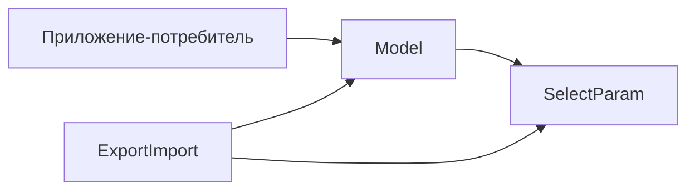

# Harness модели данных — v2

Рабочая точка входа для Model, SelectParam, ExportImport и кубика объектов. V2 организует ранее согласованные решения по ответственности. Архитектура UI, бизнес-логики и сервисов конкретного приложения выбирается по его карточкам; этот harness её не назначает.

## Версии и граница применения

V1 заморожена в репозитории vault: тег `model-harness-v1`, коммит `6ac9c54d90bebb11a4e23f5d6087b99b32557dd5`. Тег не перемещается; просмотр v1 не требует отката рабочей директории: `git show model-harness-v1:"путь/к/файлу.md"`. Перед возвращением к прежней версии учитывай текущие изменения отдельно, не применяй reset/checkout всего vault автоматически.

Документ обсуждения в Tasks/Artifacts относится к истории v1. Он не входит в чтение, получение правил или поиск шаблонов v2. Для работы используются перечисленные ниже действующие источники и код; история нужна только при отдельном исследовании происхождения решения.

Общие правила vault и областей задаются AGENTS. Эта карта выбирает источники, но не переопределяет их. После принятого изменения обновляется основной раздел правила, затем ссылки и зависимые примеры; его полные копии не создаются.

## Где живёт правило

| Ответственность | Основной действующий источник | Когда читать |
| --- | --- | --- |
| Читаемость и размещение интерфейсов | [[Sources/AGENTS]] | При работе с кодом |
| Организация методов, библиотеки, развитие паттерна и интерфейсов | [[Documents/Architectures/Data Model Principles]] | При реализации или изменении модели |
| Накопление опыта по замечаниям | [[Documents/Architectures/Data Model Principles#Накопление опыта без разрастания инструкций]] | При замечании и следующем применении исправленного источника |
| Имена, предлагаемые параметры, порядок вопросов и SQLite connection string | [[Wiki/HowToDo/Create Project Domain Model by Step#Параметры по умолчанию]] | Перед созданием проектов; только необходимые незаданные параметры |
| Стартовый состав solution и подготовка migrations | [[Commands/Create Project Domain Model by Step]] | Новый Model/ExportImport или подготовка migration |
| Поля, инициализация и сравнение нового DomainObject | [[Documents/Architectures/LibProject/netstandard2.0/Monitor.Model#Контракт новых DomainObject]] | Новый предметный объект или его потребитель |
| Состав кубика, единичный объект и коллекция, Excel, NoEntity, политика ID/Code и вычитка | [[Documents/Architectures/Cubes/DotNet/DomainObject - Entity - MappingEF - Repository]] | Создание и дополнение выбранных частей |
| Реализация дополнения полей, Mapper и Repository | [[Commands/Add Code First Fields by Step]] | Для запрошенных частей работы |
| Технологический профиль EF и его ограничения | [[Documents/Architectures/LibProject/netcoreapp3.1/Monitor.Model.Sqlite.CodeFirst.ExportImport]] | При работе с проектом доступа к данным |
| Общие строки маршрутов WebAPI и клиента | [[Documents/Architectures/WebAPI/DotNet/WebAPI.Monitor.Model.Sqlite.CodeFirst#Общие маршруты WebAPI и клиента]] | При создании или изменении WebAPI и его клиента |
| Контракт параметров выборки | [[Documents/Architectures/LibProject/netstandard2.0/SelectParam]] | При использовании SelectParams |
| Примеры, фиксированная версия и особенности переноса | [[Documents/Architectures/Data Model Examples]] | Выбрать нужный приём и прочитать соответствующий исходник |

## Модули и устойчивые границы

Модуль — часть приложения с определённой ответственностью и внешним контрактом. Проект может быть границей модуля; папка или каждый класс не объявляются отдельными модулями автоматически.

| Модуль | Ответственность и внешний контракт | Зависимости и ограничения |
| --- | --- | --- |
| Model | Внутренние данные: DomainObject, коллекции, перечисления, value objects, операции модели и интерфейсы; при наличии WebAPI — общие строки маршрутов по профильной карточке | Использует SelectParam для сигнатур выборки. Не ссылается на UI, бизнес-проекты или реализацию ExportImport; не содержит Entity, DbContext, migrations и provider-specific реализацию |
| SelectParam | Общие параметры фильтрации, сортировки и страниц; операции их применения согласно карточке | Не зависит от предметных объектов Book4U. Его реальные пакетные зависимости учитываются при сборке; слово Model не означает отсутствия транзитивных зависимостей |
| ExportImport | Entity, конфигурации, DbContext, MappingEF, реализации репозиториев для выбранного профиля | Зависит от Model и SelectParam. Наружу репозиторий возвращает DomainObject/коллекцию, EF-объекты и tracking остаются внутри |
| Приложение-потребитель | UI, бизнес-операции, сервисы и подключение реализаций согласно выбранной архитектуре | Использует контракты Model; место создания и подключения ExportImport определяется архитектурой приложения. Обратная зависимость Model от потребителя не добавляется |

Стрелки показывают ссылки проектов, а не порядок исполнения:

Потоки данных и точка преобразования описаны в [[Documents/Architectures/LibProject/netcoreapp3.1/Monitor.Model.Sqlite.CodeFirst.ExportImport#Согласованная граница с EF]]. Конкретные framework, provider, имена БД и connection string не выводятся из схемы зависимостей.

## Кубики и подключение

Кубик — повторно применимый способ построения или расширения архитектуры. Он может создать модуль, дополнить существующий модуль либо согласованно изменить несколько модулей. Для подключения читаются назначение, входы, затрагиваемые части, зависимости, совместимость и критерий результата из его карточки.

| Кубик | Вход и место подключения | Результат и границы |
| --- | --- | --- |
| [[Documents/Architectures/Cubes/DotNet/DomainObject - Entity - MappingEF - Repository]] | Описание данных либо существующие классы, выбранный состав, Model/EF-проект и профиль | Создаёт или дополняет выбранные части Model/ExportImport. Условия неполного состава и отсутствующих зависимостей — в карточке; UI/сервисы не создаёт |
| [[Documents/Architectures/Cubes/DotNet/Service - DI]] | Архитектура современного .NET, выбранный DI и режим интеграции либо автономного примера | Модуль Common.Service и его подключение по своей карточке; правила независимых таблиц и Code этим выбором не подключаются |
| [[Documents/Architectures/Cubes/DotNetFramework/Service - DIUnity]] | .NET Framework и Unity, режим интеграции либо автономного примера | Сервис и подключение согласно карточке своего runtime; не подменяет автоматически кубик современного .NET |

Повторная применимость не означает совместимость с любым solution. Сначала используется конкретная карточка и фактические зависимости; отсутствующее или непроверенное сочетание обозначается явно. Каталог совместимых вариантов — [[Documents/Architectures/Catalog]]. Новые проектные решения не изменяют общий кубик автоматически.

## Маршрут работы

1. По запросу выбери создание стартового solution, новый объект, дополнение либо подключение кубика. Учитывай имеющийся код и уже заданные параметры.
2. Прочитай обязательные инструкции области, эту карту и выбранные карточки. Подробности других архитектур и историческое обсуждение в текущий маршрут не входят.
3. Используй команду выбранной операции и её основной раздел правила. Для предметной модели действует Excel-процесс кубика; для готового стартового состава — отдельный сценарий команды создания проекта.
4. Выбери соответствующий пример Book4U и адаптируй его в границах контракта. Поля примера, локальные исключения и технические версии не становятся новыми требованиями автоматически.
5. Проверь результат в разрешённом объёме и сообщи факты. Сборка, вычитка человеком, применение migration и проверка поведения — разные подтверждения.

Опыт и порядок восстановления всей системы находятся в [[Documents/Architectures/Harness Reconstruction]]. Для обычного применения изучение этого документа не требуется.
