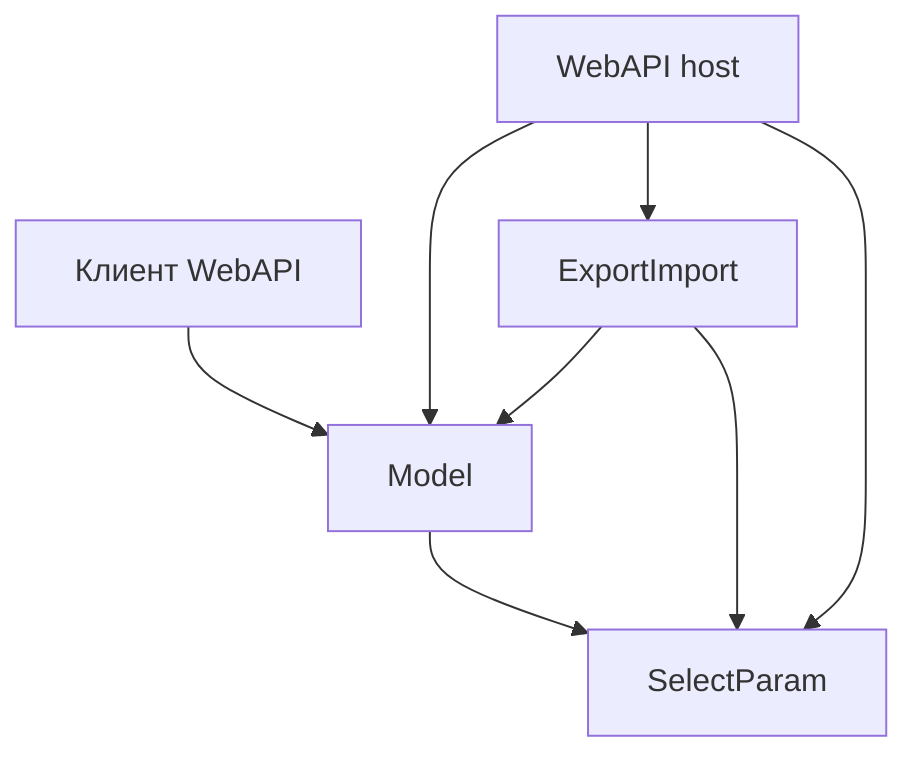

# WebAPI.Monitor.Model.Sqlite.CodeFirst

Исследование источника, первая адаптация от 2026-10-04 и повторная генерация от 2026-10-08 после вычитки Parad. Новый WebAPI Book4U пересоздан с учётом функций, удобств разработки и заготовок исходного host. Текущее покрытие и пределы проверки — в разделе «Повторная генерация Book4U»; предыдущие таблицы сохраняют историю найденных пропусков. Это ещё не утверждённый универсальный набор кубиков.

## Назначение и границы

WebAPI — потребитель модели данных и точка сборки приложения: принимает HTTP-запрос, вызывает интерфейс репозитория, формирует HTTP-ответ. Это дополнительный модуль поверх Model, SelectParam и ExportImport. Правила этих библиотек остаются в [[Documents/Architectures/Data Model Harness]]; вычитанные примеры — в [[Documents/Architectures/Data Model Examples]].

Первый проход подробно сохранил только три приёма: контроллер через интерфейс репозитория, зависимости и время жизни в host, проверку типизированной конфигурации. Это оказалось недостаточным для цели Parad — извлечь опыт всего проекта, включая удобства дальнейшего программирования и заготовки. Полный разбор состава выбранного host и найденных границ переноса находится в разделе «Повторная вычитка — функции и заготовки». Отсутствие текущего вызова означает состояние заготовки; само по себе оно не является основанием потерять её назначение.

## Исходная версия и фактическое устройство

Источник: [проект WebAPI](../../../../Sources/old/WebAPI.Monitor/src/WebAPI.Monitor.Model.Sqlite.CodeFirst/WebAPI.Monitor.Model.Sqlite.CodeFirst.csproj), репозиторий `Sources/old/WebAPI.Monitor`, commit `8998e92cc0c311dc5d9e36f8ce067c0cda1cf78c`. При исследовании уже имелось незакоммиченное добавление ProjectReference на SelectParam в `Monitor.Service.Shared.csproj`; граф ниже учитывает его. Сравнение: Book4U, commit `5c1aaced8d286cd7c6c894553621abf598ea98ab`.

Хост использует `netcoreapp3.1`, EF Core SQLite 3.1.9, Newtonsoft.Json через MVC, Swagger и Unity. Это описание источника, а не выбор версий нового приложения. По ProjectReference в текущем дереве участвуют шесть проектов:

| Проект | Прямые ссылки на проекты |
| --- | --- |
| WebAPI.Monitor.Model.Sqlite.CodeFirst | Count4U.Service.Common; Monitor.Model.Sqlite.CodeFirst.ExportImport; Service.Model.EF.SelectParam |
| Count4U.Service.Common | Monitor.Service.Shared |
| Monitor.Service.Shared | Monitor.Model.ServiceContract; Service.Model.EF.SelectParam |
| Monitor.Model.Sqlite.CodeFirst.ExportImport | Monitor.Service.Shared; Service.Model.EF.SelectParam |
| Monitor.Model.ServiceContract | Нет |
| Service.Model.EF.SelectParam | Нет |

`Monitor.Service.Shared` содержит не только модель, но и веб-настройки, SignalR и другие зависимости. Замена его имени на Book4U.Model не является переносом вычитанной архитектуры.

Путь запроса виден в [CommandResultController](../../../../Sources/old/WebAPI.Monitor/src/WebAPI.Monitor.Model.Sqlite.CodeFirst/Controllers/CommandResult/CommandResultController.cs): маршрут из `Monitor.Service.Urls` → `ICommandResultRepository` → [CommandResultEFRepository](../../../../Sources/old/WebAPI.Monitor/src/Monitor.Model.Sqlite.CodeFirst.ExportImport/CommandResult/CommandResultEFRepository.cs) → DbContext → SQLite. Контроллер возвращает DomainObject или коллекцию. Отдельные демонстрационные ADO-методы обходят этот путь.

## Предлагаемое подключение вычитанной модели

Стрелка означает ссылку проекта, а не направление HTTP-запроса:

Это схема ролей для адаптации. Выбранные параметры первого применения в Book4U зафиксированы ниже; для следующего приложения они не становятся значениями по умолчанию.

| Граница | Ответственность |
| --- | --- |
| WebAPI host | Обработка маршрутов по общим константам Model, формат запросов и ответов, HTTP-ошибки, DI, конфигурация, запуск. Контроллер получает интерфейс из Model; EF нужен точке сборки, но не CRUD-методам контроллера. |
| Model | Вычитанные DomainObject, коллекции, интерфейсы репозиториев и общие строковые константы маршрутов WebAPI/клиента. Не зависит от ASP.NET Core, HTTP pipeline или Unity. |
| SelectParam | Существующие параметры и применение выборки. Готовый SelectParams проходит через HTTP-слой по разделу «Готовый SelectParams передаётся напрямую». |
| ExportImport | Entity, EF-конфигурации, преобразования, DbContext и реализация репозиториев. Не формирует HTTP-ответы. |

Поведение данных берётся из действующего [[Documents/Architectures/Cubes/DotNet/DomainObject - Entity - MappingEF - Repository|кубика объектов]], а не восстанавливается по старому контроллеру. Для небольшого CRUD API отдельный слой сервисов пока не обоснован; его можно добавить, если появится самостоятельная операция, объединяющая несколько репозиториев.

При адаптации типы из `Shared` и `Common` раскладываются по назначению: контракты данных уже есть в Book4U.Model; общие строки маршрутов размещаются в Model по следующему разделу, обработка HTTP и параметры host принадлежат WebAPI; SignalR/JWT описываются как отдельные ответственности. Неподключённые части также входят в исследование и сохраняются с назначением и условиями подключения. Состав ограниченного первого CRUD-примера не определяет полноту извлекаемого знания. Новые библиотеки для этих частей заранее не создаются.

## Общие маршруты WebAPI и клиента

По решению Parad от 2026-10-09 строки маршрутов являются общим контрактом WebAPI и вызывающего клиента. Они хранятся в `<Service>.Model/Urls`: для каждого контроллера — свой `public static class` в отдельном файле, для каждой операции — именованная `public const string`. Контроллер ссылается на константу в `[HttpPost(...)]`, `[HttpGet(...)]`, `[HttpPut(...)]`, `[HttpDelete(...)]` или `[Route(...)]`; клиент использует ту же константу для адреса запроса. Локальные копии строк в host и клиенте не создаются.

Константа задаёт полный относительный путь от корня API, например `api/command-results/selection`. Если он уже включает префикс контроллера, повторный `[Route("api/command-results")]` над классом не добавляется. Адрес сервера и окружения задаются у потребителя; они не входят в общий маршрут. Для шаблона с ID клиент подставляет фактический ID в обозначенный параметр пути. Вынос строки не меняет HTTP-метод, расположение параметров, ограничения маршрута или форму ответа.

Model хранит обычные строковые константы без зависимостей от ASP.NET Core. Атрибуты, обработчики, HTTP pipeline и конфигурация запуска остаются в WebAPI; HTTP-вызов — у клиента. Это уточняет прежнюю слишком широкую формулировку Машины «все маршруты принадлежат host»: общая строка маршрута не является реализацией HTTP. При изменении `const` пересобираются использующие её WebAPI и клиент.

Источник приёма — [Urls.cs](../../../../Sources/old/WebAPI.Monitor/src/Monitor.Service.Shared/Urls.cs) вместе с контроллером и клиентом из следующего раздела. Текущий малый пример — [WebApiBook4URoom](../../../../Sources/Book4U/Book4U.Model/Urls/WebApiBook4URoom.cs) и [RoomsController](../../../../Sources/Book4U/WebAPI.Book4U.Model.Sqlite.CodeFirst/Controllers/RoomsController.cs). Для выборки — [WebApiBook4UCommandResult](../../../../Sources/Book4U/Book4U.Model/Urls/WebApiBook4UCommandResult.cs): `GetCommandResultsWithSelectParam` и `GetCommandResultsWithSelectParamTest`. Пример обращения клиента находится в [README](../../../../Sources/Book4U/WebAPI.Book4U.Model.Sqlite.CodeFirst/README.md#общие-маршруты).

## Чтение с параметрами в теле запроса

По уточнению Parad от 2026-10-08 сохраняется действующий паттерн источника: методы получения данных с параметрами в JSON используют `[HttpPost(...)]` и `[FromBody]`. Имя метода `Get...` описывает операцию чтения и само по себе не требует `[HttpGet]`. Не заменяй этот контракт на GET с `[FromQuery]` и не считай POST для выборки опиской или ошибкой, требующей исправления.

Показательный комплект источника:

- [CommandResultController](../../../../Sources/old/WebAPI.Monitor/src/WebAPI.Monitor.Model.Sqlite.CodeFirst/Controllers/CommandResult/CommandResultController.cs): `GetCommandResultsWithSelectParam` и `GetCommandResultsWithSelectParamTest` имеют `[HttpPost(...)]` и принимают `[FromBody] SelectParams`.
- [CommandResultService](../../../../Sources/old/WebAPI.Monitor/src/Monitor.Service.Shared/CommandResult/CommandResultService.cs): клиент отправляет параметры через `PostAsJsonAsync<SelectParams>`, затем читает коллекцию из ответа через `ReadFromJsonAsync<CommandResults>`.
- [WebApiMonitorCommandResult в Urls.cs](../../../../Sources/old/WebAPI.Monitor/src/Monitor.Service.Shared/Urls.cs): константы связывают маршрут клиента и контроллера. Отдельный `GetCommandResults()` без параметров использует GET; клиент вызывает `GetFromJsonAsync`.

Цепочка приёма: объект параметров → JSON-тело POST → `[FromBody]` → репозиторий → данные в ответе. Возврат данных не означает выполнение записи. При переносе проверяются согласованность маршрута/метода, входного типа и ответа; поведение демонстрационной подмены фильтра рассматривается отдельно от корректного выбора POST.

Область текущей правки — операции чтения, ранее получавшие параметры через `[FromQuery]`. GET без параметров и параметры из маршрута не меняются автоматически. Parad отдельно сохранила `[HttpPut("by-id/{id:long}")] UpdateById(long id, ...)`: ID остаётся в маршруте, обновляемый объект — в теле. Текущие маршруты Book4U и формы JSON находятся в README реализации.

## Готовый SelectParams передаётся напрямую

Если action получает `[FromBody] SelectParams selectParams`, передавай этот объект прямо в метод репозитория: `GetCommandResults(selectParams)` или `GetRooms(selectParams)`. Не создавай повторно SelectParams через `_selection.Create<T>(selectParams)`, не заменяй его фильтры, сортировку или paging. Применение готовой выборки принадлежит существующей библиотеке SelectParam и репозиторию.

Это решение Parad уточняет границу HTTP-слоя: преобразование нужно для другого входного контракта, например `SelectionRequest` у `/page`. Оно не требуется для уже готового SelectParams. Не переноси ограничения такого адаптера на action с SelectParams автоматически. Если проверка выявила ограничение исходной библиотеки или сериализации, сохрани конкретный пример отдельно; не маскируй его незапрошенной подменой параметров в контроллере.

## Логгер как заготовка контроллера

По замечанию Parad от 2026-10-09 логгер сохраняется как точка для дальнейшего развития контроллера. В контроллерах, создаваемых по этому профилю, предусматривай `private readonly ILogger<ИмяКонтроллера> _logger`, получай соответствующий `ILogger<ИмяКонтроллера>` через конструктор DI и присваивай `_logger = logger;` отдельной строкой. Отсутствие текущих вызовов `Log...` не является основанием пропустить поле, параметр или инициализацию. Сообщения добавляются при появлении нужного сценария; искусственные записи ради использования поля не требуются.

В источнике этот комплект есть у [CommandResultController](../../../../Sources/old/WebAPI.Monitor/src/WebAPI.Monitor.Model.Sqlite.CodeFirst/Controllers/CommandResult/CommandResultController.cs), [MonitorTestController](../../../../Sources/old/WebAPI.Monitor/src/WebAPI.Monitor.Model.Sqlite.CodeFirst/Controllers/Test/MonitorTestController.cs) и [ClaimMonitorWebApiController](../../../../Sources/old/WebAPI.Monitor/src/WebAPI.Monitor.Model.Sqlite.CodeFirst/Controllers/ClaimWebApi/ClaimWebApiController.cs): типизированное поле создаётся через `ILoggerFactory.CreateLogger<T>()`. В Book4U используется уже принятый в его фильтрах и middleware способ — прямое внедрение `ILogger<T>`; категория соответствует фактическому классу. Пример — [RoomsController](../../../../Sources/Book4U/WebAPI.Book4U.Model.Sqlite.CodeFirst/Controllers/RoomsController.cs). При добавлении зависимости проверяется создание контроллера через действующий DI.

Это правило заготовки WebAPI-контроллеров, а не требование добавлять логгер в каждый тип solution. Строковые константы, DomainObject и другие общие контракты Model не получают зависимостей от logging. Действующее логирование фильтров, middleware и фоновых служб сохраняется отдельно от этой заготовки.

## Ответ одиночной вставки

По уточнению Parad action `Insert`, возвращающий выданный БД ID, завершай единообразно через `return Ok(id);` (HTTP 200). Не заменяй этот ответ на `StatusCode(201, id)` или `Created(...)`. Это правило ответа одиночной вставки; остальные операции сохраняют свои согласованные ответы.

## ADO-пример CommandResult

По уточнению Parad в CommandResultsController Book4U сохранён отдельный action источника `[HttpGet("ado")]`, адаптированный как `GetCommandResultsADO` с общей константой маршрута в Model. Наличие ADO-примера в TestController не заменяет этот action. Сохраняется цепочка DbProviderFactories → DbConnection → DbCommand → DbDataReader; провайдер и строка подключения берутся из выбранного проекта. В Book4U это SQLite и IConnectionSqliteBook4UDB, без EF и репозитория в теле примера. Конкретный HTTP-контракт описан в [README](../../../../Sources/Book4U/WebAPI.Book4U.Model.Sqlite.CodeFirst/README.md). Старое имя GetCustomersADO, SQL CE, путь .sdf и чтение произвольного столбца по номеру не определяют предметный контракт Book4U.

По отдельной просьбе Parad тот же ADO-пример добавлен в RoomsController: GetRoomsADO читает Code таблицы Room, маршрут хранится в WebApiBook4URoom. Это согласованный состав Book4U; обязательность ADO для любого будущего контроллера из этого не следует.

## Ping для прозванивания связи

По прямому решению Parad этот класс обязателен для любого WebAPI-проекта Parad, независимо от предметной модели, СУБД или DI. При создании и дополнении WebAPI предусматривай `PingWebApi<имя сервиса>Controller`; это общее правило, а не необязательный пример SQLite-профиля. Воспроизводи контракт исходного PingWebApiMonitorController: базовый Controller, атрибуты [ApiController] и [Produces("application/json")], методы `public string Ping()` и `public string PingSecured()`. Каждый возвращает общую строковую константу `PingOpetarion.Pong` со значением `Pong`; не заменяй её объектом со status/service/authenticated. Для каждого метода сохраняются отдельные [HttpGet] и [Route(...)], для PingSecured — [Authorize]. Ответ успешной проверки — HTTP 200, application/json и JSON-строка `"Pong"`. Обычный Ping проверяет доступность HTTP, защищённый — также доступ после аутентификации; чтение БД в них не добавляется.

Маршруты хранятся в Model в классе конкретного контроллера, имена констант — GetPing/GetPingSecure. В Book4U исходный префикс monitorwebapi адаптирован в book4uwebapi: `api/book4uwebapi/ping` и `api/book4uwebapi/pingsecure`. Прежние api/ping и api/ping/secure заменены. Константа ответа PingOpetarion также находится в Model, доступной клиенту. Согласованная заготовка ILogger сохраняется; закомментированный пример Claims из источника остаётся заготовкой и не создаёт маршрут.

## SignalR-заготовки фильтров

По просьбе Parad от 2026-10-11 сохраняются исходные ControllerSignalRChatHubFilter и ControllerSignalRChatHubAsynActionFilter целиком в закомментированном виде в конце соответствующих файлов Book4U. В рабочем Book4U второе имя имеет Async вместо исходного Asyn; старый вариант внутри комментария сохраняет своё имя. Сохранены исходные using, зависимости, конструкторы, создание HubConnection, автоматическое переподключение, подписки ReceiveMessage/ReceiveNotify и пояснения к фильтрам. Их отсутствие в текущем использовании не означает, что заготовки следует удалять.

Активные каркасы Book4U продолжают регистрироваться и демонстрировать фильтры; async-каркас выполняет await next(). Добавленная ранее отправка SendNotifyAsync вместе с полем и внедрением IChatHubClient теперь закомментирована; включение SignalR в настройках само по себе не включает эту отправку. Исходный Monitor-код служит сохранённым примером: его зависимости не подключаются автоматически, готовность внешнего сервиса не заявляется. При дальнейшем включении адаптируй пример к существующему клиенту/HostedService и выбранному контракту сообщений; не создавай второе соединение на каждый запрос. Рабочая логика существующего SignalR-клиента и серверного hub этим решением не меняется.

## Ошибка при запуске WebAPI

По решению Parad от 2026-10-11 ошибку старта выводи в консоль целиком: в верхнем catch используй `Console.Error.WriteLine(exception)`, а не только `exception.Message`. Это сохраняет тип, сообщение, стек и доступные вложенные исключения. Ошибка создания БД до host.Run() завершает запуск с кодом 1; продолжать приём запросов после такого сбоя не нужно. Дополнительный файловый журнал или ожидание нажатия клавиши этим решением не вводятся.

## Небольшие примеры для повторного использования

| Приём | Где читать | Что переносится и что требует адаптации |
| --- | --- | --- |
| Контроллер через интерфейс | Конструктор и обычные методы чтения в [CommandResultController](../../../../Sources/old/WebAPI.Monitor/src/WebAPI.Monitor.Model.Sqlite.CodeFirst/Controllers/CommandResult/CommandResultController.cs) | Сама граница HTTP → интерфейс Model. Старые маршруты, ключи и ответы не копируются автоматически. Изменяющие методы содержат проблемы, перечисленные ниже. |
| Точка сборки и область жизни запроса | `ConfigureServices`, `ConfigureContainer` в [StartupMonitorModelWebAPI](../../../../Sources/old/WebAPI.Monitor/src/WebAPI.Monitor.Model.Sqlite.CodeFirst/StartupMonitorModelWebAPI.cs) | `AddDbContext` и scoped-репозиторий; контроллер не создаёт контекст вручную. Unity — свойство источника, а не общий выбор harness. ServiceLocator связывает Unity с существующими потребителями; его назначение и мост к FileSystem разобраны ниже. Подавление ошибки регистрации сохраняется как дефект, а не как требование паттерна. |
| Типизированные настройки и проверка запуска | Регистрация `IOptions<Count4uSettings>` и `IValidatable` в Startup; [SettingValidationStartupFilter](../../../../Sources/old/WebAPI.Monitor/src/Monitor.Service.Shared/StartupFilter/SettingValidationStartupFilter.cs) | Проверить обязательную конфигурацию до приёма запросов. По уточнению Parad регистрацию `services.AddTransient<IStartupFilter, SettingsValidationStartupFilter>();` размещай первой инструкцией ConfigureServices, с комментарием о валидации при старте, как в источнике. Это регистрация фильтра, а не немедленное выполнение валидации. Пути, флаги и предметные проверки Count4U не переносятся. API реализации проверки выбирается под runtime приложения. |
| Явная область для работы вне запроса | `CreateDbIfNotExists` в [Program](../../../../Sources/old/WebAPI.Monitor/src/WebAPI.Monitor.Model.Sqlite.CodeFirst/Program.cs) | `using` для scope и получение scoped-зависимости внутри него; вызов подготовки БД до Run. Реализация подготовки берётся из действующего DbInitializer Book4U. Старые EnsureCreated, seed и продолжение после ошибки требуют отдельного исправления, но не отменяют сам сценарий запуска. |

Для WebAPI предлагается время жизни DbContext и репозитория в рамках запроса. Асинхронную операцию следует завершить до формирования зависящего от неё ответа; один DbContext нельзя использовать параллельно. Основание: [документация EF Core о DbContext и DI](https://learn.microsoft.com/en-us/ef/core/dbcontext-configuration/). Эти рекомендации не подтверждают работоспособность старой связки Unity без запуска.

## Где механический перенос изменит поведение

| Наблюдение в источнике | Последствие и направление адаптации |
| --- | --- |
| `DeleteByCommandResultCode` вызывает `Delete(string)`. Старый репозиторий ищет одну запись по `CommandResultCode`; Book4U `Delete(string)` направляет вызов в `DeleteByCode`. | Совпадение сигнатур скрывает смену смысла. Новый endpoint должен явно соответствовать согласованной операции по `Code`. Сохранение старого HTTP-контракта, если есть действующие клиенты, требует отдельного решения; нельзя просто подключить новый репозиторий под прежним названием операции. |
| `DeleteById`, `DeleteByCommandResultCode` и `Update` игнорируют возвращённый Task. Старые реализации обычно выполняют SaveChanges синхронно и возвращают готовый Task; в Book4U используются реальные async-операции. | Ответ может уйти до завершения изменения, а ошибка останется вне обработки запроса. Адаптировать методы с ожиданием операции. `InsertArray` и `DeleteAll` возвращают Task вызывающему MVC — это другой случай, потери Task здесь нет. Одиночный `Insert` в Book4U возвращает `long` синхронно. |
| Старый `Update` возвращает ID из тела запроса. В Book4U есть отдельные `UpdateById` и `UpdateByCode`, а `Update` выбирает по Code. | Входной ID не доказывает ID обновлённой строки. Разделить способ поиска в HTTP-контракте; сохранять поведение репозитория по действующему кубику. Форма успешного ответа и результат при отсутствии записи относятся к HTTP-контракту потребителя; выбор первого Book4U API описан ниже. |
| Коллекция возвращается напрямую. В вычитанном Book4U `Rooms : ObservableCollection<Room>` содержит также `TotalCount`. | При обычной сериализации Newtonsoft.Json метаданные коллекции не передаются. Если клиенту нужен общий размер выборки, предлагается ответ-объект с `items` и `totalCount`; он принадлежит HTTP-слою. Это предложение, а не обязательный новый тип в Model. |
| `Program` вызывает старый DbInitializer, который использует EnsureCreated и вставляет примеры; GET `GetTestDataCommandResults` также вызывает запись в БД. | Не переносить эти побочные эффекты как часть обычного запуска/чтения. Использовать согласованный порядок подготовки БД из карточки ExportImport. В Book4U тестовая коллекция создаётся в памяти. |
| Исторический `CommandResultConfiguration` наследуется от EF6 `EntityTypeConfiguration`; EF Core DbContext выполняет только `ToTable` и не подключает этот класс. | Наличие файла конфигурации не доказывает применение ограничений. В Book4U используются EF Core-конфигурации и `ApplyConfigurationsFromAssembly`; ориентиром служит этот вычитанный вариант. |
| В SQLite host есть активные ADO-примеры с SQL Server CE и локальным путём; тестовая выборка подменяет входной SelectParams своими значениями. | Это предметные/демонстрационные части источника. Их опыт — проверка провайдера, альтернативных путей доступа и примеры SelectParam — сохраняется ниже; старые адреса, SQL CE и подмена входного запроса не становятся контрактом SQLite API. |

Вопрос схемы HTTP-ответа относится именно к границе потребителя. По [правилам Json.NET](https://www.newtonsoft.com/json/help/html/SerializationGuide.htm) коллекции сериализуются массивом без собственных дополнительных свойств. Проверка 2026-10-04: существующая локальная сборка `Book4U.Model`, объект `Rooms` с одним Room и `TotalCount = 42`, пакет Newtonsoft.Json 13.0.1 — результат массив из одного элемента без `TotalCount`. Это проверка сериализации в памяти; она не является запуском исторического MVC и не фиксирует сериализатор будущего API.

Файлы для сравнения: [интерфейс Book4U](../../../../Sources/Book4U/Book4U.Model/Interface/ICommandResultRepository.cs), [репозиторий Book4U](../../../../Sources/Book4U/Book4U.Model.Sqlite.CodeFirst.ExportImport/RepositoryEF/CommandResultEFRepository.cs), [Rooms](../../../../Sources/Book4U/Book4U.Model/Domain/Room/Rooms.cs), [DbContext Book4U](../../../../Sources/Book4U/Book4U.Model.Sqlite.CodeFirst.ExportImport/Context/Book4UDbContext.cs), [старый DbInitializer](../../../../Sources/old/WebAPI.Monitor/src/Monitor.Model.Sqlite.CodeFirst.ExportImport/Context/DbInitializer.cs), [старая EF6-конфигурация](../../../../Sources/old/WebAPI.Monitor/src/Monitor.Model.Sqlite.CodeFirst.ExportImport/ServiceContract/CommandResultConfiguration.cs).

## Повторная вычитка — функции и заготовки

Основание: Parad уточнила цель извлечения опыта и дала список обнаруженных пропусков. Исследование должно охватывать исходный проект как заготовку для дальнейшего программирования. В этой проверке различаются: фактическая функция, приём организации кода, заготовка и дефект её реализации. Это характеристики найденного кода, а не новые статусы задач.

### Почему возникли пропуски

В первом описании был введён Машиной «минимальный перенос», а проверка ограничилась CRUD Room/CommandResult. Из этого ошибочно следовало, что части вне работающего сценария можно не раскрывать. Некоторые получили лишь упоминание «пока не готовый кубик», без назначения, зависимостей и способа воспроизведения. Отдельных технических оснований отказа от install/uninstall, Swagger или диагностических контроллеров прежняя запись не содержит; такие основания задним числом не приписываются.

Разрешение Parad начать первый проход не означало отказ от остальных функций и опыта источника. Ошибка затронула и проверку: тесты проверяли выбранную реализацию, но не сравнивали её полноту с исходным проектом. Поэтому успешная сборка и HTTP-проверки не обнаружили пропуски.

### Список Parad и сопоставление с Book4U

Историческая фиксация **до повторной генерации**: слова «отсутствует» и «потерян» ниже относятся к первому варианту. Текущая карта переноса находится в разделе «Повторная генерация Book4U»; эта таблица сохраняет причину изменений.

Для строк с Program/Startup источники — [Program.cs](../../../../Sources/old/WebAPI.Monitor/src/WebAPI.Monitor.Model.Sqlite.CodeFirst/Program.cs), [StartupMonitorModelWebAPI.cs](../../../../Sources/old/WebAPI.Monitor/src/WebAPI.Monitor.Model.Sqlite.CodeFirst/StartupMonitorModelWebAPI.cs), [csproj](../../../../Sources/old/WebAPI.Monitor/src/WebAPI.Monitor.Model.Sqlite.CodeFirst/WebAPI.Monitor.Model.Sqlite.CodeFirst.csproj). Сравнение — [новый Program](../../../../Sources/Book4U/WebAPI.Book4U.Model.Sqlite.CodeFirst/Program.cs), [новый Startup](../../../../Sources/Book4U/WebAPI.Book4U.Model.Sqlite.CodeFirst/StartupBook4UWebAPI.cs), [новый csproj](../../../../Sources/Book4U/WebAPI.Book4U.Model.Sqlite.CodeFirst/WebAPI.Book4U.Model.Sqlite.CodeFirst.csproj). Номера строк относятся к исходнику при проверке 2026-10-08; ссылки на Book4U открывают уже пересозданный вариант.

| Элемент источника | Что он сохраняет для разработки | Состояние Book4U и вывод |
| --- | --- | --- |
| [install.bat](../../../../Sources/old/WebAPI.Monitor/src/WebAPI.Monitor.Model.Sqlite.CodeFirst/install.bat), [uninstall.bat](../../../../Sources/old/WebAPI.Monitor/src/WebAPI.Monitor.Model.Sqlite.CodeFirst/uninstall.bat); csproj 55–61 | Установка, перезапуск после сбоя, автозапуск, остановка и удаление службы; копирование скриптов в output. | **Отсутствует.** Сохранить сценарий развёртывания вместе со сборкой. В исходных скриптах имена Count4U-службы/exe не совпадают с именем этого host, путь binPath не заключён в кавычки. В Program нет подключения Windows service lifetime. Это заготовка, требующая адаптации и проверки установки/остановки, а не готовое развёртывание. Скрипты не запускались. |
| `RuntimeIdentifier=win-x64`; csproj 5 | Явная платформа сборки/публикации, связь с Windows-развёртыванием и нативными зависимостями. | **Отсутствует.** Роль не была сохранена; успешный локальный запуск не заменяет проверку профиля публикации. Один RID ещё не описывает полностью способ развёртывания. |
| `GenerateDocumentationFile`, `NoWarn` с 1591; csproj 9–10 | XML-документация и подавление именно предупреждения об отсутствующих XML-комментариях. | **Отсутствует**, вместе с подключением XML к Swagger. Рассматривать как связанный приём документирования API, сохраняя остальные значения NoWarn. |
| `CreateDbIfNotExists(host)`; Program 23–42 | Подготовка хранения до обслуживания запросов, scope для DbContext вне HTTP-запроса. | **В первом проходе поведение изменено:** startup filter требовал существующий файл. В Book4U уже есть [DbInitializer](../../../../Sources/Book4U/Book4U.Model.Sqlite.CodeFirst.ExportImport/Context/DbInitializer.cs); его вызов потерян. При восстановлении использовать действующий раздел [[Documents/Architectures/LibProject/netcoreapp3.1/Monitor.Model.Sqlite.CodeFirst.ExportImport#Источник модели и migrations]], а не старый EnsureCreated/seed. Относительный путь требует проверки рабочего каталога. По уточнению Parad от 2026-10-08 вызов восстановлен в Program перед Run, прежний запрет удалён. Проверены создание, повторный запуск и пересоздание после удаления временного файла. Существующая пользовательская БД не менялась. |
| Имя `Startup<имя>WebAPI`; исходный `StartupMonitorModelWebAPI` | Узнаваемая точка сборки среди нескольких host. | **Стиль потерян:** создан общий `Startup`. Для Book4U соответствующее имя — `StartupBook4UWebAPI`, с согласованным именем файла и ссылкой из Program. Технического препятствия не найдено. |
| Явный static UnityContainer и `UseUnityServiceProvider(_container)`; Program 15, 48 | Возможность подготовить и передать конкретный корневой контейнер. | **Функция интеграции сохранена иначе:** `UseUnityServiceProvider()` и `ConfigureContainer`. Вариант с явным контейнером не сохранён как пример. Это поддерживаемые варианты адаптера; они различаются местом создания/предварительной настройки контейнера, а не фактом использования Unity. |
| `AddMvc().AddNewtonsoftJson().AddControllersAsServices()`; Startup 61–66 | Сериализация и создание контроллеров через DI; полный MVC как заготовка для более широкого host. | **Частично сохранено:** новая цепочка `AddControllers().AddNewtonsoftJson().AddControllersAsServices()` содержит обе последние регистрации. Для API-контроллеров они не потеряны. Полный набор AddMvc и объяснение важности DI-регистрации не перенесены; это сужение исходной заготовки. |
| `AddHttpClient`; Startup 68 | Точка подключения исходящих HTTP-клиентов через фабрику и дальнейшей настройки клиентов. | **Отсутствует.** В выбранном host не найден текущий вызов фабрики; сохранить как инфраструктурную заготовку. Отсутствие вызова не доказывает ненужность регистрации в исходном шаблоне. |
| `AddSignalR`, `ConfigureHubSignalRClient`, адрес chatHub; Startup 69, 129, 188, 232–236 | Различение SignalR-сервера и клиента; регистрация клиентских репозиториев chat/command и сборка адресов. | **Отсутствует.** Клиентские репозитории зарегистрированы singleton и имеют реальную реализацию; `MapHub` закомментирован с пояснением, что это запуск сервера. Локальная переменная адреса в Configure далее не используется, но адреса используются в клиентах и фильтрах. Подробности жизненного цикла — ниже. |
| `AddSession` и `UseSession`; Startup 71, 177 | Сессия между запросами, регистрация сервиса и место в pipeline. | **Отсутствует.** В выбранном host и исследованных Shared/Common явная регистрация IDistributedCache не найдена; для завершённого сценария нужны хранилище сессии и проверка запросами. Это незавершённая конфигурация, которую надо сохранить с недостающей связью. |
| SwaggerGen: v1, Title/Description, XML из entry assembly, `CustomSchemaIds(i => i.FullName)`; Startup 90–104; Swagger/UI 160–165 | Самоописание и ручная проверка API, XML-комментарии, различение одноимённых типов из разных namespace. | **Отсутствует целиком.** Перенос включает пакет, генерацию/наличие XML, настройки документа, JSON endpoint и UI. Имена и описание относятся к новому сервису. FullName — отдельный приём, который нельзя потерять при упрощении Swagger-настроек. |
| Scoped `IJwtService`; [Claim-контроллер](../../../../Sources/old/WebAPI.Monitor/src/WebAPI.Monitor.Model.Sqlite.CodeFirst/Controllers/ClaimWebApi/ClaimWebApiController.cs) | Чтение claims из запроса, преобразование в диагностический ответ и профиль пользователя. | **Отсутствует.** В [JwtService](../../../../Sources/old/WebAPI.Monitor/src/Monitor.Service.Shared/Infrastructure/JwtService.cs) ParseClaimsFromJwt декодирует payload, без проверки подписи, issuer, audience и срока. Сохранить опыт извлечения/представления claims; не объявлять это готовой проверкой подлинности токена. |
| `EnableLoggingForBadRequests`; Startup 124 | Видимость ошибок входных запросов, в том числе до вызова action. | **Отсутствует.** В новом API есть ответы 400, но это не доказательство сохранённого логирования. Метод обнаружен в локальном CoreX.Extensions.Http 0.2.0; в DLL также есть InvalidModelStateResponseFactory. Точная форма сообщения/ответа пакета отдельно не проверена. Нужна проверка невалидным запросом, а не только наличием ILogger. |
| `AddOptions`, Configure Count4uSettings, concrete Value и тот же Value как IValidatable; Startup 108–117 | Один типизированный объект доступен через IOptions и напрямую; общий startup filter проверяет несколько зарегистрированных IValidatable. | **Сохранено частично:** Configure WebApiOptions и проверка старта есть. Потеряны прямое внедрение объекта и расширяемый обход IEnumerable<IValidatable>; новый фильтр знает один WebApiOptions. Отсутствие буквального AddOptions само по себе не означает отсутствия options. Предметные пути Count4U отделяются от общего способа регистрации. |
| Routing, CORS, Authorization, Session; Startup 167–177 | Порядок pipeline, доступ браузерных клиентов, точка применения политик доступа и сессий. | **Routing/MapControllers сохранены; остальные отсутствуют.** Исходная CORS-политика разрешает любые origin/методы и только ContentType/Authorization из явно заданных заголовков. Это выбор источника, не универсальная политика. AddAuthentication/UseAuthentication в выбранном host не найдены; наличие UseAuthorization и защищённого Ping не доказывает настроенную аутентификацию. |
| StatusCodePagesWithReExecute и ExceptionHandler; Startup 185–186 | Единая обработка HTTP-статусов и исключений, повторное выполнение маршрута ошибки. | **Частичный аналог:** новый ApiExceptionMiddleware формирует JSON 500, но не реализует обработку всех status codes и re-execute. В исходном host маршрут `/error/{0}` не найден. При воспроизведении нужны обработчик маршрута и проверка порядка: обработчик исключений охватывает последующие компоненты ([Microsoft](https://learn.microsoft.com/en-us/aspnet/core/fundamentals/middleware/?view=aspnetcore-3.1)). Простое копирование двух строк не завершает приём. |
| `ConfigureContainer`: IServiceLocator, scoped repository, настройки → FileSystem; Startup 197–228 | Адаптер Unity для потребителей IServiceLocator; передача типизированных настроек существующим статическим утилитам. | **Scoped-репозитории сохранены; мост отсутствует.** [FileSystem](../../../../Sources/old/WebAPI.Monitor/src/Monitor.Service.Shared/Enum/FileSystem.cs), FileWithProgramDataPath, действительно читает эти настройки. Это опыт интеграции существующего кода. Прямое DI и мост — разные способы потребления; мост не требует помещать ServiceLocator в Model. Пустой внешний catch и `throw exc` — недостатки обработки ошибок, не причина вычеркнуть назначение моста. |
| [PingWebApiMonitorController](../../../../Sources/old/WebAPI.Monitor/src/WebAPI.Monitor.Model.Sqlite.CodeFirst/Controllers/PingWebApiMonitorController.cs) | Простой Ping и отдельный PingSecured с Authorize. | **Отсутствует.** Это две диагностические проверки: доступность HTTP и применение защиты. Обычный Ping возвращает Pong и не проверяет готовность БД. Защищённый вариант требует завершённой конфигурации аутентификации. |
| [MonitorTestController](../../../../Sources/old/WebAPI.Monitor/src/WebAPI.Monitor.Model.Sqlite.CodeFirst/Controllers/Test/MonitorTestController.cs) | Место ручных проб: DI через конструктор/FromServices, именованные регистрации Unity/ServiceLocator, доступ к окружению/настройкам, claims, ADO/EF/репозиторий. | **Отсутствует.** Большая часть примеров закомментирована; активный CommandResultADO использует SQL CE и .sdf. Опыт способов проверки сохраняется, а предметный путь и провайдер требуют адаптации. Файл находится в Controllers/Test, а класс Claim-контроллера называется ClaimMonitorWebApiController. |
| Три файла [Filter/ActionFilter](../../../../Sources/old/WebAPI.Monitor/src/WebAPI.Monitor.Model.Sqlite.CodeFirst/Filter/ActionFilter) | Синхронный и асинхронный фильтры до/после action, внедрение зависимостей, изменение аргументов, пример будущего SignalR-действия. | **Отсутствуют.** SignalR-тела закомментированы, async-фильтр вызывает next; CheckTestFilterAttribute при невалидной модели подставляет id=34. Сохранить форму точки расширения и способ её подключения, но не превращать демонстрационное 34 в правило валидации. Регистрация/применение фильтров на выбранных контроллерах не найдены. |
| Три файла [Middleware/CommandResult](../../../../Sources/old/WebAPI.Monitor/src/WebAPI.Monitor.Model.Sqlite.CodeFirst/Middleware/CommandResult) | RequestDelegate до/после next, отдельный Use-метод подключения и типизированное лог-сообщение LoggerMessage.Define с EventId. | **Отсутствует исходный комплект.** Новый middleware исключений показывает только часть формы. В исходном InvokeAsync активен только next; полезная нагрузка закомментирована. UseLoggerDebugCommandResultt имеет лишнюю t; имя лог-метода Debug не совпадает с Information. Сохранить структуру комплекта и объяснение, исправляя несоответствия при реализации. |

Unity документирует оба способа подключения контейнера и разрешение контроллеров через AddControllersAsServices: [репозиторий адаптера](https://github.com/unitycontainer/microsoft-dependency-injection). Требование хранилища сессии: [Microsoft — настройка session](https://learn.microsoft.com/en-us/aspnet/core/fundamentals/app-state?view=aspnetcore-3.1#configure-session-state). Сценарий службы требует согласованной настройки host и публикации: [Microsoft — Windows Service](https://learn.microsoft.com/en-us/aspnet/core/host-and-deploy/windows-service?view=aspnetcore-3.1). Это справочные подтверждения механизмов, а не запуск исторического проекта.

### Операции CommandResult, не покрытые первым API

[Исходный контроллер](../../../../Sources/old/WebAPI.Monitor/src/WebAPI.Monitor.Model.Sqlite.CodeFirst/Controllers/CommandResult/CommandResultController.cs) сопоставлен с [интерфейсом Book4U](../../../../Sources/Book4U/Book4U.Model/Interface/ICommandResultRepository.cs). Правило Code остаётся действующим; наличие старого endpoint не разрешает возвращать его прежнюю семантику удаления.

| Функция источника | Покрытие и опыт |
| --- | --- |
| GetCommandResults без параметров и с SelectParams | В новом API есть только ограниченная страничная выборка: Code, сортировка, paging. Полный вход SelectParams и отдельное получение всех записей не воспроизведены. Упрощение HTTP-входа требует явной карты поддержанных фильтров. |
| GetCommandResultsWithSelectParamTest | Пример списочного фильтра SessionCode и альтернативы Contains; вход заменяется тестовыми значениями. Сохранить как пример составления параметров, не подменять вход обычного endpoint. |
| GetCommandResultById | Нет HTTP-операции чтения по ID; метод библиотеки Book4U существует. |
| GetCommandResultsByParentCode; GetCommandResultByCommandResultCode | Нет в новом API, есть в интерфейсе Book4U. Это предметные способы чтения; новый GetByCode не является их эквивалентом. |
| DeleteById; DeleteByCommandResultCode | Первый отсутствует в HTTP. Второй заменён DeleteByCode с принятым смыслом удаления всех совпадений Code. Сам факт наличия старого удаления по ID фиксируется; восстановление состава не должно молча отменять согласованную политику Code. |
| Insert; Update | Одиночная вставка сохранена; изменение разделено на UpdateById/UpdateByCode с ожиданием Task. Старый возврат входного ID не переносится как подтверждение изменения. |
| InsertArray; DeleteAll | Отсутствуют в HTTP, доступны в вычитанном репозитории. Это отдельные операции, не покрытые проверкой одиночной записи. Их присутствие в опыте не означает немедленное выполнение удаления или автоматическое открытие endpoint. |
| GetTestDataCommandResults | В исходном репозитории пишет данные; Book4U формирует пример в памяти. Новый API не даёт этой операции. Сохранить назначение тестового набора и различие побочных эффектов. |
| GET ado | Активная проба DbProviderFactories/DbConnection/DbCommand/DbDataReader с SQL CE, отдельно от репозитория. Этот опыт относится к диагностике/альтернативному адаптеру хранения; зависимость на SQL CE не должна попасть в чистую Model. |

### Дополнительный опыт вне списка Parad

| Источник | Что найдено и где граница переноса |
| --- | --- |
| [MyHostedService](../../../../Sources/old/WebAPI.Monitor/src/WebAPI.Monitor.Model.Sqlite.CodeFirst/HostedService/MyHostedService.cs) | BackgroundService с IServiceScopeFactory, CancellationToken и примером уведомления SignalR после события шины. AddHostedService показан в комментарии; работы пока нет, созданный scope не освобождается. Сохранить заготовку фоновой работы и связь «событие → уведомление», с явным исправлением lifetime, отмены и освобождения ресурсов. В Book4U отсутствует. |
| [ConfigureMultitenancyOptions](../../../../Sources/old/WebAPI.Monitor/src/WebAPI.Monitor.Model.Sqlite.CodeFirst/Handler/ConfigureMultitenancyOptions.cs) | По прямому уточнению Parad от 2026-10-11 это специфика исходного проекта. Исключён из переносимого опыта harness: не воспроизводить этот класс при создании новых WebAPI и не считать его отсутствие пропуском. Ссылка остаётся только для учёта состава источника. |
| Startup 106, 153, 154–158, 73–88 | AddHttpContextAccessor; CodePagesEncodingProvider; developer exception page; конфигурация логирования с Debug/EventSource и Console только в Development. Эти приёмы отсутствуют либо сужены в новом host. Его Console/Debug во всех окружениях — отдельное локальное решение. Регистрация кодировок сохраняет возможность работы с текстовыми форматами; конкретный вызывающий её сценарий в выбранном host не найден. |
| Startup 180–183 | Закомментированная цепочка JWT → заголовки → Count4U-контекст → логирование пути/контекста, с пояснением порядка. Сохранить порядок и ответственность как заготовку интеграции. Это не работающая цепочка в данном host и не основание переносить весь Common в Model. |
| [HubChatSignalRRepository](../../../../Sources/old/WebAPI.Monitor/src/Monitor.Service.Shared/SignalR/HubChatSignalRRepository.cs), [HubCommandSignalRRepository](../../../../Sources/old/WebAPI.Monitor/src/Monitor.Service.Shared/SignalR/HubCommandSignalRRepository.cs) | В конструкторах строятся подключения с reconnect; есть Start/Stop и отправка сообщений, уведомлений, команд/результатов. Сборка подключения не запускает его. Параметр startAsync позволяет запуск/остановку вокруг отправки; часть ошибок поглощается после логирования, DisposeAsync отсутствует. В host текущая отправка не найдена. Для переносимого клиента нужны владелец соединения, политика параллельных вызовов, остановка/освобождение и наблюдаемость ошибки. Command-клиент зависит от предметных DTO; общий chat-клиент не следует связывать с ними. |
| [appsettings.json](../../../../Sources/old/WebAPI.Monitor/src/WebAPI.Monitor.Model.Sqlite.CodeFirst/appsettings.json), [Development](../../../../Sources/old/WebAPI.Monitor/src/WebAPI.Monitor.Model.Sqlite.CodeFirst/appsettings.Development.json), [Production](../../../../Sources/old/WebAPI.Monitor/src/WebAPI.Monitor.Model.Sqlite.CodeFirst/appsettings.Production.json), [launchSettings](../../../../Sources/old/WebAPI.Monitor/src/WebAPI.Monitor.Model.Sqlite.CodeFirst/Properties/launchSettings.json) | Раздельные окружения, logging, host-настройки, ConnectionStrings и типизированные пути; IDE-профили IIS Express/Project/Staging. Новый host имеет один appsettings и другой источник строки подключения. На 2026-10-08 launchSettings уже присутствует в Book4U; он не входил в перечень первоначально созданных файлов и в этой проверке не изменялся. Значения инфраструктурных адресов не копируются. |
| [app.config](../../../../Sources/old/WebAPI.Monitor/src/WebAPI.Monitor.Model.Sqlite.CodeFirst/app.config), [профиль публикации](../../../../Sources/old/WebAPI.Monitor/src/WebAPI.Monitor.Model.Sqlite.CodeFirst/Properties/PublishProfiles/site2.PublishSettings.txt), [локальный dotnet-tools](../../../../Sources/old/WebAPI.Monitor/src/WebAPI.Monitor.Model.Sqlite.CodeFirst/.config/dotnet-tools.json), command.db | app.config содержит старые секции конфигурации/runtime; его роль в Core host не доказана. Профиль публикации описывает внешнее развёртывание, а не общий переносимый адрес. Локальный manifest фиксирует dotnet-ef 3.0.0 при EF Core 3.1.9 в проекте: это опыт фиксации инструмента и необходимость проверки совместимости. Наличие command.db — артефакт хранения, не замена схемы/migrations и не материал для копирования пользовательских строк. |
| csproj: пакеты и закомментированные настройки публикации | WindowsServices, Swagger, CoreX.Http, SignalR.Client, Http, CodePages и ServiceLocation связаны с описанными возможностями. BlockingDetector, MSTest и StaticFiles не имеют подтверждённых активных вызовов в выбранном host. Комментарии PublishSingleFile/PublishReadyToRun/IncludeOpenAPIAnalyzers/LangVersion — варианты настройки, не включённые возможности. Остальные EF/SQLite, MVC, Hosting, Configuration, Logging, Unity, Bcl/Targets — инфраструктурные зависимости; точный список и версии остаются в csproj. Не объявлять каждый PackageReference отдельным готовым паттерном или обязательной зависимостью Book4U. |

### Модули и возможные кубики

Разбиение описывает ответственность и направление зависимостей. Оно не требует создавать отдельный проект на каждую строку.

| Ответственность | Граница и вариант повторного использования |
| --- | --- |
| Сборка и запуск host | Program/Startup соединяют DI, конфигурацию, подготовку хранения и pipeline. Именование Startup — стиль этой точки сборки; настройка Unity и проверяемых options могут повторяться как кубики. |
| HTTP-представление модели | Контроллеры и HTTP-адаптеры зависят от Model; общие строки маршрутов принадлежат Model по разделу «Общие маршруты WebAPI и клиента», сохранение данных остаётся в ExportImport. Полнота операций проверяется отдельно от корректности каждой операции. |
| Диагностика и документирование | Swagger/XML, Ping, bad-request logging и обработка ошибок зависят от host. Тестовый контроллер показывает применение; он не задаёт бизнес-правила модели. |
| Интеграции и контекст запроса | HttpClient, claims, CORS, session, SignalR-клиенты и мост к существующим утилитам получают настройки/контракты извне. Model не зависит от реализации HTTP, Unity, JWT или SignalR. Серверный Hub и клиентское соединение — разные роли. |
| Точки расширения | Фильтр охватывает MVC action; middleware — участок HTTP pipeline; HostedService — работу вне запроса. Заготовка сохраняет место подключения, зависимости и порядок жизни даже без бизнес-тела. |
| Развёртывание | RID, публикация, конфигурация окружения и lifecycle службы образуют один проверяемый сценарий. Скрипт установки не заменяет поддержку службы в host. |

Это кандидаты на повторное использование внутри одной архитектурной карточки. Отдельные карточки кубиков и общий генератор пока не создавались. Дефект реализации не отменяет опыт назначения; сохранённая заготовка не означает, что функцию уже включили и проверили.

### Границы повторной проверки

Учтены все 25 файлов выбранной папки вне bin/obj, включая скрытый manifest инструмента: исходники и скрипты прочитаны, конфигурации/публикация разобраны по структуре без переноса адресов и учётных данных, содержимое строк БД не исследовалось. Дополнительно прослежены непосредственно связанные настройки, FileSystem, JWT, SignalR и интерфейс репозитория Book4U. Это покрытие состава выбранного host, не доказательство полного извлечения всех транзитивных Shared/Common или авторского намерения каждого комментария.

Остаются непроверенными запуск исторического host, Windows-служба, внешний SignalR, завершённая аутентификация/session, точное поведение CoreX logging и предполагаемая цель multitenancy. Общие правила, команды, замороженная v1 и исторические исходники не менялись. По последующему уточнению Parad исправлена одна функция нового host — инициализация отсутствующей БД. Она проверена с migrations только на временных файлах; пользовательская БД и службы не менялись. Остальные найденные пропуски пока сохранены в описании, их реализация остаётся следующим проходом.

## Комментарии и источники пояснений

Дополнение по запросу Parad от 2026-10-08. Комментарии рассматриваются как подсказки к назначению и условиям применения кода. Их утверждения сверяются с регистрацией, вызовами и эффектом; пояснение не делает закомментированный пример действующей функцией. Например, комментарий о регистрации тела запроса в LoggerDebugCommandResultMiddleware описывает замысел, но текущий InvokeAsync только передаёт управление дальше.

### Читаемость исходников

В выбранном WebAPI-проекте StartupMonitorModelWebAPI.cs был единственным текстовым файлом Windows-1251 без BOM; остальные файлы с русскими комментариями уже использовали UTF-8 с BOM. Чтение Startup как UTF-8 искажало кириллицу, хотя исходные байты комментариев сохранились. Файл переведён в UTF-8 с BOM по прямому разрешению Parad; совпадение всего декодированного текста и обратное преобразование в исходные байты проверены. Сохранены 245 окончаний строк CRLF, код, ссылки и формулировки комментариев. Это изменение представления текста, а не переработка исторической реализации.

### Как сохранены статьи

В этой карточке каждая ссылка связана с конкретным местом кода, коротким выводом и границей переноса. Достаточное рабочее объяснение остаётся в vault; статья служит источником и читается подробно при необходимости. Новые правила не выводятся автоматически из чужого примера. Полные статьи и ещё одна библиотека документов не создаются; версия, недостающая часть или недоступность ссылки указаны рядом с выводом.

Проверены семь разных поясняющих ссылок из комментариев выбранного host: пять материалов прочитаны, две страницы не удалось получить. Адреса localhost/сервисов и XML schema к поясняющим статьям не отнесены. Дата проверки — 2026-10-08.

| Источник и место в коде | Что объясняет и что сохраняется в опыте | Граница применения |
| --- | --- | --- |
| [Andrew Lock — Adding validation to strongly typed configuration objects](https://andrewlock.net/adding-validation-to-strongly-typed-configuration-objects-in-asp-net-core/), 2018; Startup 60, 108–117 и SettingValidationStartupFilter в Shared | Конкретный объект настроек регистрируется через IOptions.Value, чтобы потребителю было достаточно обычного типа настроек. Регистрация того же объекта как IValidatable позволяет одному startup filter проверить все такие объекты до запросов. Поэтому несколько регистраций здесь сохраняют разные способы потребления и расширяемую проверку; их нельзя считать лишними повторами. | Это объяснение найденного комплекта, а не требование всех будущих host. При переносе проверить одну и ту же конфигурацию в обоих способах получения, несколько IValidatable и отказ запуска при ошибке. Выбор IOptionsSnapshot/обновления настроек требует отдельного смысла; singleton Value сам его не реализует. |
| [DevTrends — Handling errors in ASP.NET Core Web API](https://www.devtrends.co.uk/blog/handling-errors-in-asp.net-core-web-api); Startup 185–186 | Единый понятный клиенту JSON-ответ; различение ошибок валидации, отсутствующего ресурса/маршрута и исключений. Статья содержит не только UseStatusCodePagesWithReExecute/UseExceptionHandler, но и action Error по маршруту error/{code}. В исследованном host соответствующий action не найден — потеряна часть связанного примера. | Проверять полный путь middleware → error action → ответ, а также порядок компонентов. Re-execute не означает перезапись любого ответа, у которого уже есть тело. ApiResponse из статьи не подменяет автоматически текущий ProblemDetails/HTTP-контракт Book4U. |
| [Ответ автора на Stack Overflow о RabbitMQ и SignalR](https://stackoverflow.com/questions/56360983/signalr-hub-resolves-to-null-inside-rabbitmq-subscription-handler-in-asp-net-cor), 2019; MyHostedService 11–36 | Проблема возникла при регистрации долгоживущей подписки в HTTP-middleware с захватом RequestServices. Ответ переносит её в HostedService. Форма нашего закомментированного примера соответствует этому решению: сообщение шины → IHubContext → уведомление клиентов. Теперь назначение заготовки подтверждено источником. | Пример относится к ASP.NET Core 3 preview. Он не завершает освобождение scope/подписки. Для кубика нужны определённые время жизни, отмена и остановка; нельзя механически захватывать зависимости завершённого HTTP-запроса. RabbitMQ не добавляется в Book4U по одному наличию ссылки. |
| [El Vany dev — SignalR Core and SqlTableDependency, Part Two](https://elvanydev.com/SignalR-Core-SqlDependency-part2/), 2017; Startup 211 | Другой источник уведомления: изменение таблицы → отдельный объект подписки → рассылка через hub. Сохраняется идея отделить наблюдение за изменениями от транспорта уведомлений и управлять жизнью подписки. В выбранном host есть ссылка и SignalR-заготовки, но самого SqlTableDependency-сценария нет. | Статья использует SQL Server/Service Broker и предварительную версию .NET Core 2/SignalR. SQLite не получает такой механизм от переименования проекта. Можно перенести роль подписки, но способ обнаружения изменений и API требуют выбора под реальное хранилище/runtime. |
| [Unity — Lifetime Managers](https://github.com/unitycontainer/unity/wiki/Unity-Lifetime-Managers); Startup 200 и комментарии после ConfigureHubSignalRClient | Страница описывает менеджеры времени жизни, повторное получение экземпляров и связь с контейнером. Она объясняет, зачем рядом с регистрациями сохранены замечания о scoped/singleton/transient. Для нас важны экземпляр на запрос и его освобождение, а не только имя метода регистрации. | Проверяемая связка определяется версией Unity и ASP.NET Core-адаптера. Историческая wiki не является автоматическим доказательством равенства любого child container HTTP scope. Scoped DbContext нельзя превращать в singleton. |
| [Unity — ссылка на hierarchical lifetime](https://unitycontainer.github.io/tutorials/lifetime/hierarchical.html); Startup 199 | Страницу получить не удалось. Ссылка сохранена как источник, указанный автором кода; её содержание и точные рекомендации не приписываются на основании имени URL. | Доступная wiki выше объясняет общую роль lifetime managers, но не заменяет непрочитанную страницу по содержанию. Реализацию hierarchical/scoped следует проверять по выбранным пакетам при переносе. |
| [Qaru — Resolving instances with ASP.NET Core DI](http://qaru.site/questions/69404/resolving-instances-with-aspnet-core-di); Startup 32–36, 132–136 | Страница не получена. Русские комментарии поясняют различие доступных зависимостей в конструкторе Startup и Configure; для технической проверки использована [документация Microsoft о Startup](https://learn.microsoft.com/en-us/aspnet/core/fundamentals/startup?view=aspnetcore-3.1). | Старый host использует IWebHostBuilder, Book4U — Generic Host. В Generic Host конструктор Startup поддерживает IConfiguration/IWebHostEnvironment/IHostEnvironment; остальные зависимости доступны позже. Поэтому старую подсказку о произвольных службах нельзя без проверки переносить в конструктор нового Startup. Содержание недоступной статьи не восстановлено догадкой. |

Из русских комментариев дополнительно сохранён смысл точек подключения: IHttpContextAccessor даёт доступ к HttpContext.User; фильтр может менять ActionArguments или Result; async next продолжает цепочку; JWT → заголовки → контекст имеют заданный автором порядок; MapHub относится к серверу, а клиентское соединение создаётся отдельно. Это пояснения к уже учтённым приёмам выше, а не основание включать все эти функции в каждый проект.

## Вопросы перед созданием

Для первого применения ответы получены: существующий Book4U.sln, Room и CommandResult, WebAPI.Book4U.Model.Sqlite.CodeFirst, .NET Core 3.1, Unity.Container. Для следующего создания задаются только ещё не определённые параметры:

1. Цель и имя host: новый потребитель Book4U или адаптация существующего сервиса; какие операции действительно нужны. Используются библиотеки существующего решения или отдельная согласованная копия модели.
2. Runtime, версии совместимых пакетов и DI. Исторические .NET Core 3.1 и Unity не выбираются автоматически. SQLite уже выбрана для исследуемого варианта; параметры нового решения уточняются по [[Wiki/HowToDo/Create Project Domain Model by Step|существующему порядку]].
3. Есть ли действующие HTTP-клиенты, маршруты и формат которых нужно сохранить; как передавать выборку, результат изменения и отсутствие записи. При открытии API другим потребителям определяется и требуемый доступ.
4. Источник ConnectionString и условия запуска. Исторический host читает appsettings, а design-time фабрика Book4U использует `ConnectionSqliteBook4UDB`. Для адаптации предлагается согласовать один источник настройки runtime и design-time; относительный `Data Source=book4u.db` сохраняет выбранный Parad смысл. Даже одинаковая строка может указывать на разные файлы при разных рабочих каталогах — это нужно проверить при запуске, а не молча заменять абсолютным путём.

При повторной генерации Parad отдельно выбрала: JWT и внешние SignalR — настраиваемые заготовки, подключения по умолчанию выключены. Этот ответ вместе с известными параметрами Book4U используется без повторного согласования.

## Проверка исследования

Этот раздел описывает первоначальное исследование 2026-10-04. Последующие сборка исторического host после перекодировки и проверка новой реализации описаны в результатах связанных задач.

Выполнены чтение графа ProjectReference, сопоставление контроллера с обеими реализациями репозитория, проверка регистрации/вызовов для названных примеров и проба сериализации в памяти. Исходный host не собирался и не запускался, базы и миграции не изменялись. Настройки инфраструктуры и секреты в карточку не копировались.

Для первого применения предлагается небольшой сквозной пример на вычитанном Room: чтение, выборка с paging и общим количеством, вставка, обновление с явно выбранным ключом, удаление по Code. После выбора конкретного проекта проверяются:

- завершение async-операции до ответа и попадание её ошибки в согласованный HTTP-ответ;
- удаление всех совпадений Code; обновление по ID без проверки Code; обновление по Code с сохранением ID в БД — согласно действующему кубику;
- одиночный объект, пустая коллекция и страница, где количество элементов меньше TotalCount;
- отсутствие записи, некорректные параметры выборки и недопустимая конфигурация запуска;
- разрешение DI, соответствие runtime/design-time выбранной БД и запуск по согласованному порядку миграций.

Этот перечень был составлен по результатам исследования. Его первое практическое применение описано ниже. В [[Tasks/Items/dotnet_architecture_examples/TASK-20261004-001-extract-sqlite-webapi-patterns|задаче исследования]] сохранены первоначальные вопросы к процессу harness.

## Первое применение: Book4U

История первого прохода и точечного исправления инициализации. Актуальное состояние после пересоздания находится ниже.

По решению Parad добавлен [WebAPI.Book4U.Model.Sqlite.CodeFirst](../../../../Sources/Book4U/WebAPI.Book4U.Model.Sqlite.CodeFirst/WebAPI.Book4U.Model.Sqlite.CodeFirst.csproj) в существующий Book4U.sln. Использованы netcoreapp3.1, Unity.Container 5.11.11, Unity.Microsoft.DependencyInjection 5.11.5 и MVC NewtonsoftJson 3.1.9; три вычитанные библиотеки и их версии сохранены. Адаптер Unity имеет профиль .NET Core 3.1: [пакет и зависимости](https://www.nuget.org/packages/Unity.Microsoft.DependencyInjection/5.11.5).

Контроллеры созданы для Room и CommandResult. Состав и точный HTTP-контракт описаны рядом с реализацией в [README](../../../../Sources/Book4U/WebAPI.Book4U.Model.Sqlite.CodeFirst/README.md). Выборка возвращает items/totalCount; PUT и DELETE ожидают завершения Task и возвращают 204, включая отсутствие совпадений. Так API не обещает сведений о результате, которых интерфейс репозитория не возвращает. Политика ID/Code библиотеки сохранена.

Настройки host проверяются перед приёмом запросов. ConnectionString берётся из существующего класса подключения; запуск выполняется из папки подготовленной БД. В реализации первого прохода при отсутствии файла host завершается с ошибкой. Вычитка 2026-10-08 установила: это не эквивалент вызова согласованного DbInitializer; функция подготовки отсутствующей БД при адаптации потеряна. Проверка отказа запуска подтверждала выбранную реализацию, но не верность такого сужения. По прямому уточнению Parad восстановлен CreateDbIfNotExists(host) перед Run: он вызывает существующий DbInitializer внутри scope; новая схема создаётся только для отсутствующего файла. Проверены все шесть таблиц, обе migrations, отсутствие seed, сохранность существующей БД и повторное создание после удаления временного файла. Логирование Console/Debug выбрано для локального запуска; никакого общего правила об отказе от EventLog не принято.

Сборка четырёх проектов и HTTP-сценарии на временной SQLite-БД прошли. Проверены TotalCount, оба пути обновления, дубликаты/удаление по Code, специальные значения фильтра, ошибочные запросы, ошибка сохранения и отказ запуска. Временный файл создан из DDL двух таблиц без копирования строк; пользовательская БД сохранила SHA-256. Отдельный тестовый проект не добавлен. Единственное предупреждение сборки — завершённая поддержка выбранной .NET Core 3.1.

Код ожидает вычитки Parad; HTTP-контракты и настройки этого приложения ещё не объявлены универсальными кубиками. Подробные проверки и новый опыт (Task без результата, экранирование SelectParam, EventLog, относительный путь) — [[Tasks/Items/Book4U/TASK-20261004-002-add-book4u-webapi]].

## Повторная генерация Book4U — 2026-10-08

По прямому поручению Parad удалена и заново создана только папка WebAPI на прежнем месте. Имя и запись solution сохранены. Три вычитанные библиотеки, migrations, пользовательская БД и остальные файлы Book4U не менялись: проверены 82 сохранённые контрольные суммы. Прежний вариант временно сохранён вне репозитория для сравнения.

Текущий подробный состав, HTTP-контракт, параметры подключения и **карта всех 25 файлов исходного host → результат/основание адаптации** находятся в [README нового проекта](../../../../Sources/Book4U/WebAPI.Book4U.Model.Sqlite.CodeFirst/README.md#карта-переноса-исходного-проекта). Карта — основной источник конкретного покрытия этой реализации; полный перечень здесь не дублируется.

В новой заготовке восстановлены связанные комплекты, а не только отдельные строки регистрации: именованный Startup и явный Unity; XML + Swagger; session + cache + endpoint; typed options + тот же concrete Value + несколько IValidatable; ServiceLocator + потребитель FileSystem; обработка ошибок + действующий error action; фильтры + точки применения; middleware + extension + LoggerMessage; публикация + скрипты + lifetime службы. Полный MVC, HttpClient, CodePages и developer exception page сохранены с условиями применения. Граница Model не расширена веб-зависимостями.

CommandResult получил недостающие семейства операций и примеры; Room остаётся меньшим ориентиром. При переносе DeleteById/старого DeleteByCommandResultCode приоритет имеет действующая политика Code. DeleteAll сохранён как явно выключенная операция обслуживания; наличие его кода не означает выполнение удаления. GetTestData и ADO-проверка не записывают данные. После уточнения Parad от 2026-10-09 готовый SelectParams передаётся напрямую по одноимённому разделу выше; прежняя карта ограничений HTTP-адаптера относится только к истории генерации.

По ответу Parad JWT/SignalR выключены. Декодирование claims отделено от проверенного User. Клиенты chat/command сохраняют роли сообщения, уведомления, команды и CommandResult; конкретный отсутствующий контракт AdapterInitCommand не придуман. Жизненный цикл соединений принадлежит hosted service. Отдельный локальный hub и очередь показывают сценарий «событие → фоновый обработчик → уведомление»; брокер и механизм наблюдения SQLite не объявлены реализованными. При генерации 2026-10-08 multitenancy была оставлена пояснённой заготовкой; решением Parad от 2026-10-11 ConfigureMultitenancyOptions исключён из переносимого опыта по строке выше.

Сборка solution и публикация win-x64 прошли, опубликованный результат запущен отдельно. Расширенный сценарий проверил CRUD/дополнительные операции и фильтры, Unity/options, Swagger/XML, session/CORS, ошибки, JWT с одноразовым локальным ключом, доставку уведомления через локальный SignalR LongPolling, выключенные возможности и все сценарии отсутствующей/существующей БД. Пользовательский файл сохранил SHA-256. [Сценарий и фактический отчёт](../../../../Tasks/Items/Book4U/TASK-20261004-002-add-book4u-webapi.md#артефакты) находятся в задаче реализации.

Пределы: службы Windows не устанавливались; реальные внешние SignalR-сервисы не вызывались, совместимость их методов/DTO не проверена. Сохранён выбранный netcoreapp3.1, сборка сообщает NETSDK1138. Код и карта ожидают вычитки Parad; успешные проверки не объявляют завершённым извлечение всех транзитивных проектов Shared/Common. Общие правила и замороженная v1 не изменены.
