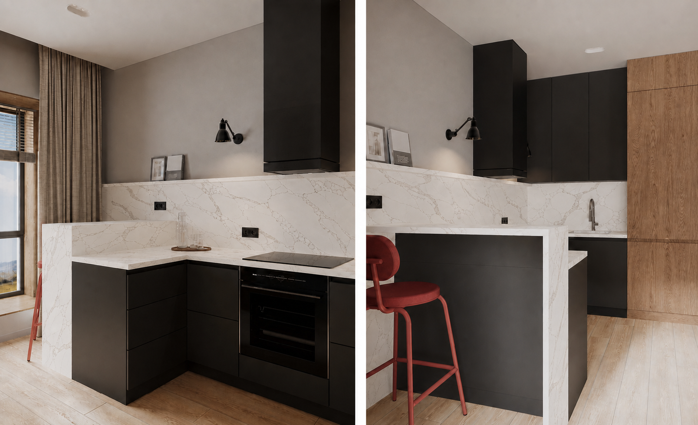
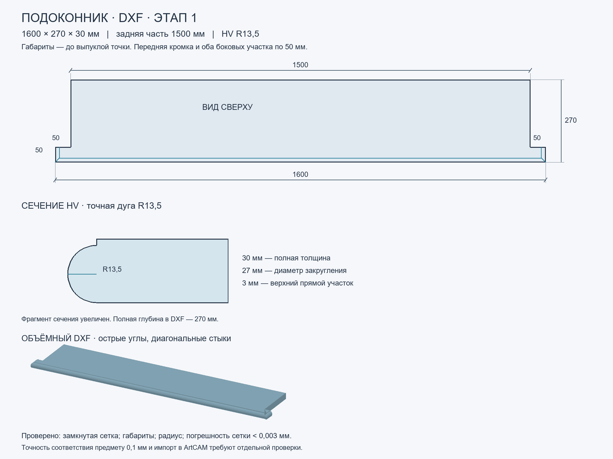
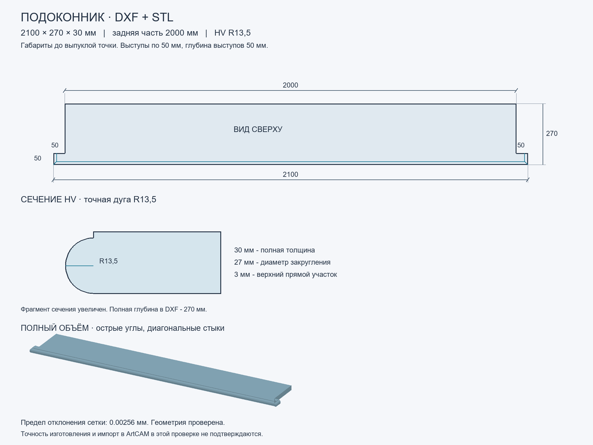
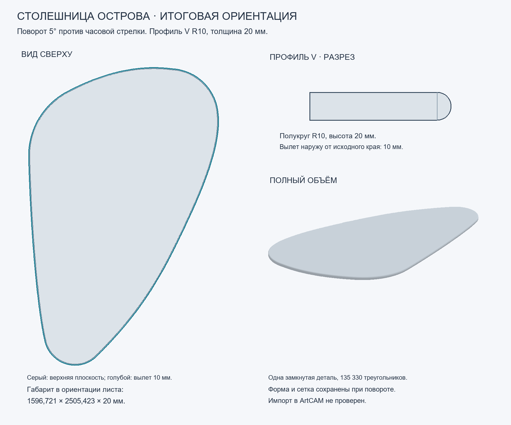
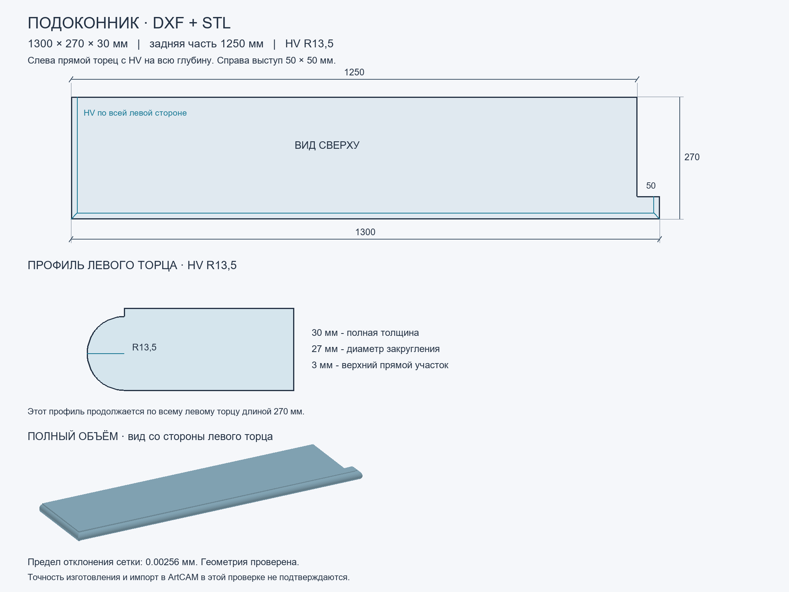
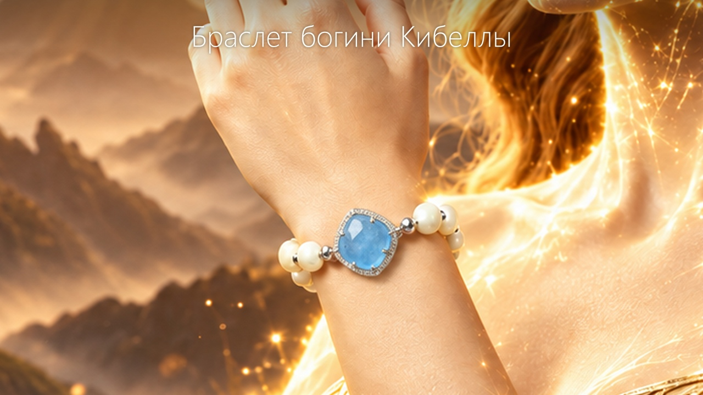
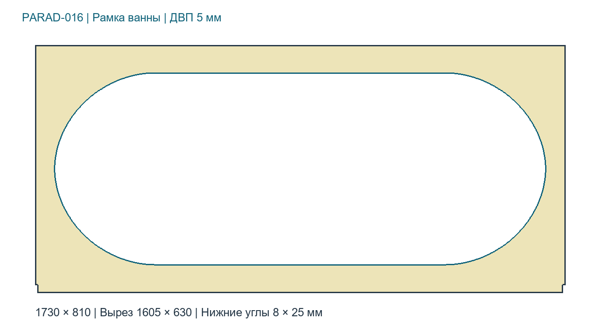
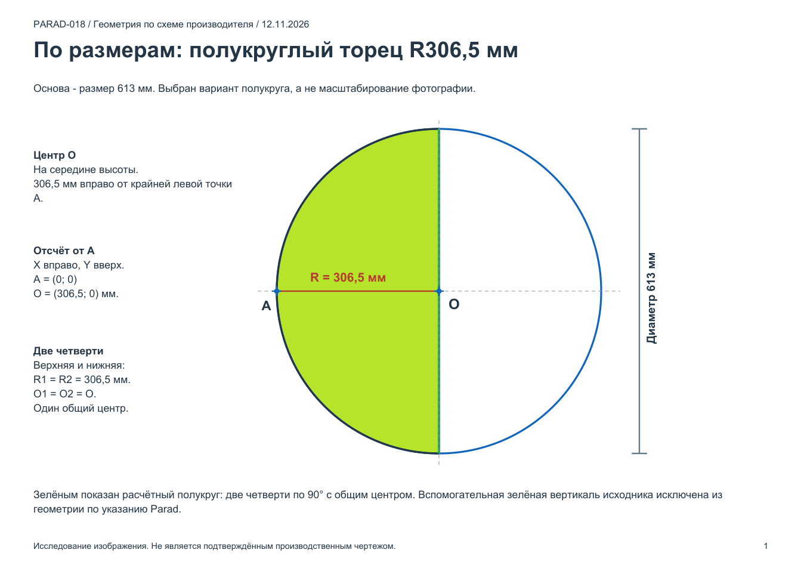
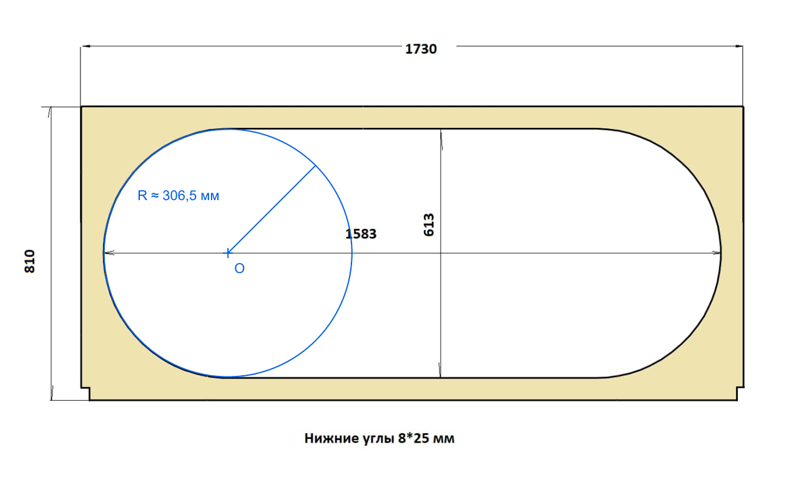
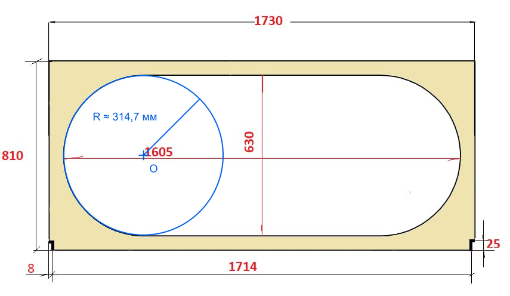

# Каталог работ Parad

Инженерные работы Parad: инженерные изделия, графика и интерьеры. Первый выпуск: 13.09.2026. Подробные материалы остаются в папках работ.

## Порядок и сохранение истории

Начальные записи расположены по датам создания папок работ: stone_08_2026 — 22.08.2026 13:53:47; stone_project — 12.09.2026 17:05:41. Внутри stone_project использованы даты создания папок результатов out1–out4. Время указано по Asia/Tomsk. Дата появления папки и дата выполнения приведены раздельно; дата файловой системы сама по себе не доказывает начало работы.

По уточнению Parad от 26.09.2026 каталог содержит все созданные результаты: расчёты, черновики, проверочные комплекты и режущие УП, в том числе не проверенные на станке и ещё не принятые пользователем. Приёмка и испытание не являются условием включения. Новые работы добавляем в конец этого Markdown-файла с постоянным номером PARAD-NNN; отдельно указываем фактический статус проверки и приёмки. Старые записи не переставляем и не удаляем. Изменение принятого решения или исправление описания добавляем в конце отдельной датированной записью со ссылкой на прежний номер. Дополнение также получает следующий номер PARAD-NNN и содержит дату, ссылку на прежнюю запись и суть изменения. Исправление сломанного пути в прежней записи допускается с пояснением в таком дополнении.

В первом выпуске сохранены все найденные работы; неподтверждённая приёмка обозначена явно. Одобрение отдельного изображения не означает приёмку всего комплекта. Для новых работ сохраняем дату появления папки, дату выполнения, первую постановку, итог, размеры, картинку, входные и выходные файлы, технологию, поисковые признаки и ссылки на подробный PDF и промпт.

Для поиска похожего сначала сопоставляем задачу, технологию и исходные данные, затем читаем подробный отчёт подходящей записи. Размеры и решения старого изделия не становятся автоматически параметрами нового.

В каталоге использовать только название Parad и номера PARAD-NNN. Не переносить личные имена, профиль пользователя или сведения о личной преемственности в описания, заголовки, колонтитулы и свойства PDF. Фактические пути к файлам сохранять для работоспособности ссылок.

Редактируемый источник — CATALOG_PARAD.md. CATALOG_PARAD.PDF пересоздаётся последним после обновления описаний и проверки ссылок; страницы проверяются визуально. Скрипт build_catalog.py читает записи этого файла, формирует оглавление и PDF, не меняя порядок записей и исходные материалы.

## Где искать настройки станка и обработки PARAD-002

Запросы «возьми настройки из PARAD-002», «основа параметров из PARAD-002», «я отвечала на этот вопрос, когда работали с подоконником» и близкие по смыслу отсылают к [единой базе согласованных ответов PARAD-002](postprocessor/confirmed_answers.md). Там собраны станок MORN1325 / RichAuto A11S, нули, инструменты, ДВП, PCD, HV, режимы, отменённые решения и оставшиеся проверки, а также все согласованные поисковые формулировки.

Сначала читать эту сводку; [история и анализ постпроцессоров](postprocessor/README.md) и [расчётный комплект](stone_project/artifacts/09122026/out1/cnc/README.md) нужны для подробностей. Для нового изделия использовать знания с учётом его условий и уточнять только изменения. Это навигация по сохранённым знаниям, не запись о новом изготовленном или принятом изделии; исторические записи каталога сохранены.

## Быстрый поиск актуальных результатов — сверено 26.09.2026

Геометрия и STEP: PARAD-002/006 (1600 мм), PARAD-003/007 (2100 мм), PARAD-004/008 (актуально 1280 мм). Проверочные комплекты этих изделий: PARAD-011/012/013. База станка и команды: PARAD-010. Общий раскрой: PARAD-014. Режущие программы ДВП двух листов: PARAD-015. Видео браслета: PARAD-009. Столешница острова: PARAD-005; интерьер кухни: PARAD-001.

Дополнения внесены по прямому запросу пользователя. Наличие результата не приравнивается к приёмке или испытанию на станке; статусы указаны в каждой записи. Старые записи и номера сохранены, новые этапы добавлены в конец. Технические изменения AGENTS, Git и настройки среды не являются отдельными изделиями каталога.

**Как найти материалы:** в каждой записи после ссылок приведены видимые пути папок от \Jenja\. Полный корень на этом компьютере: W:\obsidian\_parad\Prompts\Jenja\. Описание рядом с путём показывает, какие результаты и документы находятся в папке. Пути включать и в новые записи.

<!-- entry -->

## PARAD-001 — Замена камня в кухне

**Дата папки:** 22.08.2026 13:53:47. **Дата набора:** 22.08.2026. **Описание проверено:** 13.09.2026.

**Первая постановка:** реалистично заменить камень на выбранных поверхностях кухни по референсу, сохранив интерьер и согласованность ракурсов. Кратко восстановлено по промпту; дословное первое сообщение не сохранено.

**Объект и размеры:** столешницы, фартук и вертикальные торцы барной части. Физические размеры не указаны. Материал на референсе подписан «Калакатта Берн».

**Вход:** референс JPEG 1126 × 588 px; один JPEG интерьера 1081 × 689 px, содержащий два ракурса; текстовый промпт выбора поверхностей.

**Технология:** редактирование растрового изображения по образцу материала, подбор перспективы и масштаба рисунка, согласование связанных плоскостей. Конкретная модель и настройки исторической обработки не зафиксированы.

**Выход:** три PNG с вариантами замены — два 1608 × 978 px и один 1572 × 1001 px; повторяемый промпт и PDF-обзор. На картинке показан вариант 2 для узнавания объекта; окончательный выбор не установлен.

**Проверка:** все пять изображений открыты и просмотрены. Разрешение результатов отличается от исходника; полное сохранение композиции не подтверждено. Приёмка варианта не установлена.

**Можно повторить:** замену отделки по референсу и работу с несколькими ракурсами. **Поиск:** интерьер, кухня, текстура, Калакатта Берн, материал, фартук, барная стойка, JPEG, PNG.

**Материалы:** [Папка](stone_08_2026/) · [Входные файлы](stone_08_2026/artifacts/20260822/in/) · [Все результаты](stone_08_2026/artifacts/20260822/out/) · [Подробный PDF](stone_08_2026/project_overview.pdf) · [Описание](stone_08_2026/project_overview.md) · [Промпт](stone_08_2026/stone-texture-replacement.md).

**Материалы — папки от \Jenja\:**

[\Jenja\stone_08_2026](stone_08_2026/) — Папка, Подробный PDF, Описание, Промпт.

[\Jenja\stone_08_2026\artifacts\20260822\in](stone_08_2026/artifacts/20260822/in/) — Входные файлы.

[\Jenja\stone_08_2026\artifacts\20260822\out](stone_08_2026/artifacts/20260822/out/) — Все результаты.

<!-- entry -->

## PARAD-002 — Подоконник 1600 × 270 × 30 мм

**Дата папки out1:** 12.09.2026 17:22:43. **Дата работы:** 12.09.2026. Папка out переименована пользователем в out1; ссылки описания исправлены 13.09.2026.

**Первая постановка:** по фотографиям с размерами получить внешний контур и объёмный рельеф для ArtCAM 2018; на первом этапе — DXF. Позже отдельно разрешён один STL полной детали из объёмного DXF.

**Объект и размеры:** 1600 × 270 × 30 мм; задняя ширина 1500 мм; выступы с обеих сторон 50 × 50 мм. HV R13,5 по передней кромке и двум боковым участкам по 50 мм; верхний прямой участок 3 мм. Передние углы острые, стыки диагональные. Размеры заданы до выпуклой точки профиля.

**Вход:** фотография с размерными надписями, схема вида сверху и спереди, текстовые уточнения профиля и углов; текущая папка in1.

**Технология:** построение геометрии по заданным размерам средствами Python/ezdxf; точные дуги профиля и объёмная сетка 3DFACE; преобразование сетки DXF в STL без изменения формы.

**Выход:** четыре DXF — размерный лист, контур, сечение и объём; один STL; PNG/SVG, отчёты проверок, промпт, README и PDF.

**Проверка:** DXF прочитаны без ошибок; STL замкнут, один компонент, 1564 треугольника; габариты подтверждены. Импорт ArtCAM и соответствие физическому изделию с точностью 0,1 мм не подтверждены. Полная приёмка не зафиксирована. Ранний PDF описывает этап DXF; сведения о последующем STL подтверждены файлом и отчётом конвертации.

**Можно повторить:** построение HV по размерам и преобразование DXF → STL. **Поиск:** подоконник, HV, R13,5, два выступа, фото с размерами, ArtCAM, DXF, STL.

**Материалы:** [Папка](stone_project/artifacts/09122026/out1/) · [Входные файлы](stone_project/artifacts/09122026/in1/) · [PDF](stone_project/artifacts/09122026/out1/project_overview.pdf) · [STL](stone_project/artifacts/09122026/out1/sill_volume_mm.stl) · [Промпт первого этапа](stone_project/artifacts/09122026/stage1_reusable_prompt.md) · [Отчёт STL](stone_project/artifacts/09122026/work/stl_verification.json).

**Материалы — папки от \Jenja\:**

[\Jenja\stone_project\artifacts\09122026\out1](stone_project/artifacts/09122026/out1/) — Папка, PDF, STL.

[\Jenja\stone_project\artifacts\09122026\in1](stone_project/artifacts/09122026/in1/) — Входные файлы.

[\Jenja\stone_project\artifacts\09122026](stone_project/artifacts/09122026/) — Промпт первого этапа.

[\Jenja\stone_project\artifacts\09122026\work](stone_project/artifacts/09122026/work/) — Отчёт STL.

<!-- entry -->

## PARAD-003 — Подоконник 2100 × 270 × 30 мм

**Дата папки out2:** 12.09.2026 22:13:04. **Дата работы:** 12.09.2026.

**Первая постановка:** выполнить «Podoconnik 1 step STL» для L=2100, D=270 мм с сохранением согласованной формы и фиксированной толщины 30 мм.

**Объект и размеры:** 2100 × 270 × 30 мм; задняя ширина 2000 мм; два выступа 50 × 50 мм. HV R13,5 по передней кромке и боковым участкам по 50 мм. Острые углы и диагональные стыки профилей.

**Вход:** сохранённый параметрический промпт и размеры L × D, заданные текстом; форма профиля и выступов взята из согласованного шаблона.

**Технология:** параметрическое перестроение по длине и глубине без масштабирования профиля; Python/ezdxf, аналитические дуги и сетка 3DFACE; повторное чтение объёмного DXF для записи STL.

**Выход:** четыре DXF, один бинарный STL полной детали, PNG/SVG, параметры запуска и скрипты, отчёты проверок, README и PDF.

**Проверка:** габариты DXF и STL совпадают; один замкнутый компонент, 1564 треугольника. Суммарная оценка цифровой погрешности менее 0,00268 мм. Импорт в ArtCAM не проверен; результат передан на пользовательскую проверку.

**Можно повторить:** выпуск комплекта по новым L и D при фиксированном H=30 мм, HV и выступах; PDF после остальных файлов. **Поиск:** длинный подоконник, параметризация, HV, ArtCAM, DXF, STL, повторяемый промпт.

**Материалы:** [Папка](stone_project/artifacts/09122026/out2/) · [PDF](stone_project/artifacts/09122026/out2/project_overview.pdf) · [README](stone_project/artifacts/09122026/out2/README.md) · [STL](stone_project/artifacts/09122026/out2/podoconnik_volume_mm.stl) · [Параметры](stone_project/artifacts/09122026/out2/work/run_parameters.json) · [Промпт](stone_project/artifacts/09122026/out2/Podoconnik%201%20step%20STL.md).

**Материалы — папки от \Jenja\:**

[\Jenja\stone_project\artifacts\09122026\out2](stone_project/artifacts/09122026/out2/) — Папка, PDF, README, STL, Промпт.

[\Jenja\stone_project\artifacts\09122026\out2\work](stone_project/artifacts/09122026/out2/work/) — Параметры.

<!-- entry -->

## PARAD-004 — Подоконник с прямым левым торцом

**Дата папки out3:** 12.09.2026 22:41:34. **Дата работы:** 12.09.2026.

**Первая постановка:** создать вариант «Podoconnik 1 step STL - 3», продлив профиль HV на всю левую сторону при взгляде с длинной профилированной стороны. Затем уточнено: левый торец прямой, без выемки; запуск 1300 × 270 × 30 мм.

**Объект и размеры:** 1300 × 270 × 30 мм; задняя ширина 1250 мм. Слева нет выемки, HV проходит по всей глубине 270 мм. Справа сохранён выступ 50 × 50 мм и профиль на участке 50 мм; передняя кромка HV R13,5. Передние углы острые, соединение профилей диагональное.

**Вход:** базовый промпт подоконника, референс с размерами и текстовые уточнения левой стороны, профиля и размеров нового запуска. Параметры сохранены в work/run_parameters.json.

**Технология:** параметрическое изменение топологии контура и построение полного объёма с профилем по трём участкам; Python/ezdxf, 3DFACE → STL; отдельная проверка сечений левого торца.

**Выход:** четыре DXF, один STL, изображения PNG/SVG, скрипты и параметры, проверки, README и PDF.

**Проверка:** 1300 × 270 × 30 мм; один замкнутый компонент, 1172 треугольника; оценка цифровой погрешности менее 0,002615 мм. Профиль слева проверен в нескольких сечениях. Импорт в ArtCAM не проверен; результат передан на пользовательскую проверку.

**Можно повторить:** асимметричный подоконник с полным профилем торца. **Поиск:** левый торец, без выемки, асимметрия, HV, R13,5, подоконник, DXF, STL.

**Материалы прежней версии 1300 мм:** [Весь комплект ZIP](stone_project/artifacts/09122026/out3_1300_before_1280_20260923.zip) · [PDF](stone_project/artifacts/09122026/out3_1300_project_overview.pdf). STL, README, параметры и промпт прежней версии находятся внутри ZIP. Ссылки исправлены 23.09.2026 при архивировании; пересчёт на 1280 мм описан в PARAD-008.

**Материалы — папки от \Jenja\:**

[\Jenja\stone_project\artifacts\09122026](stone_project/artifacts/09122026/) — Весь комплект ZIP, PDF.

<!-- entry -->

## PARAD-005 — Столешница острова сложной формы

**Дата папки out4:** 12.09.2026 23:48:06. **Дата итогового комплекта:** 13.09.2026.

**Первая постановка:** по общим правилам подоконника подготовить стол сложной формы; убрать фиксированные форму и размеры, получать их из входных файлов и текста, оставить толщину 20 мм. Затем найти светло-серую столешницу в общем DXF кухонного острова и выделить её в отдельный комплект.

**Размеры:** исходный фактический контур 1627,612 × 2423,897 мм, толщина 20 мм. Кромка V R10 с вылетом 10 мм по всему периметру. Габарит итоговой сетки в осях листа после поворота: 1596,721 × 2505,423 × 20 мм. Камень: 1645 × 3200 мм.

**Вход:** общий DXF «Белинского_48_13_06_26_Лист_23_Чертеж_кухонного_острова_М1_15», фото для идентификации столешницы и профиля, текстовые уточнения. Промежуточные неповёрнутые DXF и STL сохранены в in4 и использованы для итогового преобразования.

**Технология и решение:** извлечение дуг и сплайнов, построение кромки и объёмной сетки; Python/ezdxf и расчёт геометрии. Фактический контур сохранён вместо округлённых размерных надписей. Деталь повёрнута на 5° против часовой стрелки; сверху 25 мм, по бокам 24,139 мм. Общие координаты итоговых контуров, DXF и STL.

**Выход и проверка:** семь DXF, один STL, изображения детали и раскладки, отчёты, скрипты, README и PDF. STL замкнут, один компонент, 135330 треугольников; оценка цифровой погрешности менее 0,022 мм. Импорт в ArtCAM и пригодность припусков для обработки не проверены; комплект передан на проверку.

**Можно повторить:** извлечение детали из общего чертежа и подбор поворота под ограниченный лист. **Поиск:** столешница, остров, сложный контур, сплайн, V R10, раскладка, ограничение камня, поворот 5°, DXF, STL.

**Материалы:** [Папка](stone_project/artifacts/09122026/out4/) · [Входные файлы](stone_project/artifacts/09122026/in4/) · [PDF](stone_project/artifacts/09122026/out4/project_overview.pdf) · [Раскладка](stone_project/artifacts/09122026/out4/stock_1645x3200_rotation5.png) · [STL](stone_project/artifacts/09122026/out4/stol_volume_mm.stl) · [Промпт](stone_project/artifacts/09122026/out4/Stol%201%20step%20STL%204.md).

**Материалы — папки от \Jenja\:**

[\Jenja\stone_project\artifacts\09122026\out4](stone_project/artifacts/09122026/out4/) — Папка, PDF, Раскладка, STL, Промпт.

[\Jenja\stone_project\artifacts\09122026\in4](stone_project/artifacts/09122026/in4/) — Входные файлы.

<!-- entry -->

## PARAD-006 — Дополнение к PARAD-002: перенос в SOLIDWORKS 2016

**Дата дополнения:** 23.09.2026. **Связанная работа:** PARAD-002, подоконник в out1. Запись добавлена по прямому запросу пользователя; первоначальное описание сохранено.

**Постановка дополнения:** подготовить STL и файл для SOLIDWORKS 2016. Пользователь выбрала STEP для открытия и сохранения в этой версии, затем попросила сохранить удачный способ для других проектов.

**Объект и размеры:** прежний подоконник 1600 × 270 × 30 мм, два выступа 50 × 50 мм, HV R13,5. Геометрия не менялась.

**Вход:** ранее созданный бинарный sill_volume_mm.stl; один замкнутый компонент, 1564 треугольника, миллиметры.

**Технология:** STL → твёрдый BREP с плоскими гранями → STEP AP214. Проверка чтением, пересохранением и повторным чтением в OpenCASCADE через Gmsh. Способ и общий скрипт сохранены отдельно; размеры, форма и пути задаются заново. Установленные зависимости используются повторно.

**Выход и проверка:** существующий STL повторно проверен; создан STEP с одним твёрдым телом и 1564 гранями. Габариты и объём совпадают с STL; объём около 12 100 123,121 мм³. Сохранены инструкция и отчёт проверок. Исходные DXF и STL не изменены.

**Статус:** STEP проверен в OpenCASCADE. Открытие финального STEP в SOLIDWORKS 2016 пока не проверено; SLDPRT 2016 ещё не создан. Его нужно сохранить из STEP в самой версии 2016. Гранёная аппроксимация профиля сохранена, параметрическое дерево не создавалось. Старый PDF проекта описывает прежний этап; новые сведения находятся в этом дополнении и инструкции.

**Можно повторить:** перенос готового замкнутого STL одной детали в STEP AP214 без изменения формы. **Поиск:** SOLIDWORKS 2016, STEP, AP214, STL, BREP, OpenCASCADE, перенос CAD, подоконник.

**Материалы:** [Папка](stone_project/artifacts/09122026/out1/) · [STL](stone_project/artifacts/09122026/out1/sill_volume_mm.stl) · [STEP](stone_project/artifacts/09122026/out1/sill_1600x270x30_HV_SW2016.step) · [Отчёт](stone_project/artifacts/09122026/out1/solidworks_exchange_verification.json) · [Инструкция детали](stone_project/artifacts/09122026/out1/SOLIDWORKS_2016_README.md) · [PDF прежнего этапа](stone_project/artifacts/09122026/out1/project_overview.pdf) · [Повторяемый способ](solidworks_2016_workflow.md) · [Скрипт](stl_to_step_ap214.py).

**Материалы — папки от \Jenja\:**

[\Jenja\stone_project\artifacts\09122026\out1](stone_project/artifacts/09122026/out1/) — Папка, STL, STEP, Отчёт, Инструкция детали, PDF прежнего этапа.

[\Jenja](./) — Повторяемый способ, Скрипт.

<!-- entry -->

## PARAD-007 — Дополнение к PARAD-003: перенос в SOLIDWORKS 2016

**Дата дополнения:** 23.09.2026. **Связанная работа:** PARAD-003, подоконник в out2. Добавлено по запросу пользователя с сохранением прежней записи.

**Постановка дополнения:** повторить сохранённый алгоритм подготовки файла для SOLIDWORKS 2016 для следующего подоконника, с результатами в out2.

**Объект и размеры:** 2100 × 270 × 30 мм; задняя ширина 2000 мм; два выступа 50 × 50 мм, профиль HV R13,5 и диагональные стыки. Форма и координаты сохранены.

**Вход:** готовый бинарный podoconnik_volume_mm.stl в миллиметрах; одна замкнутая согласованно ориентированная оболочка, 784 вершины, 1564 треугольника.

**Технология:** общий скрипт stl_to_step_ap214.py без изменений; STL → твёрдый BREP с плоскими гранями → STEP AP214. Чтение, пересохранение и повторное чтение через OpenCASCADE/Gmsh 4.15.2; повторная установка зависимостей не потребовалась.

**Выход и проверка:** STEP с одним твёрдым телом и 1564 гранями, отчёт JSON и инструкция. Габариты 2100 × 270 × 30 мм, объём 16 090 736,393 мм³; размеры и объём совпадают с STL в пределах допусков переноса. Контрольные суммы результата и неизменного исходника проверены.

**Статус:** нативный SLDPRT 2016 не создан. STEP следует открыть и сохранить как SLDPRT в самой SOLIDWORKS 2016; эта версия здесь недоступна, открытие в ней не проверено. Гранёная аппроксимация HV сохранена; аналитические поверхности и параметрическое дерево не восстанавливались. Прежние DXF, STL и PDF не менялись; PDF прежнего этапа дополняется этой записью и отдельной инструкцией.

**Можно повторить:** проверенный перенос готового STL одной детали в STEP AP214 с заданными новыми размерами. **Поиск:** SOLIDWORKS 2016, STEP, AP214, STL, BREP, OpenCASCADE, подоконник 2100, повторный запуск.

**Материалы:** [Папка](stone_project/artifacts/09122026/out2/) · [STL](stone_project/artifacts/09122026/out2/podoconnik_volume_mm.stl) · [STEP](stone_project/artifacts/09122026/out2/sill_2100x270x30_HV_SW2016.step) · [Отчёт](stone_project/artifacts/09122026/out2/sill_2100x270x30_HV_SW2016.verification.json) · [Инструкция](stone_project/artifacts/09122026/out2/SOLIDWORKS_2016_README.md) · [PDF прежнего этапа](stone_project/artifacts/09122026/out2/project_overview.pdf) · [Повторяемый способ](solidworks_2016_workflow.md) · [Скрипт](stl_to_step_ap214.py).

**Материалы — папки от \Jenja\:**

[\Jenja\stone_project\artifacts\09122026\out2](stone_project/artifacts/09122026/out2/) — Папка, STL, STEP, Отчёт, Инструкция, PDF прежнего этапа.

[\Jenja](./) — Повторяемый способ, Скрипт.

<!-- entry -->

## PARAD-008 — PARAD-004: пересчёт длины 1300 → 1280 мм

**Дата изменения:** 23.09.2026. **Связанная работа:** PARAD-004, out3. Старая версия сохранена в ZIP перед заменой файлов.

**Постановка:** полностью пересчитать комплект и документы при уменьшении длины с 1300 до 1280 мм; архивировать всю out3 и добавить STEP для SOLIDWORKS 2016.

**Размеры и форма:** 1280 × 270 × 30 мм; задняя ширина 1230 мм. Слева прямой торец с HV по всей глубине 270 мм, справа выступ 50 × 50 мм. HV R13,5 по передней кромке, слева и на правом участке 50 мм; острые углы с диагональными стыками сохранены.

**Вход:** прежняя параметрическая модель, новый размерный эскиз и подтверждение пользователя, что меняется только длина. Старый комплект 1300 мм: ZIP из 18 файлов с проверкой CRC и SHA-256. Исторические ссылки PARAD-004 переведены на архивные материалы.

**Технология:** новое построение DXF по параметрам, повторное чтение 3DFACE и запись STL, затем твёрдый BREP → STEP AP214 через сохранённый конвертер и OpenCASCADE. Документы и изображения обновлены; PDF сформирован после остальных файлов.

**Выход и проверка:** четыре DXF, один STL, STEP, PNG/SVG, отчёты, параметры, скрипты, промпт, README и PDF. Один замкнутый компонент, 1172 треугольника; STEP содержит одно твёрдое тело. Габариты подтверждены, площадь контура 334600 мм², объём STL около 9 850 000,467 мм³. Левый HV проверен при Y=72, 160 и 259 мм. Суммарная оценка цифрового отклонения менее 0,002615 мм.

**Статус:** импорт в ArtCAM и открытие STEP в SOLIDWORKS 2016 не проверены. SLDPRT 2016 нужно сохранить в самой версии 2016; нативный файл не создан. Гранёная аппроксимация профиля сохранена. Комплект передан на пользовательскую проверку.

**Можно повторить:** изменение длины асимметричного подоконника с архивированием прежней версии и подготовкой STEP. **Поиск:** 1280, 1230, прямой левый торец, HV, пересчёт, ZIP, DXF, STL, STEP, SOLIDWORKS 2016.

**Материалы:** [Папка](stone_project/artifacts/09122026/out3/) · [PDF](stone_project/artifacts/09122026/out3/project_overview.pdf) · [README](stone_project/artifacts/09122026/out3/README.md) · [STL](stone_project/artifacts/09122026/out3/podoconnik_volume_mm.stl) · [STEP](stone_project/artifacts/09122026/out3/sill_1280x270x30_HV_SW2016.step) · [Отчёт STEP](stone_project/artifacts/09122026/out3/sill_1280x270x30_HV_SW2016.verification.json) · [Архив 1300 мм](stone_project/artifacts/09122026/out3_1300_before_1280_20260923.zip) · [Общий алгоритм](solidworks_2016_workflow.md).

**Материалы — папки от \Jenja\:**

[\Jenja\stone_project\artifacts\09122026\out3](stone_project/artifacts/09122026/out3/) — Папка, PDF, README, STL, STEP, Отчёт STEP.

[\Jenja\stone_project\artifacts\09122026](stone_project/artifacts/09122026/) — Архив 1300 мм.

[\Jenja](./) — Общий алгоритм.

<!-- entry -->

## PARAD-009 — Рекламный ролик «Браслет богини Кибеллы»

**Дата работы:** 17.09.2026. **Дата папки out:** 17.09.2026 22:02:22. **Добавлено в каталог:** 26.09.2026; восстановлено пропущенное описание.

**Первая постановка:** переработать рекламу браслета, сохранив идею девушки, получающей силу богини; затем разрешено увеличить длительность, исправить финальную сцену и приблизить украшение к реальной фотографии.

**Вход и технология:** исходное видео, фотографии браслета и уточнения. Редактирование ключевого кадра через image_gen, монтаж с мягкими переходами, приближением и титром; сохранён движущийся средний фрагмент исходника. Тёплый золотистый фон, одна видимая рука; название одной строкой сверху по центру, Segoe UI Light.

**Выход:** версия 3, MP4 H.264, 1280 × 720, 30 кадров/с, 16 секунд; AAC. Прежние версии 1 и 2, постеры, промпты, монтажные последовательности и отчёты сохранены. Размеры самого украшения не заданы.

**Проверка:** по сохранённому отчёту декодированы 480 кадров; технические проверки пройдены, звук ассистентом не прослушивался. Художественная реконструкция не доказывает точное совпадение браслета во всех кадрах. В чате после результата — «спасибо»; отдельная полная приёмка не зафиксирована. Подробного PDF у ролика нет, описание находится в README.

**Материалы:** [Видео v3](natasha/out/cybele_bracelet_v3.mp4) · [Описание](natasha/out/README.md) · [Все результаты](natasha/out/) · [Исходники](natasha/artifacts/) · [Ключевой кадр](natasha/out/cybele_golden_keyframe_v3.png) · [Монтаж](natasha/out/edit_timeline_v3.json) · [Проверка](natasha/out/verification_v3.json) · [Промпт](natasha/out/image_prompt_v3.txt) · [Уточнение браслета](natasha/out/image_prompt_v3_refinement.txt).

**Материалы — папки от \Jenja\:**

[\Jenja\natasha\out](natasha/out/) — Видео v3, Описание, Все результаты, Ключевой кадр, Монтаж, Проверка, Промпт, Уточнение браслета.

[\Jenja\natasha\artifacts](natasha/artifacts/) — Исходники.

**Поиск:** браслет, Кибелла, девушка, сила богини, реклама, видео, золотистая палитра, реальное украшение, плавный переход.

<!-- entry -->

## PARAD-010 — База параметров станка, инструментов и постпроцессоров

**Период:** обсуждение и подготовка до 25.09.2026. **Добавлено:** 26.09.2026. **Основа:** PARAD-002.

**Первая постановка:** разобраться в двух постпроцессорах для ArtCAM 2011/2018 и MORN1325 с RichAuto A11S; сохранить ответы для повторного применения без полного повторного опроса.

**Вход:** исходные постпроцессоры, ранее работавшие NC, рекомендации производителя фрез, фото инструментов и ответы пользователя. **Выход:** структурированная база знаний: изделие и размеры, станок, материалы, инструменты и рассчитанные режимы, история изменений и ограничения; отдельная команда «УП без резания» и план общего раскроя.

**Технология и статус:** документирование подтверждений отдельно от расчётов и физических испытаний. Сохранены ДВП Ø4, PCD Ø6 и HV Ø74/R13,5, разные нули Z и безопасные отводы. Режим HV6000 — запрос пользователя выше указанного максимума производителя 4000; пригодность для резания не подтверждена AIR_XY. Черновики постов не проверены экспортом ArtCAM. Новые режущие программы здесь выпущены только для общего ДВП, см. PARAD-015.

**Материалы:** [Начать с базы ответов](postprocessor/confirmed_answers.md) · [История и анализ](postprocessor/README.md) · [Исходники и рекомендации](postprocessor/) · [Примеры NC](postprocessor/nc/) · [Черновики постов](stone_project/artifacts/09122026/out1/cnc/postprocessors/) · [Команда «УП без резания»](Commands/CNC%20Without%20Cutting.md) · [План общего раскроя](postprocessor/sill_batch_plan.md).

**Материалы — папки от \Jenja\:**

[\Jenja\postprocessor](postprocessor/) — Начать с базы ответов, История и анализ, Исходники и рекомендации, План общего раскроя.

[\Jenja\postprocessor\nc](postprocessor/nc/) — Примеры NC.

[\Jenja\stone_project\artifacts\09122026\out1\cnc\postprocessors](stone_project/artifacts/09122026/out1/cnc/postprocessors/) — Черновики постов.

[\Jenja\Commands](Commands/) — Команда «УП без резания».

**Поиск:** настройки PARAD-002, MORN1325, RichAuto A11S, ArtCAM, постпроцессор, база ответов, ДВП, PCD, HV, нули, подачи, обороты.

<!-- entry -->

## PARAD-011 — PARAD-002: подготовка УП к проверке без резания

**Дата комплекта:** 25.09.2026. **Добавлено:** 26.09.2026. **Связь:** PARAD-002.

**Первая постановка:** рассчитать траектории ДВП, PCD, HV черновой и чистовой обработки и подготовить проверочный комплект «УП без резания» для этого подоконника.

**Размеры:** 1600 × 270 × 30 мм; два выступа 50 × 50 мм. Длина вдоль Y, глубина вдоль X. Для PARAD-004 актуальны 1280 мм, прежние 1300 мм только в архиве.

**Вход и технология:** геометрия изделия и сохранённые решения PARAD-002; расчёт осевых траекторий и XYZ-переходов скриптами, отдельная генерация проверочных NC и повторное чтение. Скрипты каждого проекта сохранены в собственной cnc/scripts; исходные CAD сохранены.

**Выход:** четыре AIR_XY NC — ДВП, PCD, HV черновая и чистовая; DXF контуров, рабочих осей и полных движений XYZ, JSON, таблицы координат и времени, параметры, черновики постпроцессоров, README и PDF. Папки out1/cnc и out2/cnc приведены к однотипной организации; прежний postprocessor/parad002 сохранён для истории.

**Проверка и статус:** расчётные проверки и PDF выполнены; физический запуск не подтверждён. AIR_XY не включает шпиндель и держит постоянный безопасный Z: ДВП +45 от стола, PCD +40 от верха камня, HV +70 от низа камня. Это не режущие УП и не проверка рабочих спусков. Внутренние R2 лекал приняты без ручной доводки. Последующие режущие NC ДВП двух листов — PARAD-015.

**Материалы:** [PDF для инженера](stone_project/artifacts/09122026/out1/cnc/project_overview.pdf) · [README](stone_project/artifacts/09122026/out1/cnc/README.md) · [Четыре NC без резания](stone_project/artifacts/09122026/out1/cnc/nc_air_xy/) · [Все DXF](stone_project/artifacts/09122026/out1/cnc/geometry/) · [Параметры, координаты и проверки](stone_project/artifacts/09122026/out1/cnc/data/) · [Скрипты](stone_project/artifacts/09122026/out1/cnc/scripts/) · [Постпроцессоры](stone_project/artifacts/09122026/out1/cnc/postprocessors/) · [CAD изделия](stone_project/artifacts/09122026/out1/).

**Материалы — папки от \Jenja\:**

[\Jenja\stone_project\artifacts\09122026\out1\cnc](stone_project/artifacts/09122026/out1/cnc/) — PDF для инженера, README.

[\Jenja\stone_project\artifacts\09122026\out1\cnc\nc_air_xy](stone_project/artifacts/09122026/out1/cnc/nc_air_xy/) — Четыре NC без резания.

[\Jenja\stone_project\artifacts\09122026\out1\cnc\geometry](stone_project/artifacts/09122026/out1/cnc/geometry/) — Все DXF.

[\Jenja\stone_project\artifacts\09122026\out1\cnc\data](stone_project/artifacts/09122026/out1/cnc/data/) — Параметры, координаты и проверки.

[\Jenja\stone_project\artifacts\09122026\out1\cnc\scripts](stone_project/artifacts/09122026/out1/cnc/scripts/) — Скрипты.

[\Jenja\stone_project\artifacts\09122026\out1\cnc\postprocessors](stone_project/artifacts/09122026/out1/cnc/postprocessors/) — Постпроцессоры.

[\Jenja\stone_project\artifacts\09122026\out1](stone_project/artifacts/09122026/out1/) — CAD изделия.

**Поиск:** PARAD-002, 1600, подоконник, УП без резания, AIR_XY, DXF XYZ, ДВП, PCD, HV, проверка траектории.

<!-- entry -->

## PARAD-012 — PARAD-003: подготовка УП к проверке без резания

**Дата комплекта:** 25.09.2026. **Добавлено:** 26.09.2026. **Связь:** PARAD-003.

**Первая постановка:** рассчитать траектории ДВП, PCD, HV черновой и чистовой обработки и подготовить проверочный комплект «УП без резания» для этого подоконника.

**Размеры:** 2100 × 270 × 30 мм; два выступа 50 × 50 мм. Длина вдоль Y, глубина вдоль X. Для PARAD-004 актуальны 1280 мм, прежние 1300 мм только в архиве.

**Вход и технология:** геометрия изделия и сохранённые решения PARAD-002; расчёт осевых траекторий и XYZ-переходов скриптами, отдельная генерация проверочных NC и повторное чтение. Скрипты каждого проекта сохранены в собственной cnc/scripts; исходные CAD сохранены.

**Выход:** четыре AIR_XY NC — ДВП, PCD, HV черновая и чистовая; DXF контуров, рабочих осей и полных движений XYZ, JSON, таблицы координат и времени, параметры, черновики постпроцессоров, README и PDF. Папки out1/cnc и out2/cnc приведены к однотипной организации; прежний postprocessor/parad002 сохранён для истории.

**Проверка и статус:** расчётные проверки и PDF выполнены; физический запуск не подтверждён. AIR_XY не включает шпиндель и держит постоянный безопасный Z: ДВП +45 от стола, PCD +40 от верха камня, HV +70 от низа камня. Это не режущие УП и не проверка рабочих спусков. Внутренние R2 лекал приняты без ручной доводки. Последующие режущие NC ДВП двух листов — PARAD-015.

**Материалы:** [PDF для инженера](stone_project/artifacts/09122026/out2/cnc/project_overview.pdf) · [README](stone_project/artifacts/09122026/out2/cnc/README.md) · [Четыре NC без резания](stone_project/artifacts/09122026/out2/cnc/nc_air_xy/) · [Все DXF](stone_project/artifacts/09122026/out2/cnc/geometry/) · [Параметры, координаты и проверки](stone_project/artifacts/09122026/out2/cnc/data/) · [Скрипты](stone_project/artifacts/09122026/out2/cnc/scripts/) · [Постпроцессоры](stone_project/artifacts/09122026/out2/cnc/postprocessors/) · [CAD изделия](stone_project/artifacts/09122026/out2/).

**Материалы — папки от \Jenja\:**

[\Jenja\stone_project\artifacts\09122026\out2\cnc](stone_project/artifacts/09122026/out2/cnc/) — PDF для инженера, README.

[\Jenja\stone_project\artifacts\09122026\out2\cnc\nc_air_xy](stone_project/artifacts/09122026/out2/cnc/nc_air_xy/) — Четыре NC без резания.

[\Jenja\stone_project\artifacts\09122026\out2\cnc\geometry](stone_project/artifacts/09122026/out2/cnc/geometry/) — Все DXF.

[\Jenja\stone_project\artifacts\09122026\out2\cnc\data](stone_project/artifacts/09122026/out2/cnc/data/) — Параметры, координаты и проверки.

[\Jenja\stone_project\artifacts\09122026\out2\cnc\scripts](stone_project/artifacts/09122026/out2/cnc/scripts/) — Скрипты.

[\Jenja\stone_project\artifacts\09122026\out2\cnc\postprocessors](stone_project/artifacts/09122026/out2/cnc/postprocessors/) — Постпроцессоры.

[\Jenja\stone_project\artifacts\09122026\out2](stone_project/artifacts/09122026/out2/) — CAD изделия.

**Поиск:** PARAD-003, 2100, подоконник, УП без резания, AIR_XY, DXF XYZ, ДВП, PCD, HV, проверка траектории.

<!-- entry -->

## PARAD-013 — PARAD-004: подготовка УП к проверке без резания

**Дата комплекта:** 25.09.2026. **Добавлено:** 26.09.2026. **Связь:** PARAD-004 и PARAD-008.

**Первая постановка:** рассчитать траектории ДВП, PCD, HV черновой и чистовой обработки и подготовить проверочный комплект «УП без резания» для этого подоконника.

**Размеры:** 1280 × 270 × 30 мм; прямой левый торец с HV по всей глубине, один правый выступ. Длина вдоль Y, глубина вдоль X. Для PARAD-004 актуальны 1280 мм, прежние 1300 мм только в архиве.

**Вход и технология:** геометрия изделия и сохранённые решения PARAD-002; расчёт осевых траекторий и XYZ-переходов скриптами, отдельная генерация проверочных NC и повторное чтение. Скрипты каждого проекта сохранены в собственной cnc/scripts; исходные CAD сохранены.

**Выход:** четыре AIR_XY NC — ДВП, PCD, HV черновая и чистовая; DXF контуров, рабочих осей и полных движений XYZ, JSON, таблицы координат и времени, параметры, черновики постпроцессоров, README и PDF. Папки out1/cnc и out2/cnc приведены к однотипной организации; прежний postprocessor/parad002 сохранён для истории.

**Проверка и статус:** расчётные проверки и PDF выполнены; физический запуск не подтверждён. AIR_XY не включает шпиндель и держит постоянный безопасный Z: ДВП +45 от стола, PCD +40 от верха камня, HV +70 от низа камня. Это не режущие УП и не проверка рабочих спусков. Внутренние R2 лекал приняты без ручной доводки. Последующие режущие NC ДВП двух листов — PARAD-015.

**Материалы:** [PDF для инженера](stone_project/artifacts/09122026/out3/cnc/project_overview.pdf) · [README](stone_project/artifacts/09122026/out3/cnc/README.md) · [Четыре NC без резания](stone_project/artifacts/09122026/out3/cnc/nc_air_xy/) · [Все DXF](stone_project/artifacts/09122026/out3/cnc/geometry/) · [Параметры, координаты и проверки](stone_project/artifacts/09122026/out3/cnc/data/) · [Скрипты](stone_project/artifacts/09122026/out3/cnc/scripts/) · [Постпроцессоры](stone_project/artifacts/09122026/out3/cnc/postprocessors/) · [CAD изделия](stone_project/artifacts/09122026/out3/).

**Материалы — папки от \Jenja\:**

[\Jenja\stone_project\artifacts\09122026\out3\cnc](stone_project/artifacts/09122026/out3/cnc/) — PDF для инженера, README.

[\Jenja\stone_project\artifacts\09122026\out3\cnc\nc_air_xy](stone_project/artifacts/09122026/out3/cnc/nc_air_xy/) — Четыре NC без резания.

[\Jenja\stone_project\artifacts\09122026\out3\cnc\geometry](stone_project/artifacts/09122026/out3/cnc/geometry/) — Все DXF.

[\Jenja\stone_project\artifacts\09122026\out3\cnc\data](stone_project/artifacts/09122026/out3/cnc/data/) — Параметры, координаты и проверки.

[\Jenja\stone_project\artifacts\09122026\out3\cnc\scripts](stone_project/artifacts/09122026/out3/cnc/scripts/) — Скрипты.

[\Jenja\stone_project\artifacts\09122026\out3\cnc\postprocessors](stone_project/artifacts/09122026/out3/cnc/postprocessors/) — Постпроцессоры.

[\Jenja\stone_project\artifacts\09122026\out3](stone_project/artifacts/09122026/out3/) — CAD изделия.

**Поиск:** PARAD-004, 1280, подоконник, УП без резания, AIR_XY, DXF XYZ, ДВП, PCD, HV, проверка траектории.

<!-- entry -->

## PARAD-014 — PARAD-002/003/004: принятый раскрой ДВП на двух листах

**Дата работы и принятия раскладки:** 25.09.2026. **Добавлено:** 26.09.2026.

**Первая постановка:** разместить лекала трёх подоконников на одном листе ДВП, сравнить варианты A/B в одном PDF; затем выбран B и добавлен второй лист с четырьмя PARAD-002. Каменный раскрой не выполнялся.

**Вход:** контуры лекал PARAD-002 1600, PARAD-003 2100 и PARAD-004 1280 мм, глубина 270 мм; лист ДВП 1220 × 2710 × 5 мм. **Результат:** «Раскрой ДВП: два листа», принят пользователем. Лист 1 — по одному лекалу 002/003/004; лист 2 — четыре 002 со смещением соседних на 100 мм вдоль Y.

**Размещение:** XY0 B в углу первого 002, на листе 1 от края (50;50), на листе 2 (40;50) мм. Начала лекал в B: лист 1 (0;0), (320;0), (640;0); лист 2 (0;0), (290;100), (580;0), (870;100). Отверстия Ø8: 18/24, перемычки: 18/24. Технология — расчёт размещения контуров и зон инструмента, отверстий и перемычек; PDF со схемами и действиями.

**Выход и статус:** принятый общий PDF, два DXF, CSV отверстий/перемычек, проверки и скрипты; прежнее сравнение A/B в архиве. Принятие раскладки не означает испытание на станке. Продолжение с режущими NC — PARAD-015.

**Материалы:** [PDF раскроя обоих листов](postprocessor/dvp_002_003_004/project_overview.pdf) · [Общая папка и README](postprocessor/dvp_002_003_004/README.md) · [DXF листа 1](postprocessor/dvp_002_003_004/layout_sheet1_B.dxf) · [DXF листа 2](postprocessor/dvp_002_003_004/layout_sheet2_B.dxf) · [Отверстия 1](postprocessor/dvp_002_003_004/sheet1_holes.csv) · [Отверстия 2](postprocessor/dvp_002_003_004/sheet2_holes.csv) · [Перемычки 1](postprocessor/dvp_002_003_004/sheet1_tabs.csv) · [Перемычки 2](postprocessor/dvp_002_003_004/sheet2_tabs.csv) · [Архив сравнения](postprocessor/dvp_002_003_004/archive/) · [Скрипты](postprocessor/dvp_002_003_004/scripts/) · [Проверки](postprocessor/dvp_002_003_004/verification.json).

**Материалы — папки от \Jenja\:**

[\Jenja\postprocessor\dvp_002_003_004](postprocessor/dvp_002_003_004/) — PDF раскроя обоих листов, Общая папка и README, DXF листа 1, DXF листа 2, Отверстия 1, Отверстия 2, Перемычки 1, Перемычки 2, Проверки.

[\Jenja\postprocessor\dvp_002_003_004\archive](postprocessor/dvp_002_003_004/archive/) — Архив сравнения.

[\Jenja\postprocessor\dvp_002_003_004\scripts](postprocessor/dvp_002_003_004/scripts/) — Скрипты.

**Поиск:** общий раскрой, два листа, ДВП 1220 × 2710, вариант B, четыре 1600, отверстия, перемычки.

<!-- entry -->

## PARAD-015 — Два листа ДВП: режущие NC и порядок запуска

**Дата выпуска:** 25.09.2026. **Добавлено:** 26.09.2026. **Основа:** принятая раскладка PARAD-014; изделия PARAD-002/003/004.

**Первая постановка:** перейти от принятого раскроя к УП физической резки ДВП; создать отдельную папку для каждого листа.

**Вход и технология:** принятая раскладка и рассчитанные движения отдельных лекал. Скриптовая генерация NC с повторным независимым разбором записанных координат, дуг, глубин и режимов; проверка зоны инструмента относительно контуров и перемычек. Это не экспорт из ArtCAM.

**Параметры:** ДВП 5 мм; фреза Ø4, один зуб; S16000, XY F800, погружение F100. Z0 стол; два уровня +2,5 и +0,3, безопасный +45, подвод +7. После M3 — G04 P21000, выбранная выдержка 21 с. Шесть перемычек на лекало, высота 5 мм, минимальная ширина 5 мм; недорез 0,3 мм. Вход через заранее просверленные Ø8. Между участками и деталями подъём +45; конец M5, рабочий XY0, M30.

**Выход:** в sheet_1 и sheet_2 — режущая CUT.nc, проверочная AIR_XY.nc, XYZ DXF, таблицы, README, PDF запуска, отчёты и хеши исходников. В test_checks — отдельный тест выдержки без движения/вращения и тест шпинделя без движения осей. Общие скрипты сохранены рядом.

**Проверка и статус:** статические проверки пройдены, 36/48 спусков в отверстия, PDF просмотрены. На станке не запускалось. Перед резанием выполнить проверки установки, паузы, разгона и AIR_XY по инструкции; CUT включает шпиндель и входит в материал. Время на подаче с явной паузой 31,26/40,37 мин — без G0, ускорений, дополнительной задержки пульта и установки. Рабочие УП камня не выпускались.

**Лист 1, 002 + 003 + 004:** [PDF запуска](postprocessor/dvp_002_003_004/sheet_1/project_overview.pdf) · [Режущая NC](postprocessor/dvp_002_003_004/sheet_1/SHEET_1_DVP_D4_CUT.nc) · [AIR_XY](postprocessor/dvp_002_003_004/sheet_1/SHEET_1_DVP_AIR_XY.nc) · [Все файлы листа 1](postprocessor/dvp_002_003_004/sheet_1/).

**Лист 2, четыре 002:** [PDF запуска](postprocessor/dvp_002_003_004/sheet_2/project_overview.pdf) · [Режущая NC](postprocessor/dvp_002_003_004/sheet_2/SHEET_2_DVP_D4_CUT.nc) · [AIR_XY](postprocessor/dvp_002_003_004/sheet_2/SHEET_2_DVP_AIR_XY.nc) · [Все файлы листа 2](postprocessor/dvp_002_003_004/sheet_2/).

**Общие материалы:** [README](postprocessor/dvp_002_003_004/README.md) · [Тесты перед резанием](postprocessor/dvp_002_003_004/test_checks/) · [Скрипты](postprocessor/dvp_002_003_004/scripts/) · [Сводка проверок](postprocessor/dvp_002_003_004/cutting_summary.json) · [База ответов](postprocessor/confirmed_answers.md).

**Материалы — папки от \Jenja\:**

[\Jenja\postprocessor\dvp_002_003_004\sheet_1](postprocessor/dvp_002_003_004/sheet_1/) — PDF запуска, Режущая NC, AIR_XY, Все файлы листа 1.

[\Jenja\postprocessor\dvp_002_003_004\sheet_2](postprocessor/dvp_002_003_004/sheet_2/) — PDF запуска, Режущая NC, AIR_XY, Все файлы листа 2.

[\Jenja\postprocessor\dvp_002_003_004](postprocessor/dvp_002_003_004/) — README, Сводка проверок.

[\Jenja\postprocessor\dvp_002_003_004\test_checks](postprocessor/dvp_002_003_004/test_checks/) — Тесты перед резанием.

[\Jenja\postprocessor\dvp_002_003_004\scripts](postprocessor/dvp_002_003_004/scripts/) — Скрипты.

[\Jenja\postprocessor](postprocessor/) — База ответов.

**Поиск:** резка ДВП, CUT, два листа, M3, G04 P21000, пауза 21 секунда, S16000, физическая резка, NC.

<!-- entry -->

## PARAD-016 — Рамка ванны из ДВП 1730 × 810 мм

**Дата работы:** 06.11.2026. **Папка:** outvanna рядом с out1; существовала пустой до расчёта. **Основа режимов:** PARAD-015.

**Первая постановка:** новый раскрой ДВП по другому чертежу; сохранить проект в outvanna, выдать DXF, PDF, AIR_XY и CUT и добавить в каталог. Перед выполнением Parad согласовала условия и дала «выполняй».

**Объект:** одна рамка 1730 × 810 мм, центральный вырез 1605 × 630 мм; два нижних выреза 8 × 25 мм, между ними 1714 мм. Лист 1220 × 2710 × 5 мм; длина по Y, ширина по X, отступы 50 мм. XY0 — габаритный угол рамки, Z0 — стол.

**Вход и технология:** три JPG в invanna; выбран photo_2026-11-06_20-20-39.jpg. По указанию Parad форма внутренних кривых восстановлена по схеме при точных габаритах. Это аппроксимация, не точные радиусы производителя; посадка ванны не проверена. Скриптовое построение DXF и осевых путей Ø4, генерация G1 NC с повторным разбором. Внутренние углы нижних вырезов после фрезы имеют R2.

**Обработка:** сначала внутренний контур, затем наружный; вход через два предварительных Ø8 в отходе. S16000, XY800, Z100, G04 P21000; уровни Z+2,5 и Z0, переходы Z45. По текущему решению общий недорез отменён; на каждом контуре одна перемычка минимум 5 мм × 1 мм по Z, осевой участок 9 мм. Прижимы механические, вне путей по сообщению Parad; геометрия крепления не измерена.

**Результат и статус:** два основных DXF, раскладка и XYZ DXF, CUT и AIR_XY, CSV/JSON, скрипты, README и PDF. Статические проверки пройдены: четыре входа в отверстия, отсутствие Z ниже стола, соответствие XY AIR/CUT, сохранность рамки и перемычек, аудит DXF; пять страниц PDF просмотрены. Время подачи с явной паузой 23,11 мин, не полный цикл. Пользовательская приёмка и испытание на станке не подтверждены.

**Материалы:** [PDF](stone_project/artifacts/09122026/outvanna/project_overview.pdf) · [README](stone_project/artifacts/09122026/outvanna/README.md) · [Размерный DXF](stone_project/artifacts/09122026/outvanna/vanna_dimensioned_mm.dxf) · [Контуры DXF](stone_project/artifacts/09122026/outvanna/vanna_contours_mm.dxf) · [Проверки](stone_project/artifacts/09122026/outvanna/cnc/data/verification.json).

**Материалы — папки от \Jenja\:**

[\Jenja\stone_project\artifacts\09122026\invanna](stone_project/artifacts/09122026/invanna/) — входящие JPG.

[\Jenja\stone_project\artifacts\09122026\outvanna](stone_project/artifacts/09122026/outvanna/) — DXF детали, PDF, README, превью.

[\Jenja\stone_project\artifacts\09122026\outvanna\cnc\nc](stone_project/artifacts/09122026/outvanna/cnc/nc/) — AIR_XY и CUT.

[\Jenja\stone_project\artifacts\09122026\outvanna\cnc\geometry](stone_project/artifacts/09122026/outvanna/cnc/geometry/) — раскладка и движения XYZ.

[\Jenja\stone_project\artifacts\09122026\outvanna\cnc\data](stone_project/artifacts/09122026/outvanna/cnc/data/) — координаты, параметры, проверки, хеши и наложение на исходную схему.

[\Jenja\stone_project\artifacts\09122026\outvanna\cnc\scripts](stone_project/artifacts/09122026/outvanna/cnc/scripts/) — воспроизводимые скрипты.

**Поиск:** ванна, рамка, outvanna, invanna, ДВП, 1730, 810, 1605, 630, уголки 8 × 25, две перемычки, Z0, AIR_XY, CUT.

<!-- entry -->

## PARAD-017 — PARAD-016: пауза разгона шпинделя 5 секунд

**Дата изменения:** 06.11.2026. **Связь:** PARAD-016, рамка ванны outvanna.

**Основание:** Parad передала просьбу оператора изменить паузу разгона с 21 на 5 секунд и поручила обновить комплект. Изменение относится к outvanna; параметры прежних заказов не менялись.

**Актуальное решение:** после M3 S16000 стоит G04 P5000. Значения G04 P21000 и 23,11 мин в исходной записи PARAD-016 описывают первый выпуск и заменены этим дополнением. Новое время подачи с явной паузой — 22,85 мин, на 16 секунд меньше; полный цикл по-прежнему неизвестен.

**Результат и проверки:** в CUT изменена ровно одна строка выдержки; остальной файл совпадает побайтно. Хешами подтверждена неизменность AIR_XY, DXF, траекторий и координат. Синхронизированы параметры, генераторы, расчёт времени, README и PDF. Созданы отдельные тесты выдержки и шпинделя на 5 секунд в папке проекта. Выполнение на станке и фактическое время разгона не проверялись.

**Материалы:** [Актуальный PDF](stone_project/artifacts/09122026/outvanna/project_overview.pdf) · [README](stone_project/artifacts/09122026/outvanna/README.md) · [CUT с паузой 5 с](stone_project/artifacts/09122026/outvanna/cnc/nc/VANNA_DVP_D4_CUT.nc) · [Проверка изменения](stone_project/artifacts/09122026/outvanna/cnc/data/dwell_update_verification.json).

**Материалы — папки от \Jenja\:**

[\Jenja\stone_project\artifacts\09122026\outvanna](stone_project/artifacts/09122026/outvanna/) — PDF, README и DXF.

[\Jenja\stone_project\artifacts\09122026\outvanna\cnc\nc](stone_project/artifacts/09122026/outvanna/cnc/nc/) — CUT и AIR_XY.

[\Jenja\stone_project\artifacts\09122026\outvanna\cnc\test_checks](stone_project/artifacts/09122026/outvanna/cnc/test_checks/) — тесты на 5 секунд.

[\Jenja\stone_project\artifacts\09122026\outvanna\cnc\data](stone_project/artifacts/09122026/outvanna/cnc/data/) — параметры, проверки и хеши.

[\Jenja\stone_project\artifacts\09122026\outvanna\cnc\scripts](stone_project/artifacts/09122026/outvanna/cnc/scripts/) — обновлённые генераторы.

**Поиск:** outvanna, ванна, пауза разгона, 5 секунд, G04 P5000, изменение оператора.

<!-- entry -->

## PARAD-018 — Окружность левого торца ванны: построение по размерам

**Дата работы:** 12.11.2026. **Тип:** геометрическое исследование, без раскроя и УП.

**Первая постановка:** определить, одной или двум окружностям принадлежит зелёный сегмент, нарисовать центры и радиусы. Последующие указания Parad: ориентироваться на цифры, зелёную вертикаль не учитывать; сверить соседнюю картинку без заливки.

**Вход:** invanna2/33.jpg и photo_2026-11-12_19-19-33.jpg; внутренний размер 1583 × 613 мм, наружный 1730 × 810 мм. Схема не является точным CAD.

**Результат:** для модели полукруглого торца R = 613/2 = 306,5 мм; центр на середине высоты, на 306,5 мм вправо от крайней левой точки выреза. Верхняя и нижняя четверти имеют общий центр. При двух полукруглых торцах длина прямых 970 мм. Зелёная вертикаль не участвует в расчёте. Подписанные габариты сами по себе не доказывают строго круговую форму реального изделия.

**Технология и проверки:** предварительная подгонка чёрной кромки по пикселям дала практически общий круг; после уточнения пользователя итог построен по числам, без использования масштаба растра. Выпущены PNG, PDF на двух страницах, JSON, README и скрипты. Проверены арифметика, координаты и страницы PDF. Исходники и программы резки не изменены; физическая проверка не выполнялась.

**Материалы:** [PDF](stone_project/artifacts/09122026/circle_analysis_33/project_overview.pdf) · [README](stone_project/artifacts/09122026/circle_analysis_33/README.md) · [Размерный результат](stone_project/artifacts/09122026/circle_analysis_33/dimension_result.json).

**Материалы — папки от \Jenja\:**

[\Jenja\stone_project\artifacts\09122026\invanna2](stone_project/artifacts/09122026/invanna2/) — две входящие картинки.

[\Jenja\stone_project\artifacts\09122026\circle_analysis_33](stone_project/artifacts/09122026/circle_analysis_33/) — итоговые схемы и PDF, данные, скрипты, предварительное исследование.

**Поиск:** ванна, зелёный сегмент, окружность, центр, радиус 306,5, диаметр 613, две четверти, 1583, геометрия.

<!-- entry -->

## PARAD-019 — PARAD-018: окружность поверх исходного чертежа

**Дата уточнения:** 12.11.2026. **Связь:** PARAD-018.

**Решение Parad:** нужен круг с центром и радиусом непосредственно поверх photo_2026-11-12_19-19-33.jpg, без добавленной заливки, вместо отдельной схемы круга. Исходный файл сохранён.

**Результат:** отдельная PNG-копия с синей окружностью левого торца, центром O и подписью R306,5 мм. Выполнено встроенным ImageGen; визуальная аннотация, не точный CAD и не гарантия пиксельной неизменности чертежа. Проверены видимость окружности, подписи, исходных размеров и отсутствие новой заливки.

**Материалы:** [Окружность на исходном чертеже](stone_project/artifacts/09122026/circle_analysis_33/circle_on_original.png) · [Описание и расчёт](stone_project/artifacts/09122026/circle_analysis_33/README.md) · [Промт редактирования](stone_project/artifacts/09122026/circle_analysis_33/overlay_prompt.txt).

**Материалы — папки от \Jenja\:**

[\Jenja\stone_project\artifacts\09122026\invanna2](stone_project/artifacts/09122026/invanna2/) — исходный чертёж.

[\Jenja\stone_project\artifacts\09122026\circle_analysis_33](stone_project/artifacts/09122026/circle_analysis_33/) — аннотированная копия, описание, промт и прежнее исследование.

**Поиск:** ванна, окружность поверх чертежа, центр O, R306,5, без заливки.

<!-- entry -->

## PARAD-020 — PARAD-019: математическая окружность поверх исходника

**Дата:** 13.11.2026. **Связь:** исправление PARAD-018/019 по новому промту.

**Запрос:** повторить подбор по photo_2026-11-12_19-19-33.jpg; полная окружность с центром и радиусом поверх чертежа, без заливки.

**Результат:** одна окружность описывает левую дугу (368 точек, RMS 0,200 пикселя). Для кругового торца, касающегося параллельных прямых с расстоянием 613 мм, R306,5 мм; центр на средней линии, на 306,5 мм вправо от левой крайней точки. Подпись R ≈ 306,5 мм отражает приблизительность модели производителя по схеме. Размеры растра имеют несовместимые масштабы; производственная точность не подтверждена.

**Исправление:** прежний ImageGen-вариант PARAD-019 отклонён Parad как овал. Новый результат построен математически; диаметры по X/Y равны. Пиксели вне слоя аннотаций совпадают с исходником; JPG не изменён. Верх/низ не требуют двух разных центров. УП не создавались. Пользовательская приёмка нового варианта ожидается.

**Материалы:** [PNG](stone_project/artifacts/09122026/circle_analysis_33/circle_on_original_exact2.png) · [SVG](stone_project/artifacts/09122026/circle_analysis_33/circle_on_original_exact2.svg) · [Проверки](stone_project/artifacts/09122026/circle_analysis_33/circle_on_original_exact2.json) · [Описание](stone_project/artifacts/09122026/circle_analysis_33/README.md) · [Промт](Commands/Circle%20Radius%20on%20Image.md).

**Материалы — папки от \Jenja\:**

[\Jenja\stone_project\artifacts\09122026\invanna2](stone_project/artifacts/09122026/invanna2/) — исходник.

[\Jenja\stone_project\artifacts\09122026\circle_analysis_33](stone_project/artifacts/09122026/circle_analysis_33/) — наложения, данные, скрипт и история.

**Поиск:** ванна, ДВП, окружность, радиус, центр, исправление овала, 306,5.

<!-- entry -->

## PARAD-021 — Окружность поверх старой схемы ванны

**Дата:** 13.11.2026. **Связь:** PARAD-016/020, сравнение двух измерений одной ванны.

**Запрос:** по промту наложить окружность, центр и радиус на invanna/photo_2026-11-06_20-20-39.jpg, без заливки.

**Результат:** по 243 точкам левой дуги подобрана одна окружность. Центр O=(240,549;260,204) px от верхнего левого угла; R134,369 px, RMS0,190 px. Перевод по вертикальному размеру 630 мм / 269 px даёт R≈314,7 мм. Это оценка по схеме, а не точный радиус производителя: масштабы размерных надписей не согласованы. Старый вырез 1605 × 630 мм; наружный габарит 1730 × 810 мм.

**Проверки:** математическая окружность, диаметры равны; пиксели вне аннотаций совпадают с исходником. PNG просмотрен. Исходный JPG, DXF и УП не изменены; пользовательская приёмка ожидается.

**Материалы:** [PNG](stone_project/artifacts/09122026/circle_analysis_33/circle_old_original.png) · [SVG](stone_project/artifacts/09122026/circle_analysis_33/circle_old_original.svg) · [Данные](stone_project/artifacts/09122026/circle_analysis_33/circle_old_original.json) · [Промт](Commands/Circle%20Radius%20on%20Image.md).

**Материалы — папки от \Jenja\:**

[\Jenja\stone_project\artifacts\09122026\invanna](stone_project/artifacts/09122026/invanna/) — старый исходник.

[\Jenja\stone_project\artifacts\09122026\circle_analysis_33](stone_project/artifacts/09122026/circle_analysis_33/) — наложение, скрипт, данные и описание.

**Поиск:** ванна, ДВП, радиус 314,7, окружность, старые измерения, 630, 1605.

<!-- entry -->

## PARAD-022 — Левая дуга реальной ванны и исходный рисунок

**Дата исследования:** 13.11.2026. **Регистрация:** 14.11.2026. **Связь:** PARAD-016/021.

**Вход:** invanna/test1/photo_2026-11-13_20-58-53.jpg. Parad подтвердила вырезанную деталь, ширину630 мм и серую обводку реальной ванны. Запрошено предварительное исследование при допущении отсутствия горизонтального наклона.

**Результат:** условная аффинная реконструкция с равным местным масштабом X/Y и удалением бокового наклона. По 12 уточнённым точкам маркера R≈314 мм; исходный рисунок R≈315 мм. Центры совмещены для сравнения формы. Разница около1 мм не доказана из-за неопределённости перспективы и ручного считывания. Это не основание менять контур или УП. Первый черновой подбор около311 мм отклонён после проверки точек; актуален v2.

**Проверки:** увеличенный просмотр точек маркера и наложения. Измеренные630 мм использованы для масштаба. Полное исправление перспективы и положение рамки при обводке не установлены. Исходники, DXF и NC не изменены. Пользовательская приёмка формы ожидается.

**Материалы:** [Левая сторона](stone_project/artifacts/09122026/outvanna/photo_analysis_test1/left_comparison.png) · [Описание](stone_project/artifacts/09122026/outvanna/photo_analysis_test1/README.md) · [Параметры](stone_project/artifacts/09122026/outvanna/photo_analysis_test1/analysis_v2.json).

**Материалы — папки от \Jenja\:**

[\Jenja\stone_project\artifacts\09122026\invanna\test1](stone_project/artifacts/09122026/invanna/test1/) — фотографии изготовленной детали.

[\Jenja\stone_project\artifacts\09122026\outvanna\photo_analysis_test1](stone_project/artifacts/09122026/outvanna/photo_analysis_test1/) — реконструкция, наложения и данные.

**Поиск:** ванна, ДВП, серая линия, маркер, левая дуга, перспектива, 630 мм.

<!-- entry -->

## PARAD-023 — Расстояния от центра левой дуги до сторон рамки

**Дата:** 14.11.2026. **Связь:** PARAD-022. По запросу Parad к центру O проведены четыре перпендикуляра от внешних сторон прямоугольника1730×810 мм.

**Результат:** слева ≈370 мм, справа ≈1360 мм, сверху и снизу ≈405 мм. Центр взят из подбора серого маркера в условной реконструкции по630 мм. Правая сторона вне фотографии показана пунктиром и рассчитана по длине1730 мм. Значения приблизительные; это не натурная проверка координат. Проверены суммы расстояний1730/810 и подписи на изображении. DXF/NC не менялись.

**Материалы:** [Фото с размерами](stone_project/artifacts/09122026/outvanna/photo_analysis_test1/center_to_outer_sides.png) · [Числа](stone_project/artifacts/09122026/outvanna/photo_analysis_test1/center_to_outer_sides.json).

**Материалы — папки от \Jenja\:**

[\Jenja\stone_project\artifacts\09122026\outvanna\photo_analysis_test1](stone_project/artifacts/09122026/outvanna/photo_analysis_test1/) — изображение, данные и скрипт.

[\Jenja\stone_project\artifacts\09122026\invanna\test1](stone_project/artifacts/09122026/invanna/test1/) — исходные фотографии.

**Поиск:** ванна, центр, расстояния до сторон, 370, 1360, 405.

<!-- entry -->

## PARAD-024 — Касательное сопряжение левого торца R315

**Дата:** 14.11.2026. **Связь:** PARAD-022/023. Parad указала на различие верхнего и нижнего стыков и попросила R315 без разрывов на обоих сопряжениях.

**Результат:** R315 и Y центра405 мм зафиксированы по ширине630 мм. По серому маркеру подобран только X≈371,8 мм. Верхняя точка(371,8;90), нижняя(371,8;720); положение и направление касательной непрерывны. RMS точек маркера1,16 мм. Синяя опора — круговая модель центрального выреза1605×630, центр(377,5;405). Условный сдвиг центров около5,7 мм не объявляется физическим расхождением из-за неопределённой перспективы.

**Изменение:** прежний свободный R≈314 и его центр сохранены как история; для текущего сопряжения используется R315. Старый DXF содержит другую, суперэллиптическую модель и не изменялся; CUT/AIR также сохранены.

**Материалы:** [Построение R315](stone_project/artifacts/09122026/outvanna/photo_analysis_test1/tangent_r315.png) · [Данные](stone_project/artifacts/09122026/outvanna/photo_analysis_test1/tangent_r315.json) · [Описание](stone_project/artifacts/09122026/outvanna/photo_analysis_test1/README.md).

**Материалы — папки от \Jenja\:**

[\Jenja\stone_project\artifacts\09122026\outvanna\photo_analysis_test1](stone_project/artifacts/09122026/outvanna/photo_analysis_test1/) — наложение, расчёт и скрипт.

[\Jenja\stone_project\artifacts\09122026\invanna\test1](stone_project/artifacts/09122026/invanna/test1/) — исходное фото.

**Поиск:** ванна, R315, касание, стык, 630 мм, серый маркер.

<!-- entry -->

## PARAD-025 — R315 и четыре расстояния до внешних сторон

**Дата:** 14.11.2026. **Связь:** PARAD-023/024. По просьбе Parad убрана синяя окружность; оставлена коричневая R315 и восстановлены четыре перпендикуляра от обновлённого центра O.

**Результат:** слева≈372 мм, справа≈1358 мм, сверху/снизу405 мм. Проверены суммы1730/810 и изображение. Правая граница расчётная, вне фото; координаты условны из-за перспективы. DXF/NC не изменены.

**Материалы:** [Схема](stone_project/artifacts/09122026/outvanna/photo_analysis_test1/center_to_outer_sides_r315.png) · [Данные](stone_project/artifacts/09122026/outvanna/photo_analysis_test1/center_to_outer_sides_r315.json).

**Материалы — папки от \Jenja\:** [\Jenja\stone_project\artifacts\09122026\outvanna\photo_analysis_test1](stone_project/artifacts/09122026/outvanna/photo_analysis_test1/) — схемы и скрипты; [\Jenja\stone_project\artifacts\09122026\invanna\test1](stone_project/artifacts/09122026/invanna/test1/) — исходное фото.

<!-- entry -->

## PARAD-026 — Проверка файлов резки против модели R315

**Дата:** 14.11.2026. **Связь:** PARAD-016/025. Запрос Parad: проверить радиус и привязку центра в сохранённых файлах резки, ничего в них не менять; нарисовать сравнение.

**Результат:** оба DXF содержат одинаковую суперэллиптическую модель, полуоси326,664/315 мм, модельный центр C=(389,164;405). Нынешняя условная модель по маркеру: окружность R315, O=(371,831;405). Центры разных моделей различаются по X на17,333 мм; крайние левые точки на5,669 мм. Радиальное отклонение старой дуги относительно новой окружности достигает10,959 мм внутрь. Это не доказанное расхождение с реальной ванной: новая привязка зависит от условной реконструкции фото.

**Проверки:** номинальные DXF совпали с сохранённой геометрией; ось CUT на левой дуге соответствует внутреннему смещению2 мм с максимальным вычислительным отклонением0,000676 мм на проверенных вершинах/серединах сегментов. Хеши DXF, CUT и AIR_XY неизменны. Физическая точность обработки этим не подтверждается.

**Материалы:** [Сравнительная схема](stone_project/artifacts/09122026/outvanna/photo_analysis_test1/cut_vs_r315.png) · [Подробности](stone_project/artifacts/09122026/outvanna/photo_analysis_test1/README.md) · [Хеши](stone_project/artifacts/09122026/outvanna/photo_analysis_test1/cut_vs_r315_file_hashes.json).

**Материалы — папки от \Jenja\:** [\Jenja\stone_project\artifacts\09122026\outvanna\photo_analysis_test1](stone_project/artifacts/09122026/outvanna/photo_analysis_test1/) — схема и исследование; [\Jenja\stone_project\artifacts\09122026\outvanna\cnc\nc](stone_project/artifacts/09122026/outvanna/cnc/nc/) — проверенные неизменённые программы.
