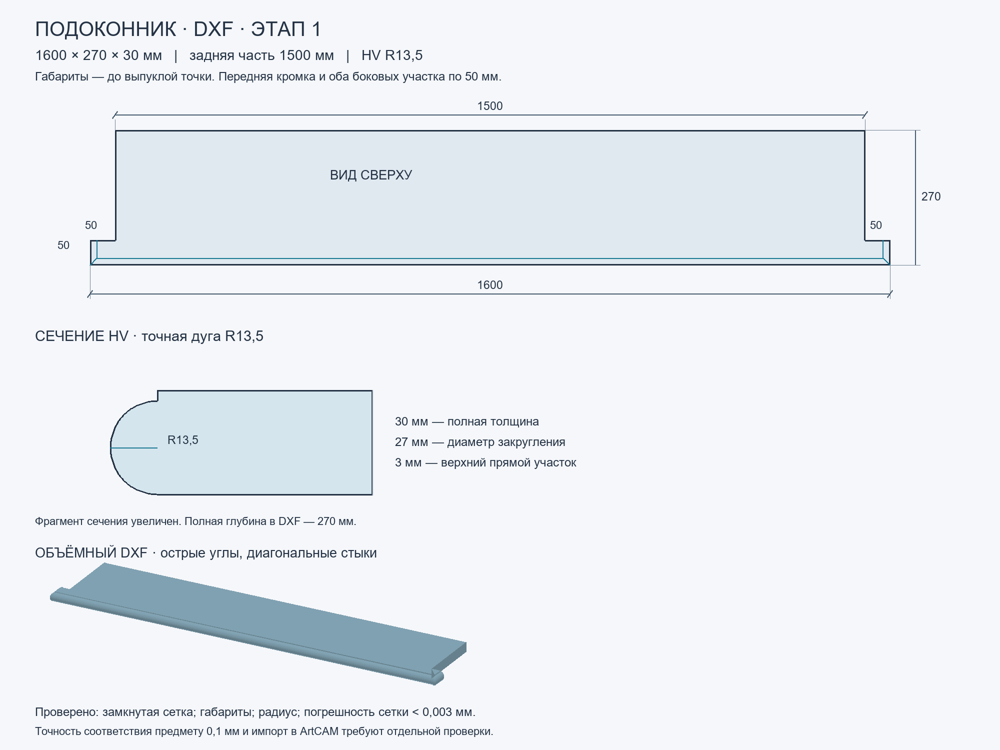
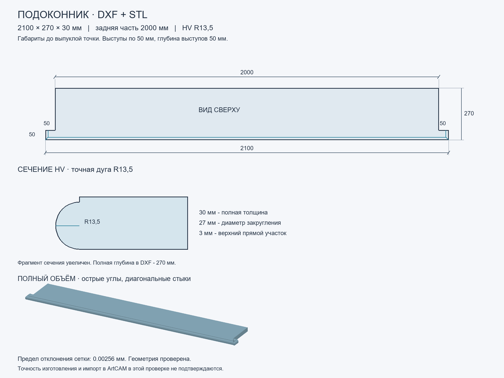
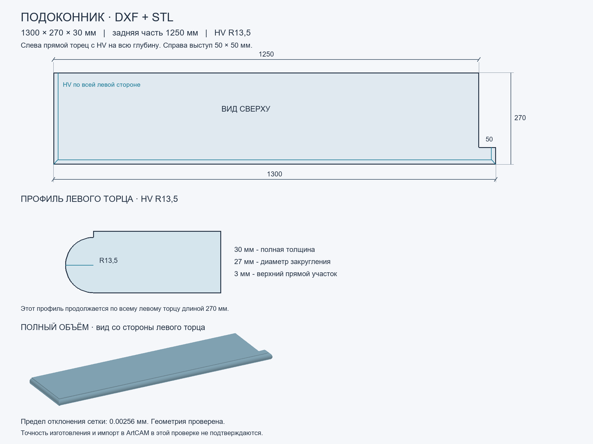

# Каталог подоконников Parad — PARAD-002, PARAD-003, PARAD-004

Выборка из CATALOG_PARAD.md от 26.09.2026. Основной каталог не изменён. Сохранены описания, история, STEP и проверочные УП трёх проектов. PARAD-004: актуальная длина 1280 мм; 1300 мм — архив. Видимые пути папок приведены от \Jenja\.

<!-- entry -->

## PARAD-002 — Подоконник 1600 × 270 × 30 мм

**Дата папки out1:** 12.09.2026 17:22:43. **Дата работы:** 12.09.2026. Папка out переименована пользователем в out1; ссылки описания исправлены 13.09.2026.

**Первая постановка:** по фотографиям с размерами получить внешний контур и объёмный рельеф для ArtCAM 2018; на первом этапе — DXF. Позже отдельно разрешён один STL полной детали из объёмного DXF.

**Объект и размеры:** 1600 × 270 × 30 мм; задняя ширина 1500 мм; выступы с обеих сторон 50 × 50 мм. HV R13,5 по передней кромке и двум боковым участкам по 50 мм; верхний прямой участок 3 мм. Передние углы острые, стыки диагональные. Размеры заданы до выпуклой точки профиля.

**Вход:** фотография с размерными надписями, схема вида сверху и спереди, текстовые уточнения профиля и углов; текущая папка in1.

**Технология:** построение геометрии по заданным размерам средствами Python/ezdxf; точные дуги профиля и объёмная сетка 3DFACE; преобразование сетки DXF в STL без изменения формы.

**Выход:** четыре DXF — размерный лист, контур, сечение и объём; один STL; PNG/SVG, отчёты проверок, промпт, README и PDF.

**Проверка:** DXF прочитаны без ошибок; STL замкнут, один компонент, 1564 треугольника; габариты подтверждены. Импорт ArtCAM и соответствие физическому изделию с точностью 0,1 мм не подтверждены. Полная приёмка не зафиксирована. Ранний PDF описывает этап DXF; сведения о последующем STL подтверждены файлом и отчётом конвертации.

**Можно повторить:** построение HV по размерам и преобразование DXF → STL. **Поиск:** подоконник, HV, R13,5, два выступа, фото с размерами, ArtCAM, DXF, STL.

**Материалы:** [Папка](stone_project/artifacts/09122026/out1/) · [Входные файлы](stone_project/artifacts/09122026/in1/) · [PDF](stone_project/artifacts/09122026/out1/project_overview.pdf) · [STL](stone_project/artifacts/09122026/out1/sill_volume_mm.stl) · [Промпт первого этапа](stone_project/artifacts/09122026/stage1_reusable_prompt.md) · [Отчёт STL](stone_project/artifacts/09122026/work/stl_verification.json).

**Материалы — папки от \Jenja\:**

[\Jenja\stone_project\artifacts\09122026\out1](stone_project/artifacts/09122026/out1/) — Папка, PDF, STL.

[\Jenja\stone_project\artifacts\09122026\in1](stone_project/artifacts/09122026/in1/) — Входные файлы.

[\Jenja\stone_project\artifacts\09122026](stone_project/artifacts/09122026/) — Промпт первого этапа.

[\Jenja\stone_project\artifacts\09122026\work](stone_project/artifacts/09122026/work/) — Отчёт STL.

**PARAD-006 — Дополнение к PARAD-002: перенос в SOLIDWORKS 2016**

**Дата дополнения:** 23.09.2026. **Связанная работа:** PARAD-002, подоконник в out1. Запись добавлена по прямому запросу пользователя; первоначальное описание сохранено.

**Постановка дополнения:** подготовить STL и файл для SOLIDWORKS 2016. Пользователь выбрала STEP для открытия и сохранения в этой версии, затем попросила сохранить удачный способ для других проектов.

**Объект и размеры:** прежний подоконник 1600 × 270 × 30 мм, два выступа 50 × 50 мм, HV R13,5. Геометрия не менялась.

**Вход:** ранее созданный бинарный sill_volume_mm.stl; один замкнутый компонент, 1564 треугольника, миллиметры.

**Технология:** STL → твёрдый BREP с плоскими гранями → STEP AP214. Проверка чтением, пересохранением и повторным чтением в OpenCASCADE через Gmsh. Способ и общий скрипт сохранены отдельно; размеры, форма и пути задаются заново. Установленные зависимости используются повторно.

**Выход и проверка:** существующий STL повторно проверен; создан STEP с одним твёрдым телом и 1564 гранями. Габариты и объём совпадают с STL; объём около 12 100 123,121 мм³. Сохранены инструкция и отчёт проверок. Исходные DXF и STL не изменены.

**Статус:** STEP проверен в OpenCASCADE. Открытие финального STEP в SOLIDWORKS 2016 пока не проверено; SLDPRT 2016 ещё не создан. Его нужно сохранить из STEP в самой версии 2016. Гранёная аппроксимация профиля сохранена, параметрическое дерево не создавалось. Старый PDF проекта описывает прежний этап; новые сведения находятся в этом дополнении и инструкции.

**Можно повторить:** перенос готового замкнутого STL одной детали в STEP AP214 без изменения формы. **Поиск:** SOLIDWORKS 2016, STEP, AP214, STL, BREP, OpenCASCADE, перенос CAD, подоконник.

**Материалы:** [Папка](stone_project/artifacts/09122026/out1/) · [STL](stone_project/artifacts/09122026/out1/sill_volume_mm.stl) · [STEP](stone_project/artifacts/09122026/out1/sill_1600x270x30_HV_SW2016.step) · [Отчёт](stone_project/artifacts/09122026/out1/solidworks_exchange_verification.json) · [Инструкция детали](stone_project/artifacts/09122026/out1/SOLIDWORKS_2016_README.md) · [PDF прежнего этапа](stone_project/artifacts/09122026/out1/project_overview.pdf) · [Повторяемый способ](solidworks_2016_workflow.md) · [Скрипт](stl_to_step_ap214.py).

**Материалы — папки от \Jenja\:**

[\Jenja\stone_project\artifacts\09122026\out1](stone_project/artifacts/09122026/out1/) — Папка, STL, STEP, Отчёт, Инструкция детали, PDF прежнего этапа.

[\Jenja](./) — Повторяемый способ, Скрипт.

**PARAD-011 — PARAD-002: подготовка УП к проверке без резания**

**Дата комплекта:** 25.09.2026. **Добавлено:** 26.09.2026. **Связь:** PARAD-002.

**Первая постановка:** рассчитать траектории ДВП, PCD, HV черновой и чистовой обработки и подготовить проверочный комплект «УП без резания» для этого подоконника.

**Размеры:** 1600 × 270 × 30 мм; два выступа 50 × 50 мм. Длина вдоль Y, глубина вдоль X. Для PARAD-004 актуальны 1280 мм, прежние 1300 мм только в архиве.

**Вход и технология:** геометрия изделия и сохранённые решения PARAD-002; расчёт осевых траекторий и XYZ-переходов скриптами, отдельная генерация проверочных NC и повторное чтение. Скрипты каждого проекта сохранены в собственной cnc/scripts; исходные CAD сохранены.

**Выход:** четыре AIR_XY NC — ДВП, PCD, HV черновая и чистовая; DXF контуров, рабочих осей и полных движений XYZ, JSON, таблицы координат и времени, параметры, черновики постпроцессоров, README и PDF. Папки out1/cnc и out2/cnc приведены к однотипной организации; прежний postprocessor/parad002 сохранён для истории.

**Проверка и статус:** расчётные проверки и PDF выполнены; физический запуск не подтверждён. AIR_XY не включает шпиндель и держит постоянный безопасный Z: ДВП +45 от стола, PCD +40 от верха камня, HV +70 от низа камня. Это не режущие УП и не проверка рабочих спусков. Внутренние R2 лекал приняты без ручной доводки. Последующие режущие NC ДВП двух листов — PARAD-015.

**Материалы:** [PDF для инженера](stone_project/artifacts/09122026/out1/cnc/project_overview.pdf) · [README](stone_project/artifacts/09122026/out1/cnc/README.md) · [Четыре NC без резания](stone_project/artifacts/09122026/out1/cnc/nc_air_xy/) · [Все DXF](stone_project/artifacts/09122026/out1/cnc/geometry/) · [Параметры, координаты и проверки](stone_project/artifacts/09122026/out1/cnc/data/) · [Скрипты](stone_project/artifacts/09122026/out1/cnc/scripts/) · [Постпроцессоры](stone_project/artifacts/09122026/out1/cnc/postprocessors/) · [CAD изделия](stone_project/artifacts/09122026/out1/).

**Материалы — папки от \Jenja\:**

[\Jenja\stone_project\artifacts\09122026\out1\cnc](stone_project/artifacts/09122026/out1/cnc/) — PDF для инженера, README.

[\Jenja\stone_project\artifacts\09122026\out1\cnc\nc_air_xy](stone_project/artifacts/09122026/out1/cnc/nc_air_xy/) — Четыре NC без резания.

[\Jenja\stone_project\artifacts\09122026\out1\cnc\geometry](stone_project/artifacts/09122026/out1/cnc/geometry/) — Все DXF.

[\Jenja\stone_project\artifacts\09122026\out1\cnc\data](stone_project/artifacts/09122026/out1/cnc/data/) — Параметры, координаты и проверки.

[\Jenja\stone_project\artifacts\09122026\out1\cnc\scripts](stone_project/artifacts/09122026/out1/cnc/scripts/) — Скрипты.

[\Jenja\stone_project\artifacts\09122026\out1\cnc\postprocessors](stone_project/artifacts/09122026/out1/cnc/postprocessors/) — Постпроцессоры.

[\Jenja\stone_project\artifacts\09122026\out1](stone_project/artifacts/09122026/out1/) — CAD изделия.

**Поиск:** PARAD-002, 1600, подоконник, УП без резания, AIR_XY, DXF XYZ, ДВП, PCD, HV, проверка траектории.

**Таблица всех файлов проекта**

Все 50 файлов папки \Jenja\stone_project\artifacts\09122026\out1. В таблице указан путь внутри этой папки; каждое имя — ссылка на файл. Снимок состава от 26.09.2026.

| Файл / путь внутри папки проекта | Назначение |
| --- | --- |
| [cnc/data/dvp_holes.csv](stone_project/artifacts/09122026/out1/cnc/data/dvp_holes.csv) | Координаты центров отверстий Ø8 для входа фрезы ДВП. |
| [cnc/data/geometry_verification.json](stone_project/artifacts/09122026/out1/cnc/data/geometry_verification.json) | Отчёт расчётной проверки геометрии и траекторий. |
| [cnc/data/inputs_manifest.json](stone_project/artifacts/09122026/out1/cnc/data/inputs_manifest.json) | Перечень исходных файлов и контрольные сведения. |
| [cnc/data/nc_readback_verification.json](stone_project/artifacts/09122026/out1/cnc/data/nc_readback_verification.json) | Результаты повторного чтения и проверки записанных NC. |
| [cnc/data/paths_working_coordinates.csv](stone_project/artifacts/09122026/out1/cnc/data/paths_working_coordinates.csv) | Таблица координат рабочих проходов инструмента. |
| [cnc/data/planned_3d_motion.json](stone_project/artifacts/09122026/out1/cnc/data/planned_3d_motion.json) | Полная последовательность расчётных движений XYZ. |
| [cnc/data/run_parameters.json](stone_project/artifacts/09122026/out1/cnc/data/run_parameters.json) | Размеры, режимы и параметры этого запуска. |
| [cnc/data/tabs.json](stone_project/artifacts/09122026/out1/cnc/data/tabs.json) | Положение и геометрия перемычек лекала. |
| [cnc/data/time_estimates.json](stone_project/artifacts/09122026/out1/cnc/data/time_estimates.json) | Расчёт длительности траекторий и принятые допущения. |
| [cnc/data/toolpaths.json](stone_project/artifacts/09122026/out1/cnc/data/toolpaths.json) | Расчётные рабочие участки траекторий по операциям. |
| [cnc/geometry/01_dvp_center_paths.dxf](stone_project/artifacts/09122026/out1/cnc/geometry/01_dvp_center_paths.dxf) | ДВП: оси фрезы на рабочих проходах, DXF. Это траектории инструмента, не контур детали. |
| [cnc/geometry/01_dvp_planned_3d_motion.dxf](stone_project/artifacts/09122026/out1/cnc/geometry/01_dvp_planned_3d_motion.dxf) | ДВП: полные расчётные перемещения XYZ, рабочие и холостые, DXF. |
| [cnc/geometry/02_pcd_center_paths.dxf](stone_project/artifacts/09122026/out1/cnc/geometry/02_pcd_center_paths.dxf) | PCD: оси фрезы на рабочих проходах, DXF. Это траектории инструмента, не контур детали. |
| [cnc/geometry/02_pcd_planned_3d_motion.dxf](stone_project/artifacts/09122026/out1/cnc/geometry/02_pcd_planned_3d_motion.dxf) | PCD: полные расчётные перемещения XYZ, рабочие и холостые, DXF. |
| [cnc/geometry/03_hv_rough_center_paths.dxf](stone_project/artifacts/09122026/out1/cnc/geometry/03_hv_rough_center_paths.dxf) | HV, черновая: оси фрезы на рабочих проходах, DXF. Это траектории инструмента, не контур детали. |
| [cnc/geometry/03_hv_rough_planned_3d_motion.dxf](stone_project/artifacts/09122026/out1/cnc/geometry/03_hv_rough_planned_3d_motion.dxf) | HV, черновая: полные расчётные перемещения XYZ, рабочие и холостые, DXF. |
| [cnc/geometry/04_hv_finish_center_paths.dxf](stone_project/artifacts/09122026/out1/cnc/geometry/04_hv_finish_center_paths.dxf) | HV, чистовая: оси фрезы на рабочих проходах, DXF. Это траектории инструмента, не контур детали. |
| [cnc/geometry/04_hv_finish_planned_3d_motion.dxf](stone_project/artifacts/09122026/out1/cnc/geometry/04_hv_finish_planned_3d_motion.dxf) | HV, чистовая: полные расчётные перемещения XYZ, рабочие и холостые, DXF. |
| [cnc/geometry/dvp_contour_R2_Y1600.dxf](stone_project/artifacts/09122026/out1/cnc/geometry/dvp_contour_R2_Y1600.dxf) | Контур лекала ДВП с принятыми внутренними R2, длина вдоль Y. |
| [cnc/geometry/dvp_sheet_holes_tabs.dxf](stone_project/artifacts/09122026/out1/cnc/geometry/dvp_sheet_holes_tabs.dxf) | Раскладка лекала ДВП на листе, отверстия входа и перемычки. |
| [cnc/geometry/part_contours_Y1600.dxf](stone_project/artifacts/09122026/out1/cnc/geometry/part_contours_Y1600.dxf) | Контуры изделия в системе координат станка, длина вдоль Y. |
| [cnc/geometry/stone_contour_Y1600.dxf](stone_project/artifacts/09122026/out1/cnc/geometry/stone_contour_Y1600.dxf) | Замкнутый контур каменной детали, длина вдоль Y. |
| [cnc/nc_air_xy/01_dvp_AIR_XY.nc](stone_project/artifacts/09122026/out1/cnc/nc_air_xy/01_dvp_AIR_XY.nc) | ДВП: проверка XY без резания и вращения шпинделя; постоянная безопасная высота. Не режущая УП. |
| [cnc/nc_air_xy/02_pcd_AIR_XY.nc](stone_project/artifacts/09122026/out1/cnc/nc_air_xy/02_pcd_AIR_XY.nc) | PCD: проверка XY без резания и вращения шпинделя; постоянная безопасная высота. Не режущая УП. |
| [cnc/nc_air_xy/03_hv_rough_AIR_XY.nc](stone_project/artifacts/09122026/out1/cnc/nc_air_xy/03_hv_rough_AIR_XY.nc) | HV, черновая: проверка XY без резания и вращения шпинделя; постоянная безопасная высота. Не режущая УП. |
| [cnc/nc_air_xy/04_hv_finish_AIR_XY.nc](stone_project/artifacts/09122026/out1/cnc/nc_air_xy/04_hv_finish_AIR_XY.nc) | HV, чистовая: проверка XY без резания и вращения шпинделя; постоянная безопасная высота. Не режущая УП. |
| [cnc/postprocessors/PARAD_A11_REVIEW_CAM_FS_HOME.con](stone_project/artifacts/09122026/out1/cnc/postprocessors/PARAD_A11_REVIEW_CAM_FS_HOME.con) | Черновик постпроцессора ArtCAM: F/S из CAM; возврат в рабочий XY0. Экспортом ArtCAM не проверен. |
| [cnc/postprocessors/PARAD_A11_REVIEW_CAM_FS_STAY.con](stone_project/artifacts/09122026/out1/cnc/postprocessors/PARAD_A11_REVIEW_CAM_FS_STAY.con) | Черновик постпроцессора ArtCAM: F/S из CAM; остаться в точке завершения. Экспортом ArtCAM не проверен. |
| [cnc/project_overview.pdf](stone_project/artifacts/09122026/out1/cnc/project_overview.pdf) | PDF-обзор траекторий и комплекта проверки без резания. |
| [cnc/README.md](stone_project/artifacts/09122026/out1/cnc/README.md) | Состав проверочного CNC-комплекта и порядок его применения. |
| [cnc/scripts/build_parad002_cnc.py](stone_project/artifacts/09122026/out1/cnc/scripts/build_parad002_cnc.py) | Скрипт построения траекторий и проверочного CNC-комплекта. |
| [cnc/scripts/document_parad002_cnc.py](stone_project/artifacts/09122026/out1/cnc/scripts/document_parad002_cnc.py) | Скрипт формирования PDF-обзора. |
| [cnc/scripts/README.md](stone_project/artifacts/09122026/out1/cnc/scripts/README.md) | Описание скриптов и условий повторного запуска. |
| [cnc/scripts/requirements.txt](stone_project/artifacts/09122026/out1/cnc/scripts/requirements.txt) | Перечень Python-зависимостей для запуска скриптов. |
| [cnc/scripts/verify_parad002_nc.py](stone_project/artifacts/09122026/out1/cnc/scripts/verify_parad002_nc.py) | Скрипт повторного чтения и проверки NC. |
| [Podoconnik 1 step STL.md](stone_project/artifacts/09122026/out1/Podoconnik%201%20step%20STL.md) | Сохранённый промпт для повторения построения подоконника. |
| [project_overview.pdf](stone_project/artifacts/09122026/out1/project_overview.pdf) | PDF-обзор геометрии, размеров и результатов проекта. |
| [README.md](stone_project/artifacts/09122026/out1/README.md) | Описание проекта, параметров, файлов и проверок. |
| [sill_1600x270x30_HV_SW2016.step](stone_project/artifacts/09122026/out1/sill_1600x270x30_HV_SW2016.step) | Твёрдотельная обменная модель STEP AP214 для открытия в SOLIDWORKS 2016. Не нативный SLDPRT. |
| [sill_contour_1600x270_mm.dxf](stone_project/artifacts/09122026/out1/sill_contour_1600x270_mm.dxf) | Плоский внешний контур изделия в миллиметрах. |
| [sill_drawing.png](stone_project/artifacts/09122026/out1/sill_drawing.png) | Изображение чертежа с размерами. Растровый PNG. |
| [sill_drawing.svg](stone_project/artifacts/09122026/out1/sill_drawing.svg) | Изображение чертежа с размерами. Векторный SVG. |
| [sill_drawing_mm.dxf](stone_project/artifacts/09122026/out1/sill_drawing_mm.dxf) | Чертёж изделия с размерами и видами. |
| [sill_preview.png](stone_project/artifacts/09122026/out1/sill_preview.png) | Изображение обзора формы и объёма. Растровый PNG. |
| [sill_section_HV_R13p5_mm.dxf](stone_project/artifacts/09122026/out1/sill_section_HV_R13p5_mm.dxf) | Сечение профиля HV, размерная геометрия. |
| [sill_volume_3d_mm.dxf](stone_project/artifacts/09122026/out1/sill_volume_3d_mm.dxf) | Объёмная поверхность полной детали в DXF, сетка 3DFACE. |
| [sill_volume_mm.stl](stone_project/artifacts/09122026/out1/sill_volume_mm.stl) | Треугольная объёмная модель всей детали в миллиметрах. |
| [SOLIDWORKS_2016_README.md](stone_project/artifacts/09122026/out1/SOLIDWORKS_2016_README.md) | Инструкция: открыть STEP в SOLIDWORKS 2016 и сохранить SLDPRT. |
| [solidworks_exchange_verification.json](stone_project/artifacts/09122026/out1/solidworks_exchange_verification.json) | Отчёт проверки переноса модели в STEP. |
| [verification.json](stone_project/artifacts/09122026/out1/verification.json) | Отчёт проверки цифровой геометрии проекта. |

**Связанные файлы вне папки проекта**

Пути от \Jenja\; эти файлы сохранены в общих папках или архиве.

| Файл / путь от Jenja | Назначение |
| --- | --- |
| [solidworks_2016_workflow.md](solidworks_2016_workflow.md) | Повторяемый алгоритм переноса STL в STEP для SOLIDWORKS 2016. |
| [stl_to_step_ap214.py](stl_to_step_ap214.py) | Общий конвертер STL в твёрдое тело STEP AP214. |
| [stone_project/artifacts/09122026/stage1_reusable_prompt.md](stone_project/artifacts/09122026/stage1_reusable_prompt.md) | Повторяемый промпт первого этапа построения по новым исходным данным. |
| [stone_project/artifacts/09122026/work/stl_verification.json](stone_project/artifacts/09122026/work/stl_verification.json) | Отчёт проверки STL. |
<!-- entry -->

## PARAD-003 — Подоконник 2100 × 270 × 30 мм

**Дата папки out2:** 12.09.2026 22:13:04. **Дата работы:** 12.09.2026.

**Первая постановка:** выполнить «Podoconnik 1 step STL» для L=2100, D=270 мм с сохранением согласованной формы и фиксированной толщины 30 мм.

**Объект и размеры:** 2100 × 270 × 30 мм; задняя ширина 2000 мм; два выступа 50 × 50 мм. HV R13,5 по передней кромке и боковым участкам по 50 мм. Острые углы и диагональные стыки профилей.

**Вход:** сохранённый параметрический промпт и размеры L × D, заданные текстом; форма профиля и выступов взята из согласованного шаблона.

**Технология:** параметрическое перестроение по длине и глубине без масштабирования профиля; Python/ezdxf, аналитические дуги и сетка 3DFACE; повторное чтение объёмного DXF для записи STL.

**Выход:** четыре DXF, один бинарный STL полной детали, PNG/SVG, параметры запуска и скрипты, отчёты проверок, README и PDF.

**Проверка:** габариты DXF и STL совпадают; один замкнутый компонент, 1564 треугольника. Суммарная оценка цифровой погрешности менее 0,00268 мм. Импорт в ArtCAM не проверен; результат передан на пользовательскую проверку.

**Можно повторить:** выпуск комплекта по новым L и D при фиксированном H=30 мм, HV и выступах; PDF после остальных файлов. **Поиск:** длинный подоконник, параметризация, HV, ArtCAM, DXF, STL, повторяемый промпт.

**Материалы:** [Папка](stone_project/artifacts/09122026/out2/) · [PDF](stone_project/artifacts/09122026/out2/project_overview.pdf) · [README](stone_project/artifacts/09122026/out2/README.md) · [STL](stone_project/artifacts/09122026/out2/podoconnik_volume_mm.stl) · [Параметры](stone_project/artifacts/09122026/out2/work/run_parameters.json) · [Промпт](stone_project/artifacts/09122026/out2/Podoconnik%201%20step%20STL.md).

**Материалы — папки от \Jenja\:**

[\Jenja\stone_project\artifacts\09122026\out2](stone_project/artifacts/09122026/out2/) — Папка, PDF, README, STL, Промпт.

[\Jenja\stone_project\artifacts\09122026\out2\work](stone_project/artifacts/09122026/out2/work/) — Параметры.

**PARAD-007 — Дополнение к PARAD-003: перенос в SOLIDWORKS 2016**

**Дата дополнения:** 23.09.2026. **Связанная работа:** PARAD-003, подоконник в out2. Добавлено по запросу пользователя с сохранением прежней записи.

**Постановка дополнения:** повторить сохранённый алгоритм подготовки файла для SOLIDWORKS 2016 для следующего подоконника, с результатами в out2.

**Объект и размеры:** 2100 × 270 × 30 мм; задняя ширина 2000 мм; два выступа 50 × 50 мм, профиль HV R13,5 и диагональные стыки. Форма и координаты сохранены.

**Вход:** готовый бинарный podoconnik_volume_mm.stl в миллиметрах; одна замкнутая согласованно ориентированная оболочка, 784 вершины, 1564 треугольника.

**Технология:** общий скрипт stl_to_step_ap214.py без изменений; STL → твёрдый BREP с плоскими гранями → STEP AP214. Чтение, пересохранение и повторное чтение через OpenCASCADE/Gmsh 4.15.2; повторная установка зависимостей не потребовалась.

**Выход и проверка:** STEP с одним твёрдым телом и 1564 гранями, отчёт JSON и инструкция. Габариты 2100 × 270 × 30 мм, объём 16 090 736,393 мм³; размеры и объём совпадают с STL в пределах допусков переноса. Контрольные суммы результата и неизменного исходника проверены.

**Статус:** нативный SLDPRT 2016 не создан. STEP следует открыть и сохранить как SLDPRT в самой SOLIDWORKS 2016; эта версия здесь недоступна, открытие в ней не проверено. Гранёная аппроксимация HV сохранена; аналитические поверхности и параметрическое дерево не восстанавливались. Прежние DXF, STL и PDF не менялись; PDF прежнего этапа дополняется этой записью и отдельной инструкцией.

**Можно повторить:** проверенный перенос готового STL одной детали в STEP AP214 с заданными новыми размерами. **Поиск:** SOLIDWORKS 2016, STEP, AP214, STL, BREP, OpenCASCADE, подоконник 2100, повторный запуск.

**Материалы:** [Папка](stone_project/artifacts/09122026/out2/) · [STL](stone_project/artifacts/09122026/out2/podoconnik_volume_mm.stl) · [STEP](stone_project/artifacts/09122026/out2/sill_2100x270x30_HV_SW2016.step) · [Отчёт](stone_project/artifacts/09122026/out2/sill_2100x270x30_HV_SW2016.verification.json) · [Инструкция](stone_project/artifacts/09122026/out2/SOLIDWORKS_2016_README.md) · [PDF прежнего этапа](stone_project/artifacts/09122026/out2/project_overview.pdf) · [Повторяемый способ](solidworks_2016_workflow.md) · [Скрипт](stl_to_step_ap214.py).

**Материалы — папки от \Jenja\:**

[\Jenja\stone_project\artifacts\09122026\out2](stone_project/artifacts/09122026/out2/) — Папка, STL, STEP, Отчёт, Инструкция, PDF прежнего этапа.

[\Jenja](./) — Повторяемый способ, Скрипт.

**PARAD-012 — PARAD-003: подготовка УП к проверке без резания**

**Дата комплекта:** 25.09.2026. **Добавлено:** 26.09.2026. **Связь:** PARAD-003.

**Первая постановка:** рассчитать траектории ДВП, PCD, HV черновой и чистовой обработки и подготовить проверочный комплект «УП без резания» для этого подоконника.

**Размеры:** 2100 × 270 × 30 мм; два выступа 50 × 50 мм. Длина вдоль Y, глубина вдоль X. Для PARAD-004 актуальны 1280 мм, прежние 1300 мм только в архиве.

**Вход и технология:** геометрия изделия и сохранённые решения PARAD-002; расчёт осевых траекторий и XYZ-переходов скриптами, отдельная генерация проверочных NC и повторное чтение. Скрипты каждого проекта сохранены в собственной cnc/scripts; исходные CAD сохранены.

**Выход:** четыре AIR_XY NC — ДВП, PCD, HV черновая и чистовая; DXF контуров, рабочих осей и полных движений XYZ, JSON, таблицы координат и времени, параметры, черновики постпроцессоров, README и PDF. Папки out1/cnc и out2/cnc приведены к однотипной организации; прежний postprocessor/parad002 сохранён для истории.

**Проверка и статус:** расчётные проверки и PDF выполнены; физический запуск не подтверждён. AIR_XY не включает шпиндель и держит постоянный безопасный Z: ДВП +45 от стола, PCD +40 от верха камня, HV +70 от низа камня. Это не режущие УП и не проверка рабочих спусков. Внутренние R2 лекал приняты без ручной доводки. Последующие режущие NC ДВП двух листов — PARAD-015.

**Материалы:** [PDF для инженера](stone_project/artifacts/09122026/out2/cnc/project_overview.pdf) · [README](stone_project/artifacts/09122026/out2/cnc/README.md) · [Четыре NC без резания](stone_project/artifacts/09122026/out2/cnc/nc_air_xy/) · [Все DXF](stone_project/artifacts/09122026/out2/cnc/geometry/) · [Параметры, координаты и проверки](stone_project/artifacts/09122026/out2/cnc/data/) · [Скрипты](stone_project/artifacts/09122026/out2/cnc/scripts/) · [Постпроцессоры](stone_project/artifacts/09122026/out2/cnc/postprocessors/) · [CAD изделия](stone_project/artifacts/09122026/out2/).

**Материалы — папки от \Jenja\:**

[\Jenja\stone_project\artifacts\09122026\out2\cnc](stone_project/artifacts/09122026/out2/cnc/) — PDF для инженера, README.

[\Jenja\stone_project\artifacts\09122026\out2\cnc\nc_air_xy](stone_project/artifacts/09122026/out2/cnc/nc_air_xy/) — Четыре NC без резания.

[\Jenja\stone_project\artifacts\09122026\out2\cnc\geometry](stone_project/artifacts/09122026/out2/cnc/geometry/) — Все DXF.

[\Jenja\stone_project\artifacts\09122026\out2\cnc\data](stone_project/artifacts/09122026/out2/cnc/data/) — Параметры, координаты и проверки.

[\Jenja\stone_project\artifacts\09122026\out2\cnc\scripts](stone_project/artifacts/09122026/out2/cnc/scripts/) — Скрипты.

[\Jenja\stone_project\artifacts\09122026\out2\cnc\postprocessors](stone_project/artifacts/09122026/out2/cnc/postprocessors/) — Постпроцессоры.

[\Jenja\stone_project\artifacts\09122026\out2](stone_project/artifacts/09122026/out2/) — CAD изделия.

**Поиск:** PARAD-003, 2100, подоконник, УП без резания, AIR_XY, DXF XYZ, ДВП, PCD, HV, проверка траектории.

**Таблица всех файлов проекта**

Все 56 файлов папки \Jenja\stone_project\artifacts\09122026\out2. В таблице указан путь внутри этой папки; каждое имя — ссылка на файл. Снимок состава от 26.09.2026.

| Файл / путь внутри папки проекта | Назначение |
| --- | --- |
| [cnc/data/dvp_holes.csv](stone_project/artifacts/09122026/out2/cnc/data/dvp_holes.csv) | Координаты центров отверстий Ø8 для входа фрезы ДВП. |
| [cnc/data/geometry_verification.json](stone_project/artifacts/09122026/out2/cnc/data/geometry_verification.json) | Отчёт расчётной проверки геометрии и траекторий. |
| [cnc/data/inputs_manifest.json](stone_project/artifacts/09122026/out2/cnc/data/inputs_manifest.json) | Перечень исходных файлов и контрольные сведения. |
| [cnc/data/nc_readback_verification.json](stone_project/artifacts/09122026/out2/cnc/data/nc_readback_verification.json) | Результаты повторного чтения и проверки записанных NC. |
| [cnc/data/original_parad002_hashes.json](stone_project/artifacts/09122026/out2/cnc/data/original_parad002_hashes.json) | Контрольные суммы исходного комплекта PARAD-002 для проверки неизменности. |
| [cnc/data/paths_working_coordinates.csv](stone_project/artifacts/09122026/out2/cnc/data/paths_working_coordinates.csv) | Таблица координат рабочих проходов инструмента. |
| [cnc/data/planned_3d_motion.json](stone_project/artifacts/09122026/out2/cnc/data/planned_3d_motion.json) | Полная последовательность расчётных движений XYZ. |
| [cnc/data/run_parameters.json](stone_project/artifacts/09122026/out2/cnc/data/run_parameters.json) | Размеры, режимы и параметры этого запуска. |
| [cnc/data/tabs.json](stone_project/artifacts/09122026/out2/cnc/data/tabs.json) | Положение и геометрия перемычек лекала. |
| [cnc/data/time_estimates.json](stone_project/artifacts/09122026/out2/cnc/data/time_estimates.json) | Расчёт длительности траекторий и принятые допущения. |
| [cnc/data/toolpaths.json](stone_project/artifacts/09122026/out2/cnc/data/toolpaths.json) | Расчётные рабочие участки траекторий по операциям. |
| [cnc/geometry/01_dvp_center_paths.dxf](stone_project/artifacts/09122026/out2/cnc/geometry/01_dvp_center_paths.dxf) | ДВП: оси фрезы на рабочих проходах, DXF. Это траектории инструмента, не контур детали. |
| [cnc/geometry/01_dvp_planned_3d_motion.dxf](stone_project/artifacts/09122026/out2/cnc/geometry/01_dvp_planned_3d_motion.dxf) | ДВП: полные расчётные перемещения XYZ, рабочие и холостые, DXF. |
| [cnc/geometry/02_pcd_center_paths.dxf](stone_project/artifacts/09122026/out2/cnc/geometry/02_pcd_center_paths.dxf) | PCD: оси фрезы на рабочих проходах, DXF. Это траектории инструмента, не контур детали. |
| [cnc/geometry/02_pcd_planned_3d_motion.dxf](stone_project/artifacts/09122026/out2/cnc/geometry/02_pcd_planned_3d_motion.dxf) | PCD: полные расчётные перемещения XYZ, рабочие и холостые, DXF. |
| [cnc/geometry/03_hv_rough_center_paths.dxf](stone_project/artifacts/09122026/out2/cnc/geometry/03_hv_rough_center_paths.dxf) | HV, черновая: оси фрезы на рабочих проходах, DXF. Это траектории инструмента, не контур детали. |
| [cnc/geometry/03_hv_rough_planned_3d_motion.dxf](stone_project/artifacts/09122026/out2/cnc/geometry/03_hv_rough_planned_3d_motion.dxf) | HV, черновая: полные расчётные перемещения XYZ, рабочие и холостые, DXF. |
| [cnc/geometry/04_hv_finish_center_paths.dxf](stone_project/artifacts/09122026/out2/cnc/geometry/04_hv_finish_center_paths.dxf) | HV, чистовая: оси фрезы на рабочих проходах, DXF. Это траектории инструмента, не контур детали. |
| [cnc/geometry/04_hv_finish_planned_3d_motion.dxf](stone_project/artifacts/09122026/out2/cnc/geometry/04_hv_finish_planned_3d_motion.dxf) | HV, чистовая: полные расчётные перемещения XYZ, рабочие и холостые, DXF. |
| [cnc/geometry/dvp_contour_R2_Y2100.dxf](stone_project/artifacts/09122026/out2/cnc/geometry/dvp_contour_R2_Y2100.dxf) | Контур лекала ДВП с принятыми внутренними R2, длина вдоль Y. |
| [cnc/geometry/dvp_sheet_holes_tabs.dxf](stone_project/artifacts/09122026/out2/cnc/geometry/dvp_sheet_holes_tabs.dxf) | Раскладка лекала ДВП на листе, отверстия входа и перемычки. |
| [cnc/geometry/part_contours_Y2100.dxf](stone_project/artifacts/09122026/out2/cnc/geometry/part_contours_Y2100.dxf) | Контуры изделия в системе координат станка, длина вдоль Y. |
| [cnc/geometry/stone_contour_Y2100.dxf](stone_project/artifacts/09122026/out2/cnc/geometry/stone_contour_Y2100.dxf) | Замкнутый контур каменной детали, длина вдоль Y. |
| [cnc/nc_air_xy/01_dvp_AIR_XY.nc](stone_project/artifacts/09122026/out2/cnc/nc_air_xy/01_dvp_AIR_XY.nc) | ДВП: проверка XY без резания и вращения шпинделя; постоянная безопасная высота. Не режущая УП. |
| [cnc/nc_air_xy/02_pcd_AIR_XY.nc](stone_project/artifacts/09122026/out2/cnc/nc_air_xy/02_pcd_AIR_XY.nc) | PCD: проверка XY без резания и вращения шпинделя; постоянная безопасная высота. Не режущая УП. |
| [cnc/nc_air_xy/03_hv_rough_AIR_XY.nc](stone_project/artifacts/09122026/out2/cnc/nc_air_xy/03_hv_rough_AIR_XY.nc) | HV, черновая: проверка XY без резания и вращения шпинделя; постоянная безопасная высота. Не режущая УП. |
| [cnc/nc_air_xy/04_hv_finish_AIR_XY.nc](stone_project/artifacts/09122026/out2/cnc/nc_air_xy/04_hv_finish_AIR_XY.nc) | HV, чистовая: проверка XY без резания и вращения шпинделя; постоянная безопасная высота. Не режущая УП. |
| [cnc/postprocessors/PARAD_A11_REVIEW_CAM_FS_HOME.con](stone_project/artifacts/09122026/out2/cnc/postprocessors/PARAD_A11_REVIEW_CAM_FS_HOME.con) | Черновик постпроцессора ArtCAM: F/S из CAM; возврат в рабочий XY0. Экспортом ArtCAM не проверен. |
| [cnc/postprocessors/PARAD_A11_REVIEW_CAM_FS_STAY.con](stone_project/artifacts/09122026/out2/cnc/postprocessors/PARAD_A11_REVIEW_CAM_FS_STAY.con) | Черновик постпроцессора ArtCAM: F/S из CAM; остаться в точке завершения. Экспортом ArtCAM не проверен. |
| [cnc/project_overview.pdf](stone_project/artifacts/09122026/out2/cnc/project_overview.pdf) | PDF-обзор траекторий и комплекта проверки без резания. |
| [cnc/README.md](stone_project/artifacts/09122026/out2/cnc/README.md) | Состав проверочного CNC-комплекта и порядок его применения. |
| [cnc/scripts/build_parad003_cnc.py](stone_project/artifacts/09122026/out2/cnc/scripts/build_parad003_cnc.py) | Скрипт построения траекторий и проверочного CNC-комплекта. |
| [cnc/scripts/document_parad003_cnc.py](stone_project/artifacts/09122026/out2/cnc/scripts/document_parad003_cnc.py) | Скрипт формирования PDF-обзора. |
| [cnc/scripts/requirements.txt](stone_project/artifacts/09122026/out2/cnc/scripts/requirements.txt) | Перечень Python-зависимостей для запуска скриптов. |
| [cnc/scripts/verify_parad003_nc.py](stone_project/artifacts/09122026/out2/cnc/scripts/verify_parad003_nc.py) | Скрипт повторного чтения и проверки NC. |
| [Podoconnik 1 step STL.md](stone_project/artifacts/09122026/out2/Podoconnik%201%20step%20STL.md) | Сохранённый промпт для повторения построения подоконника. |
| [podoconnik_contour_mm.dxf](stone_project/artifacts/09122026/out2/podoconnik_contour_mm.dxf) | Плоский внешний контур изделия в миллиметрах. |
| [podoconnik_drawing.png](stone_project/artifacts/09122026/out2/podoconnik_drawing.png) | Изображение чертежа с размерами. Растровый PNG. |
| [podoconnik_drawing.svg](stone_project/artifacts/09122026/out2/podoconnik_drawing.svg) | Изображение чертежа с размерами. Векторный SVG. |
| [podoconnik_drawing_mm.dxf](stone_project/artifacts/09122026/out2/podoconnik_drawing_mm.dxf) | Чертёж изделия с размерами и видами. |
| [podoconnik_preview.png](stone_project/artifacts/09122026/out2/podoconnik_preview.png) | Изображение обзора формы и объёма. Растровый PNG. |
| [podoconnik_section_HV_mm.dxf](stone_project/artifacts/09122026/out2/podoconnik_section_HV_mm.dxf) | Сечение профиля HV, размерная геометрия. |
| [podoconnik_volume_3d_mm.dxf](stone_project/artifacts/09122026/out2/podoconnik_volume_3d_mm.dxf) | Объёмная поверхность полной детали в DXF, сетка 3DFACE. |
| [podoconnik_volume_mm.stl](stone_project/artifacts/09122026/out2/podoconnik_volume_mm.stl) | Треугольная объёмная модель всей детали в миллиметрах. |
| [project_overview.pdf](stone_project/artifacts/09122026/out2/project_overview.pdf) | PDF-обзор геометрии, размеров и результатов проекта. |
| [README.md](stone_project/artifacts/09122026/out2/README.md) | Описание проекта, параметров, файлов и проверок. |
| [sill_2100x270x30_HV_SW2016.step](stone_project/artifacts/09122026/out2/sill_2100x270x30_HV_SW2016.step) | Твёрдотельная обменная модель STEP AP214 для открытия в SOLIDWORKS 2016. Не нативный SLDPRT. |
| [sill_2100x270x30_HV_SW2016.verification.json](stone_project/artifacts/09122026/out2/sill_2100x270x30_HV_SW2016.verification.json) | Отчёт проверки переноса модели в STEP. |
| [SOLIDWORKS_2016_README.md](stone_project/artifacts/09122026/out2/SOLIDWORKS_2016_README.md) | Инструкция: открыть STEP в SOLIDWORKS 2016 и сохранить SLDPRT. |
| [verification.json](stone_project/artifacts/09122026/out2/verification.json) | Отчёт проверки цифровой геометрии проекта. |
| [work/build_podoconnik.py](stone_project/artifacts/09122026/out2/work/build_podoconnik.py) | Скрипт построения геометрии подоконника. |
| [work/build_project_pdf.py](stone_project/artifacts/09122026/out2/work/build_project_pdf.py) | Скрипт формирования PDF-обзора. |
| [work/convert_podoconnik_stl.py](stone_project/artifacts/09122026/out2/work/convert_podoconnik_stl.py) | Скрипт преобразования объёмной модели DXF в STL. |
| [work/requirements.txt](stone_project/artifacts/09122026/out2/work/requirements.txt) | Перечень Python-зависимостей для запуска скриптов. |
| [work/run_parameters.json](stone_project/artifacts/09122026/out2/work/run_parameters.json) | Размеры, режимы и параметры этого запуска. |
| [work/stl_verification.json](stone_project/artifacts/09122026/out2/work/stl_verification.json) | Отчёт проверки STL. |

**Связанные файлы вне папки проекта**

Пути от \Jenja\; эти файлы сохранены в общих папках или архиве.

| Файл / путь от Jenja | Назначение |
| --- | --- |
| [solidworks_2016_workflow.md](solidworks_2016_workflow.md) | Повторяемый алгоритм переноса STL в STEP для SOLIDWORKS 2016. |
| [stl_to_step_ap214.py](stl_to_step_ap214.py) | Общий конвертер STL в твёрдое тело STEP AP214. |
<!-- entry -->

## PARAD-004 — Подоконник с прямым левым торцом: 1280 мм

**Актуальная версия:** 1280 × 270 × 30 мм, описана ниже в дополнении PARAD-008. Следующее первоначальное описание относится к архиву 1300 мм.

**Дата папки out3:** 12.09.2026 22:41:34. **Дата работы:** 12.09.2026.

**Первая постановка:** создать вариант «Podoconnik 1 step STL - 3», продлив профиль HV на всю левую сторону при взгляде с длинной профилированной стороны. Затем уточнено: левый торец прямой, без выемки; запуск 1300 × 270 × 30 мм.

**Объект и размеры:** 1300 × 270 × 30 мм; задняя ширина 1250 мм. Слева нет выемки, HV проходит по всей глубине 270 мм. Справа сохранён выступ 50 × 50 мм и профиль на участке 50 мм; передняя кромка HV R13,5. Передние углы острые, соединение профилей диагональное.

**Вход:** базовый промпт подоконника, референс с размерами и текстовые уточнения левой стороны, профиля и размеров нового запуска. Параметры сохранены в work/run_parameters.json.

**Технология:** параметрическое изменение топологии контура и построение полного объёма с профилем по трём участкам; Python/ezdxf, 3DFACE → STL; отдельная проверка сечений левого торца.

**Выход:** четыре DXF, один STL, изображения PNG/SVG, скрипты и параметры, проверки, README и PDF.

**Проверка:** 1300 × 270 × 30 мм; один замкнутый компонент, 1172 треугольника; оценка цифровой погрешности менее 0,002615 мм. Профиль слева проверен в нескольких сечениях. Импорт в ArtCAM не проверен; результат передан на пользовательскую проверку.

**Можно повторить:** асимметричный подоконник с полным профилем торца. **Поиск:** левый торец, без выемки, асимметрия, HV, R13,5, подоконник, DXF, STL.

**Материалы прежней версии 1300 мм:** [Весь комплект ZIP](stone_project/artifacts/09122026/out3_1300_before_1280_20260923.zip) · [PDF](stone_project/artifacts/09122026/out3_1300_project_overview.pdf). STL, README, параметры и промпт прежней версии находятся внутри ZIP. Ссылки исправлены 23.09.2026 при архивировании; пересчёт на 1280 мм описан в PARAD-008.

**Материалы — папки от \Jenja\:**

[\Jenja\stone_project\artifacts\09122026](stone_project/artifacts/09122026/) — Весь комплект ZIP, PDF.

**PARAD-008 — PARAD-004: пересчёт длины 1300 → 1280 мм**

**Дата изменения:** 23.09.2026. **Связанная работа:** PARAD-004, out3. Старая версия сохранена в ZIP перед заменой файлов.

**Постановка:** полностью пересчитать комплект и документы при уменьшении длины с 1300 до 1280 мм; архивировать всю out3 и добавить STEP для SOLIDWORKS 2016.

**Размеры и форма:** 1280 × 270 × 30 мм; задняя ширина 1230 мм. Слева прямой торец с HV по всей глубине 270 мм, справа выступ 50 × 50 мм. HV R13,5 по передней кромке, слева и на правом участке 50 мм; острые углы с диагональными стыками сохранены.

**Вход:** прежняя параметрическая модель, новый размерный эскиз и подтверждение пользователя, что меняется только длина. Старый комплект 1300 мм: ZIP из 18 файлов с проверкой CRC и SHA-256. Исторические ссылки PARAD-004 переведены на архивные материалы.

**Технология:** новое построение DXF по параметрам, повторное чтение 3DFACE и запись STL, затем твёрдый BREP → STEP AP214 через сохранённый конвертер и OpenCASCADE. Документы и изображения обновлены; PDF сформирован после остальных файлов.

**Выход и проверка:** четыре DXF, один STL, STEP, PNG/SVG, отчёты, параметры, скрипты, промпт, README и PDF. Один замкнутый компонент, 1172 треугольника; STEP содержит одно твёрдое тело. Габариты подтверждены, площадь контура 334600 мм², объём STL около 9 850 000,467 мм³. Левый HV проверен при Y=72, 160 и 259 мм. Суммарная оценка цифрового отклонения менее 0,002615 мм.

**Статус:** импорт в ArtCAM и открытие STEP в SOLIDWORKS 2016 не проверены. SLDPRT 2016 нужно сохранить в самой версии 2016; нативный файл не создан. Гранёная аппроксимация профиля сохранена. Комплект передан на пользовательскую проверку.

**Можно повторить:** изменение длины асимметричного подоконника с архивированием прежней версии и подготовкой STEP. **Поиск:** 1280, 1230, прямой левый торец, HV, пересчёт, ZIP, DXF, STL, STEP, SOLIDWORKS 2016.

**Материалы:** [Папка](stone_project/artifacts/09122026/out3/) · [PDF](stone_project/artifacts/09122026/out3/project_overview.pdf) · [README](stone_project/artifacts/09122026/out3/README.md) · [STL](stone_project/artifacts/09122026/out3/podoconnik_volume_mm.stl) · [STEP](stone_project/artifacts/09122026/out3/sill_1280x270x30_HV_SW2016.step) · [Отчёт STEP](stone_project/artifacts/09122026/out3/sill_1280x270x30_HV_SW2016.verification.json) · [Архив 1300 мм](stone_project/artifacts/09122026/out3_1300_before_1280_20260923.zip) · [Общий алгоритм](solidworks_2016_workflow.md).

**Материалы — папки от \Jenja\:**

[\Jenja\stone_project\artifacts\09122026\out3](stone_project/artifacts/09122026/out3/) — Папка, PDF, README, STL, STEP, Отчёт STEP.

[\Jenja\stone_project\artifacts\09122026](stone_project/artifacts/09122026/) — Архив 1300 мм.

[\Jenja](./) — Общий алгоритм.

**PARAD-013 — PARAD-004: подготовка УП к проверке без резания**

**Дата комплекта:** 25.09.2026. **Добавлено:** 26.09.2026. **Связь:** PARAD-004 и PARAD-008.

**Первая постановка:** рассчитать траектории ДВП, PCD, HV черновой и чистовой обработки и подготовить проверочный комплект «УП без резания» для этого подоконника.

**Размеры:** 1280 × 270 × 30 мм; прямой левый торец с HV по всей глубине, один правый выступ. Длина вдоль Y, глубина вдоль X. Для PARAD-004 актуальны 1280 мм, прежние 1300 мм только в архиве.

**Вход и технология:** геометрия изделия и сохранённые решения PARAD-002; расчёт осевых траекторий и XYZ-переходов скриптами, отдельная генерация проверочных NC и повторное чтение. Скрипты каждого проекта сохранены в собственной cnc/scripts; исходные CAD сохранены.

**Выход:** четыре AIR_XY NC — ДВП, PCD, HV черновая и чистовая; DXF контуров, рабочих осей и полных движений XYZ, JSON, таблицы координат и времени, параметры, черновики постпроцессоров, README и PDF. Папки out1/cnc и out2/cnc приведены к однотипной организации; прежний postprocessor/parad002 сохранён для истории.

**Проверка и статус:** расчётные проверки и PDF выполнены; физический запуск не подтверждён. AIR_XY не включает шпиндель и держит постоянный безопасный Z: ДВП +45 от стола, PCD +40 от верха камня, HV +70 от низа камня. Это не режущие УП и не проверка рабочих спусков. Внутренние R2 лекал приняты без ручной доводки. Последующие режущие NC ДВП двух листов — PARAD-015.

**Материалы:** [PDF для инженера](stone_project/artifacts/09122026/out3/cnc/project_overview.pdf) · [README](stone_project/artifacts/09122026/out3/cnc/README.md) · [Четыре NC без резания](stone_project/artifacts/09122026/out3/cnc/nc_air_xy/) · [Все DXF](stone_project/artifacts/09122026/out3/cnc/geometry/) · [Параметры, координаты и проверки](stone_project/artifacts/09122026/out3/cnc/data/) · [Скрипты](stone_project/artifacts/09122026/out3/cnc/scripts/) · [Постпроцессоры](stone_project/artifacts/09122026/out3/cnc/postprocessors/) · [CAD изделия](stone_project/artifacts/09122026/out3/).

**Материалы — папки от \Jenja\:**

[\Jenja\stone_project\artifacts\09122026\out3\cnc](stone_project/artifacts/09122026/out3/cnc/) — PDF для инженера, README.

[\Jenja\stone_project\artifacts\09122026\out3\cnc\nc_air_xy](stone_project/artifacts/09122026/out3/cnc/nc_air_xy/) — Четыре NC без резания.

[\Jenja\stone_project\artifacts\09122026\out3\cnc\geometry](stone_project/artifacts/09122026/out3/cnc/geometry/) — Все DXF.

[\Jenja\stone_project\artifacts\09122026\out3\cnc\data](stone_project/artifacts/09122026/out3/cnc/data/) — Параметры, координаты и проверки.

[\Jenja\stone_project\artifacts\09122026\out3\cnc\scripts](stone_project/artifacts/09122026/out3/cnc/scripts/) — Скрипты.

[\Jenja\stone_project\artifacts\09122026\out3\cnc\postprocessors](stone_project/artifacts/09122026/out3/cnc/postprocessors/) — Постпроцессоры.

[\Jenja\stone_project\artifacts\09122026\out3](stone_project/artifacts/09122026/out3/) — CAD изделия.

**Поиск:** PARAD-004, 1280, подоконник, УП без резания, AIR_XY, DXF XYZ, ДВП, PCD, HV, проверка траектории.

**Таблица всех файлов проекта**

Все 56 файлов папки \Jenja\stone_project\artifacts\09122026\out3. В таблице указан путь внутри этой папки; каждое имя — ссылка на файл. Снимок состава от 26.09.2026.

| Файл / путь внутри папки проекта | Назначение |
| --- | --- |
| [cnc/data/dvp_holes.csv](stone_project/artifacts/09122026/out3/cnc/data/dvp_holes.csv) | Координаты центров отверстий Ø8 для входа фрезы ДВП. |
| [cnc/data/geometry_verification.json](stone_project/artifacts/09122026/out3/cnc/data/geometry_verification.json) | Отчёт расчётной проверки геометрии и траекторий. |
| [cnc/data/inputs_manifest.json](stone_project/artifacts/09122026/out3/cnc/data/inputs_manifest.json) | Перечень исходных файлов и контрольные сведения. |
| [cnc/data/nc_readback_verification.json](stone_project/artifacts/09122026/out3/cnc/data/nc_readback_verification.json) | Результаты повторного чтения и проверки записанных NC. |
| [cnc/data/paths_working_coordinates.csv](stone_project/artifacts/09122026/out3/cnc/data/paths_working_coordinates.csv) | Таблица координат рабочих проходов инструмента. |
| [cnc/data/planned_3d_motion.json](stone_project/artifacts/09122026/out3/cnc/data/planned_3d_motion.json) | Полная последовательность расчётных движений XYZ. |
| [cnc/data/prior_projects_hashes.json](stone_project/artifacts/09122026/out3/cnc/data/prior_projects_hashes.json) | Контрольные суммы предшествующих проектов для проверки неизменности. |
| [cnc/data/run_parameters.json](stone_project/artifacts/09122026/out3/cnc/data/run_parameters.json) | Размеры, режимы и параметры этого запуска. |
| [cnc/data/tabs.json](stone_project/artifacts/09122026/out3/cnc/data/tabs.json) | Положение и геометрия перемычек лекала. |
| [cnc/data/time_estimates.json](stone_project/artifacts/09122026/out3/cnc/data/time_estimates.json) | Расчёт длительности траекторий и принятые допущения. |
| [cnc/data/toolpaths.json](stone_project/artifacts/09122026/out3/cnc/data/toolpaths.json) | Расчётные рабочие участки траекторий по операциям. |
| [cnc/geometry/01_dvp_center_paths.dxf](stone_project/artifacts/09122026/out3/cnc/geometry/01_dvp_center_paths.dxf) | ДВП: оси фрезы на рабочих проходах, DXF. Это траектории инструмента, не контур детали. |
| [cnc/geometry/01_dvp_planned_3d_motion.dxf](stone_project/artifacts/09122026/out3/cnc/geometry/01_dvp_planned_3d_motion.dxf) | ДВП: полные расчётные перемещения XYZ, рабочие и холостые, DXF. |
| [cnc/geometry/02_pcd_center_paths.dxf](stone_project/artifacts/09122026/out3/cnc/geometry/02_pcd_center_paths.dxf) | PCD: оси фрезы на рабочих проходах, DXF. Это траектории инструмента, не контур детали. |
| [cnc/geometry/02_pcd_planned_3d_motion.dxf](stone_project/artifacts/09122026/out3/cnc/geometry/02_pcd_planned_3d_motion.dxf) | PCD: полные расчётные перемещения XYZ, рабочие и холостые, DXF. |
| [cnc/geometry/03_hv_rough_center_paths.dxf](stone_project/artifacts/09122026/out3/cnc/geometry/03_hv_rough_center_paths.dxf) | HV, черновая: оси фрезы на рабочих проходах, DXF. Это траектории инструмента, не контур детали. |
| [cnc/geometry/03_hv_rough_planned_3d_motion.dxf](stone_project/artifacts/09122026/out3/cnc/geometry/03_hv_rough_planned_3d_motion.dxf) | HV, черновая: полные расчётные перемещения XYZ, рабочие и холостые, DXF. |
| [cnc/geometry/04_hv_finish_center_paths.dxf](stone_project/artifacts/09122026/out3/cnc/geometry/04_hv_finish_center_paths.dxf) | HV, чистовая: оси фрезы на рабочих проходах, DXF. Это траектории инструмента, не контур детали. |
| [cnc/geometry/04_hv_finish_planned_3d_motion.dxf](stone_project/artifacts/09122026/out3/cnc/geometry/04_hv_finish_planned_3d_motion.dxf) | HV, чистовая: полные расчётные перемещения XYZ, рабочие и холостые, DXF. |
| [cnc/geometry/dvp_contour_R2_Y1280.dxf](stone_project/artifacts/09122026/out3/cnc/geometry/dvp_contour_R2_Y1280.dxf) | Контур лекала ДВП с принятыми внутренними R2, длина вдоль Y. |
| [cnc/geometry/dvp_sheet_holes_tabs.dxf](stone_project/artifacts/09122026/out3/cnc/geometry/dvp_sheet_holes_tabs.dxf) | Раскладка лекала ДВП на листе, отверстия входа и перемычки. |
| [cnc/geometry/part_contours_Y1280.dxf](stone_project/artifacts/09122026/out3/cnc/geometry/part_contours_Y1280.dxf) | Контуры изделия в системе координат станка, длина вдоль Y. |
| [cnc/geometry/stone_contour_Y1280.dxf](stone_project/artifacts/09122026/out3/cnc/geometry/stone_contour_Y1280.dxf) | Замкнутый контур каменной детали, длина вдоль Y. |
| [cnc/nc_air_xy/01_dvp_AIR_XY.nc](stone_project/artifacts/09122026/out3/cnc/nc_air_xy/01_dvp_AIR_XY.nc) | ДВП: проверка XY без резания и вращения шпинделя; постоянная безопасная высота. Не режущая УП. |
| [cnc/nc_air_xy/02_pcd_AIR_XY.nc](stone_project/artifacts/09122026/out3/cnc/nc_air_xy/02_pcd_AIR_XY.nc) | PCD: проверка XY без резания и вращения шпинделя; постоянная безопасная высота. Не режущая УП. |
| [cnc/nc_air_xy/03_hv_rough_AIR_XY.nc](stone_project/artifacts/09122026/out3/cnc/nc_air_xy/03_hv_rough_AIR_XY.nc) | HV, черновая: проверка XY без резания и вращения шпинделя; постоянная безопасная высота. Не режущая УП. |
| [cnc/nc_air_xy/04_hv_finish_AIR_XY.nc](stone_project/artifacts/09122026/out3/cnc/nc_air_xy/04_hv_finish_AIR_XY.nc) | HV, чистовая: проверка XY без резания и вращения шпинделя; постоянная безопасная высота. Не режущая УП. |
| [cnc/postprocessors/PARAD_A11_REVIEW_CAM_FS_HOME.con](stone_project/artifacts/09122026/out3/cnc/postprocessors/PARAD_A11_REVIEW_CAM_FS_HOME.con) | Черновик постпроцессора ArtCAM: F/S из CAM; возврат в рабочий XY0. Экспортом ArtCAM не проверен. |
| [cnc/postprocessors/PARAD_A11_REVIEW_CAM_FS_STAY.con](stone_project/artifacts/09122026/out3/cnc/postprocessors/PARAD_A11_REVIEW_CAM_FS_STAY.con) | Черновик постпроцессора ArtCAM: F/S из CAM; остаться в точке завершения. Экспортом ArtCAM не проверен. |
| [cnc/project_overview.pdf](stone_project/artifacts/09122026/out3/cnc/project_overview.pdf) | PDF-обзор траекторий и комплекта проверки без резания. |
| [cnc/README.md](stone_project/artifacts/09122026/out3/cnc/README.md) | Состав проверочного CNC-комплекта и порядок его применения. |
| [cnc/scripts/build_parad004_cnc.py](stone_project/artifacts/09122026/out3/cnc/scripts/build_parad004_cnc.py) | Скрипт построения траекторий и проверочного CNC-комплекта. |
| [cnc/scripts/document_parad004_cnc.py](stone_project/artifacts/09122026/out3/cnc/scripts/document_parad004_cnc.py) | Скрипт формирования PDF-обзора. |
| [cnc/scripts/requirements.txt](stone_project/artifacts/09122026/out3/cnc/scripts/requirements.txt) | Перечень Python-зависимостей для запуска скриптов. |
| [cnc/scripts/verify_parad004_nc.py](stone_project/artifacts/09122026/out3/cnc/scripts/verify_parad004_nc.py) | Скрипт повторного чтения и проверки NC. |
| [Podoconnik 1 step STL - 3.md](stone_project/artifacts/09122026/out3/Podoconnik%201%20step%20STL%20-%203.md) | Сохранённый промпт для повторения построения подоконника. |
| [podoconnik_contour_mm.dxf](stone_project/artifacts/09122026/out3/podoconnik_contour_mm.dxf) | Плоский внешний контур изделия в миллиметрах. |
| [podoconnik_drawing.png](stone_project/artifacts/09122026/out3/podoconnik_drawing.png) | Изображение чертежа с размерами. Растровый PNG. |
| [podoconnik_drawing.svg](stone_project/artifacts/09122026/out3/podoconnik_drawing.svg) | Изображение чертежа с размерами. Векторный SVG. |
| [podoconnik_drawing_mm.dxf](stone_project/artifacts/09122026/out3/podoconnik_drawing_mm.dxf) | Чертёж изделия с размерами и видами. |
| [podoconnik_preview.png](stone_project/artifacts/09122026/out3/podoconnik_preview.png) | Изображение обзора формы и объёма. Растровый PNG. |
| [podoconnik_section_HV_mm.dxf](stone_project/artifacts/09122026/out3/podoconnik_section_HV_mm.dxf) | Сечение профиля HV, размерная геометрия. |
| [podoconnik_volume_3d_mm.dxf](stone_project/artifacts/09122026/out3/podoconnik_volume_3d_mm.dxf) | Объёмная поверхность полной детали в DXF, сетка 3DFACE. |
| [podoconnik_volume_mm.stl](stone_project/artifacts/09122026/out3/podoconnik_volume_mm.stl) | Треугольная объёмная модель всей детали в миллиметрах. |
| [project_overview.pdf](stone_project/artifacts/09122026/out3/project_overview.pdf) | PDF-обзор геометрии, размеров и результатов проекта. |
| [README.md](stone_project/artifacts/09122026/out3/README.md) | Описание проекта, параметров, файлов и проверок. |
| [sill_1280x270x30_HV_SW2016.step](stone_project/artifacts/09122026/out3/sill_1280x270x30_HV_SW2016.step) | Твёрдотельная обменная модель STEP AP214 для открытия в SOLIDWORKS 2016. Не нативный SLDPRT. |
| [sill_1280x270x30_HV_SW2016.verification.json](stone_project/artifacts/09122026/out3/sill_1280x270x30_HV_SW2016.verification.json) | Отчёт проверки переноса модели в STEP. |
| [SOLIDWORKS_2016_README.md](stone_project/artifacts/09122026/out3/SOLIDWORKS_2016_README.md) | Инструкция: открыть STEP в SOLIDWORKS 2016 и сохранить SLDPRT. |
| [verification.json](stone_project/artifacts/09122026/out3/verification.json) | Отчёт проверки цифровой геометрии проекта. |
| [work/build_podoconnik3.py](stone_project/artifacts/09122026/out3/work/build_podoconnik3.py) | Скрипт построения геометрии подоконника. |
| [work/build_project_pdf.py](stone_project/artifacts/09122026/out3/work/build_project_pdf.py) | Скрипт формирования PDF-обзора. |
| [work/convert_podoconnik_stl.py](stone_project/artifacts/09122026/out3/work/convert_podoconnik_stl.py) | Скрипт преобразования объёмной модели DXF в STL. |
| [work/requirements.txt](stone_project/artifacts/09122026/out3/work/requirements.txt) | Перечень Python-зависимостей для запуска скриптов. |
| [work/run_parameters.json](stone_project/artifacts/09122026/out3/work/run_parameters.json) | Размеры, режимы и параметры этого запуска. |
| [work/stl_verification.json](stone_project/artifacts/09122026/out3/work/stl_verification.json) | Отчёт проверки STL. |

**Связанные файлы вне папки проекта**

Пути от \Jenja\; эти файлы сохранены в общих папках или архиве.

| Файл / путь от Jenja | Назначение |
| --- | --- |
| [solidworks_2016_workflow.md](solidworks_2016_workflow.md) | Повторяемый алгоритм переноса STL в STEP для SOLIDWORKS 2016. |
| [stone_project/artifacts/09122026/out3_1300_before_1280_20260923.zip](stone_project/artifacts/09122026/out3_1300_before_1280_20260923.zip) | Архив полного комплекта прежней версии PARAD-004 длиной 1300 мм. |
| [stone_project/artifacts/09122026/out3_1300_project_overview.pdf](stone_project/artifacts/09122026/out3_1300_project_overview.pdf) | PDF прежней версии 1300 мм, сохранённый вне архива. |
