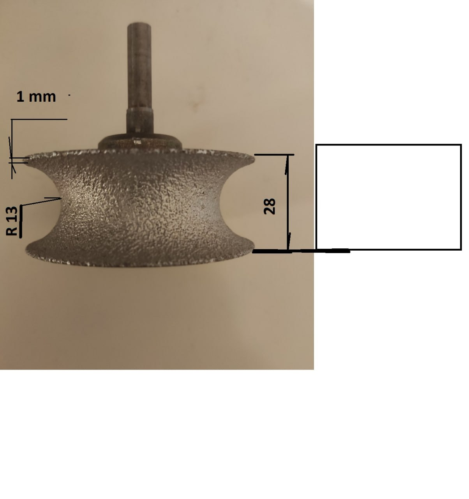
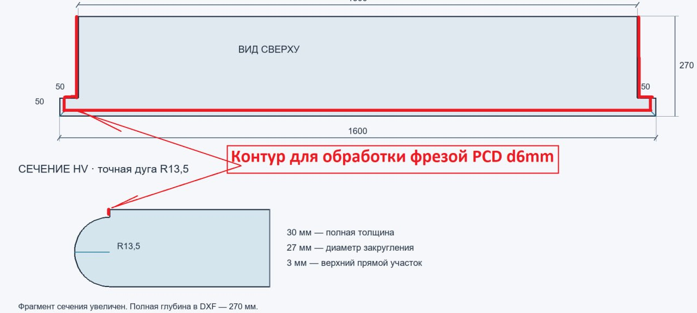
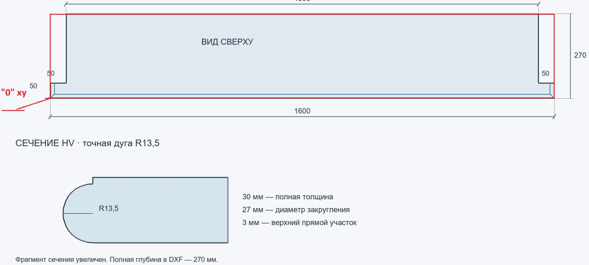

# Постпроцессоры ArtCAM и УП для MORN1325 / RichAuto A11S

**Начать здесь: [все согласованные ответы по станку, инструментам и PARAD-002](confirmed_answers.md).** Сводка содержит последние решения, отменённые варианты и оставшиеся проверки. Для нового проекта уточнять изменившиеся условия, не повторять весь опрос.

**Правило для новых режущих УП ДВП, 07.11.2026:** применять [раздел 4.1.1 общей базы](confirmed_answers.md#411-общее-правило-паузы-разгона-при-резке-двп). Старые выдержки в примерах и описаниях выпусков ниже являются историей, а не настройкой нового раскроя.

Обновлено: 25.09.2026. Документ сохраняет постановку задачи, ответы пользователя и предварительные наблюдения для продолжения работы. При следующем обращении сначала прочитать сводку ответов по ссылке выше; этот README хранит подробности и историю.

## Текущий статус и разрешённые действия

**25.09.2026: после команды «выполняй» рассчитаны траектории PARAD-002 и сохранён [комплект проверки](../stone_project/artifacts/09122026/out1/cnc/README.md) с [PDF-обзором](../stone_project/artifacts/09122026/out1/cnc/project_overview.pdf).** В папке `../stone_project/artifacts/09122026/out1/cnc/nc_air_xy` четыре проверочных NC: движения XY при постоянном безопасном Z, без запуска шпинделя и без резания. Все рабочие глубины и переходы рассчитаны отдельно в 3D DXF/JSON. Режущие NC ещё не выпущены; фактический запуск на станке не выполнялся. Это результат согласованного ближайшего этапа, а не отмена последующих производственных УП.

В комплекте 12 DXF, четыре NC для проверки XY, таблицы координат/времени и два черновика .con с F/S из CAM; вариант пульта требует проверки настроек A11S. Посты не установлены и не проверены экспортом ArtCAM. Исходные .con, образцы .NC, рекомендации и CAD out1 сохранены. Независимое повторное чтение проверило команды NC, дуги, конечные точки, постоянный безопасный Z и целостность DXF. PDF создан после расчётных файлов и визуально просмотрен.

Для лекала пользователь отдельно выбрала **оставить два внутренних R2 без ручной доводки**. Это ограниченное отличие от острого контура камня; максимальное отклонение в этих углах 0,8284 мм. Форма камня не изменена. Остальные подтверждённые условия ниже сохраняются. Пробный рез на единственной каменной заготовке отклонён. Проверка XY по воздуху не подтверждает резание, движения Z около материала, качество, держатель/крепление или выбранные обороты HV.

Продолжать по разделу «Открытые вопросы»: фактические настройки пульта и установка отложены до доступа к станку. Задавать новые существенные вопросы по одному, не повторять подтверждённое. Численные ответы и происхождение сохраняются здесь; полные расчётные данные находятся в новом комплекте.

## Цель консультации

Разобраться, что делают два имеющихся постпроцессора, для каких операций каждый подходит, и проверить их применимость с ArtCAM 2011 и ArtCAM 2018 на трёхосевом станке с RichAuto A11S. Затем, после согласования и команды, перейти к подготовке отдельных УП `.nc` для описанных ниже операций.

Постпроцессор переводит рассчитанную CAM-траекторию в команды контроллера. Компенсацию размера фрезы и технологический припуск задают при расчёте траектории; нельзя считать, что смена постпроцессора сама создаст нужный профиль или припуск.

## Подтверждённые сведения о станке

| Параметр | Согласованные данные |
| --- | --- |
| Станок | MORN1325 |
| Оси | Три оси |
| Контроллер | Пульт RichAuto A11S |
| Прошивка | Неизвестна |
| Вращение при M3 | По часовой стрелке при взгляде сверху от двигателя к столу — подтверждено пользователем |
| Люфт X/Y | Не проверяли, измерений нет. Это не подтверждение наличия или отсутствия люфта |
| CAM | ArtCAM 2011 и ArtCAM 2018 |
| Формат УП | `.nc` |
| Смена инструмента | Вручную |
| Вода | Подаётся вручную |
| Шпиндель и рабочий диапазон | GDZ-125-5.5, 5,5 кВт; 6000–24 000 об/мин по данным пользователя. Изготовитель конкретного экземпляра не установлен; это не пределы инструмента |

Источник оборотов и подачи указан отдельно для каждой операции. Запуск и останов шпинделя должны выполняться из УП для всех операций. Источник оборотов и подачи не меняет это требование. Вода включается вручную.

## Первое изделие: PARAD-002

Пользователь выбрала первым **PARAD-002 — подоконник 1600 × 270 × 30 мм, два выступа, профиль HV**.

Согласованная геометрия из истории проекта:

- Общая длина 1600 мм, глубина 270 мм, толщина 30 мм; задняя ширина 1500 мм.
- Два выступа по 50 × 50 мм.
- HV R13,5 по передней кромке и двум боковым участкам по 50 мм.
- Высота закругления 27 мм; верхний прямой участок 3 мм.
- Передние углы острые в плане, профили сходятся по диагональным стыкам.
- Размеры заданы до крайней выпуклой точки профиля.

Материал камня: **мрамор Emperador Dark**, подтверждено пользователем. Отдельного обрезка для пробы PCD/HV нет; имеется только заготовка подоконника. Предложенный короткий пробный рез PCD 100–150 мм на удаляемой полосе самой заготовки пользователь **отклонила**. Такой пробный файл и такой рез в ближайший этап не включать.

Материалы: [out1](../stone_project/artifacts/09122026/out1/) · [README изделия](../stone_project/artifacts/09122026/out1/README.md) · [PDF изделия](../stone_project/artifacts/09122026/out1/project_overview.pdf) · [STL](../stone_project/artifacts/09122026/out1/sill_volume_mm.stl) · [STEP](../stone_project/artifacts/09122026/out1/sill_1600x270x30_HV_SW2016.step) · [Каталог](../CATALOG_PARAD.md).

Лекало повторяет окончательный внешний габарит готового изделия без припуска. Каменная заготовка уже вырезана по номинальному внешнему контуру 1600 × 270 мм с двумя выступами, без дополнительного материала наружу. Последним решением обязательный припуск HV 1 мм наружу отменён: работаем с имеющейся заготовкой, пользователь допускает небольшое уменьшение размеров после шлифования/полирования. Новый численный припуск и соответствующее смещение траектории не назначены. Не переносить автоматически размеры или асимметричную форму PARAD-003/004 в эту задачу.

## Оси, рабочие нули и безопасная высота — последние решения

Длинная сторона 1600 мм должна располагаться **по Y**, глубина 270 мм — **по X**. Это изменение ориентации по сравнению с прежними файлами изделия, где длина была по X. Исходные CAD-файлы в рамках консультации не поворачивались. Перед расчётом применить подтверждённые направления осей и проверить преобразование; простая перестановка координат может зеркально изменить ориентацию контура и направление дуг.

После фотографии станка пользователь подтвердила: рабочий ноль — в переднем левом углу со стороны оператора; +X вправо (глубина детали 270 мм), +Y от оператора в глубину стола (длина 1600 мм), +Z вверх. Прежние предположения о знаках осей на рисунке заменены этим подтверждением.

| Операция | Последний согласованный Z=0 | Безопасная высота |
| --- | --- | --- |
| ДВП Ø4 | Поверхность рабочего стола/основания | 40 мм над верхом ДВП; при фактической толщине 5 мм и непосредственном прилегании к основанию это Z=+45 мм |
| HV Ø74 | **Нижняя поверхность камня** | После полного бокового выхода — 40 мм над камнем; для толщины 30 мм это Z=+70 мм |
| PCD Ø6 | Верхняя поверхность камня | Z=+40 мм; рабочая глубина Z=−2,5 мм |

Ранее для HV назывались верх камня, затем основание стола. **Оба значения отменены последним уточнением: ноль HV — низ камня.** Высота опор теперь не прибавляется к Z в этой рабочей системе, но опоры и стол учитываются при проверке свободного места для инструмента. Значения Z относятся к согласованной базе привязки инструмента; для HV пользователь подтвердила базу инструмента — самую нижнюю точку режущей части. Пользователь затем подтвердила: нижняя точка дуги R13,5 совпадает с нижней режущей точкой, высота дуги 27 мм, дополнительный 1 мм находится сверху; полная высота режущей части 28 мм.

## Три операции — четыре управляющие программы

### УП №1 — лекало-макет из ДВП

- Материал: ДВП толщиной 5 мм. Исходный лист **1220 × 2710 мм**, используется целиком; вариант предварительного укорачивания не выбран. Ширина 1220 — вдоль X, длина 2710 — вдоль Y.
- На фото станка указано поле X 1300 / Y 2500 мм. Лист длиннее указанного поля на 210 мм; пользователь выбрала установку с опорой выступающей части в одной плоскости со столом. Фактическая установка и доступность всех перемещений ещё не проверены.
- Лекало 1600 × 270 мм располагается с отступами по **50 мм от левого и ближнего к оператору краёв листа**. От угла листа габарит занимает X 50…320 и Y 50…1650 мм. Рабочий XY=0 остаётся в согласованном переднем левом углу габарита изделия; не подменять его углом листа или машинным нулём.
- Операция: наружный окончательный габарит PARAD-002 **без припуска**.
- Инструмент: торцевая фреза **Ø4 мм, один зуб**. Производитель, модель, геометрия торца и допустимость погружения неизвестны; дополнительных сведений/фото у пользователя нет.
- Для первоначальной пробы выбраны **16 000 об/мин, подача по контуру 800 мм/мин**, источник F/S — ArtCAM. Возможность пробного реза на обрезке той же ДВП подтверждена; результат этой пробы ещё не сообщён.
- Z=0 — поверхность стола/основания, верх ДВП при точной толщине и прилегании Z=+5 мм. Безопасная высота — 40 мм над ДВП, то есть **Z=+45 мм** при этих условиях.
- **Два прохода: Z=+2,5 мм, затем Z=+0,3 мм**; снимается 2,5 и ещё 2,2 мм. Жертвенной подложки нет, оставить общий недорез **0,3 мм**.
- **Перемычки: 6 шт., ширина 5 мм, высота 5 мм** — на всю толщину листа. По две на каждой длинной стороне и по одной на каждом торце. Координаты рассчитаны и сохранены в `parad002/data/tabs.json`; фактическое крепление ещё проверить. Для минимальной ширины 5 мм через весь паз ось пропускает 9 мм с учётом круглых концов Ø4; у изделия ширина перемычки 9 мм. Перемычки дополняют общий недорез.
- Заход от свободного внешнего края листа отклонён; нужен вход внутри листа. Выбран вход через **6 стартовых отверстий Ø8 мм в отходе за контуром**, по одному на участок между полнотолщинными перемычками. Одни и те же отверстия используются на обоих проходах. Подготовить отверстия до установки на станке, их центры включить в чертёж; номинальный радиальный зазор при точном центрировании фрезы Ø4 равен 2 мм.
- **Скорость заключительного участка опускания в отверстие — 100 мм/мин**, затем переход на подачу 800 мм/мин. Это выбранный параметр подвода внутри подготовленного отверстия; способность неизвестной фрезы сверлить или наклонно врезаться не предполагается. Высоту переключения быстрого подвода на рабочую подачу определить при проверке траектории.
- Лист удерживают механические прижимы по краям. Их конкретные позиции и высоты ещё не заданы; размещать вне реза, отверстий и перемещений. Запуск/останов шпинделя — из УП.
- Завершение: выход и подъём, затем **возврат в рабочий XY=0 по проверенному маршруту**, останов шпинделя и завершение программы. Порядок M5 относительно возврата отдельно не выбирался; шпиндель должен быть остановлен к завершению.

Радиус фрезы 2 мм учитывать в CAM для обработки снаружи контура, исключить двойную компенсацию в CAM и контроллере. 25.09.2026: два внутренних угла лекала оставляем R2 без доводки, выбран вариант 2. Внутри этих углов отличие от острого каменного контура достигает 0,8284 мм; контур камня не меняется. Стартовые отверстия, заходы, переходы через перемычки, прижимы и маршрут возврата проверить совместно.

Обоснование выбранного пробного режима: [Sorotec, таблица параметров](https://www.sorotec.de/webshop/Datenblaetter/fraeser/schnittwerte.pdf) даёт для MDF и Ø4 ориентир 0,05 мм на зуб. MDF использован как приближённый аналог ДВП, а не как идентичный материал. Расчёт 16 000 × 1 × 0,05 = 800 мм/мин; сами 16 000 выбраны пользователем из предложенных вариантов, не взяты как паспортное назначение этой неизвестной фрезы.

### УП №2 — фасонная обработка HV на мраморе

- Материал: **мрамор Emperador Dark**, номинальная толщина изделия 30 мм.
- Обработка боковой профилированной поверхностью фрезы вдоль торца; **боковое врезание**.
- Инструмент: фасонная фреза с алмазным покрытием, вакуумное нанесение абразива; максимальный наружный диаметр **74 мм**, по повторному измерению пользователя; прежнее значение 73 мм отменено.
- На исходном фото указан R13. Пользователь уточнила: для фрезы принимаем **R13,5**. Это последнее согласованное значение; подпись R13 на фотографии устарела. Фактический инструмент независимо не измерялся.
- Пользователь подтвердила полную высоту режущей части 28 мм: дуга R13,5 высотой 27 мм начинается от самой нижней режущей точки, весь дополнительный участок 1 мм расположен сверху. Это подтверждение пользователя, независимых измерений не проводилось.
- Ранее требовавшийся припуск **1 мм наружу в плане отменён** после уточнения: заготовка уже вырезана по номинальному внешнему габариту. Пользователь принимает небольшое уменьшение размеров после шлифования/полирования; новый численный припуск не задан.
- Переданные рекомендации HV: [сводка, ограничения и опыт пользователя](tool_recommendations.md), [исходный текст](<recomendation fres.txt>). В тексте 3000 об/мин и максимум 4000; пользователь подтвердила, что максимум **4000 об/мин относится к имеющейся фрезе**. Независимого паспорта нет.
- Пользователь выбрала для дальнейшей подготовки **ту же HV при 6000 об/мин**, сообщив, что уже пробовала её на своём станке: фреза быстрее изнашивается/«сгорает». Подача, съём и остальные условия прежней пробы неизвестны. Это заявленный пользователем экспериментальный режим **выше указанного предела 4000**, а не подтверждение изготовителя или подтверждение безопасности. Снижение подачи не устраняет превышение ограничения по оборотам. Временный вариант отложить HV впоследствии отменён пользователем.
- По запросу уменьшить только подачу на 30–40% выбран вариант **−35% от середин исходных диапазонов**: черновая 450 × 0,65 = **292,5 мм/мин**, чистовая 250 × 0,65 = **162,5 мм/мин**. Эта комбинация на станке ещё не проверена.
- Радиальные съёмы подтверждены отдельно: **первый проход 1 мм, последующие черновые по 2 мм, последний чистовой 0,5 мм**. Не увеличивать их из-за 6000 об/мин и не трактовать как шаг Z. 25.09.2026 по согласованной идеальной форме Ø74/R13,5 рассчитан общий съём 13,5 мм: 7 черновых проходов (1 + 6 × 2) и чистовой 0,5 мм. Это расчёт по номинальной геометрии; фактическая фреза независимо не измерена.
- Выбраны **две отдельные УП HV**: черновая и чистовая. Между ними инструмент и рабочая привязка сохраняются; оператор меняет подачу на пульте. Каждая УП сама запускает и останавливает шпиндель. Не рассчитывать на непроверенную промежуточную остановку одного файла.
- Обороты и подача задаются на пульте. Запуск и останов шпинделя — из УП. Вода — вручную.
- Z=0 — **нижняя поверхность камня**, верх камня Z=+30 мм.
- Камень лежит на опорах. Пользователь обеспечит их высоту и расположение вне зоны инструмента при установке. Крепление — механические прижимы по задней длинной необрабатываемой кромке со стороны окна; высоты прижимов неизвестны и определяются при установке. Значение 40 мм над камнем нужно проверить относительно фактического крепления.

**Обязательное условие выхода HV:** сначала боковой выход на рабочей высоте, чтобы нижняя часть фрезы полностью вышла из-под камня и между ней и заготовкой оставалось минимум **10 мм**. Только затем поднимать инструмент в безопасную зону — 40 мм над камнем. Эти 10 мм относятся к свободному зазору от края инструмента, а не к смещению центра на 10 мм. Нельзя поднимать фрезу, пока её нижняя часть находится под камнем. Предусмотреть соответствующие подводы и отводы по габаритам всего инструмента; конкретная траектория ещё не рассчитана.

Для обеих УП HV после такого выхода и подъёма выбран останов шпинделя и завершение **в точке отвода, без возврата в XY=0**.

Геометрия PARAD-002 предусматривает HV на передней кромке и двух боковых участках по 50 мм. Красная схема PCD ниже относится к другой операции; не переносить её целиком на HV.

### УП №3 — верхний прямой участок, PCD

- Материал: **мрамор Emperador Dark**. Инструмент: торцевая **PCD Ø6 мм**; написание «PSD» в раннем ответе относится к этой операции. Точный изготовитель/артикул не установлен.
- Прочитана [PCDfres.txt](PCDfres.txt), консультационная заметка со ссылками. Это не паспорт идентифицированной фрезы. Различия между исходной заметкой, источниками и выбранными параметрами — в [памятке](tool_recommendations.md).
- Пользователь выбрала **8000 об/мин**, рабочую подачу **500 мм/мин**, подачу по Z **100 мм/мин**. Обороты и подача — с пульта; его конкретные настройки ещё не проверены. Вода ручная; пуск/останов шпинделя из УП.
- Z=0 — **верх камня**, безопасная высота **Z=+40 мм** с проверкой фактических прижимов.
- **Два прохода по глубине: Z=−1,5 мм, затем Z=−2,5 мм** (1,5 и ещё 1 мм). Припуск не нужен. Это два уровня по Z, а не обещание выбрать полосу за две единственные линии XY.
- Выбран **боковой вход**: опустить инструмент вне камня, затем плавно подвести сбоку на глубине обработки. Пользователь подтвердила возможность такого подхода. Подача Z=100 не означает разрешения вертикально погружаться в мрамор.
- Согласовано сохранить верхнюю кромку **по существующей модели**: на передней профилированной кромке и двух профилированных боковых участках снимается сверху полоса шириной **13,5 мм**, до глубины 2,5 мм. Ширина следует из отступа верхней плоскости HV R13,5 от габарита. **Выбран боковой съём PCD по 1 мм**, последний по ширине **0,5 мм**: для полосы 13,5 мм предварительно 14 проходов на каждом из двух уровней Z, всего 28. Ø6 не перекрывает всю полосу одной линией; это выбранный пробный параметр, не подтверждённая норма изготовителя.
- Предварительная оценка времени резания PCD при 500 мм/мин: для шага 1 мм **95,2 минуты (около 1 ч 35 мин)**, для невыбранного варианта 1,5 мм — **61,2 минуты**; разница 34 минуты. Расчёт по приближённой длине 1600 + 50 + 50 = 1700 мм: 1700 × 28 / 500 и 1700 × 18 / 500. Это не время готовой УП: не включены подводы, отводы, возвраты, замедления, дополнительные участки, смена инструмента и настройка. Позднейший расчёт 25.09.2026 дал 97,99 минуты перемещений XY на подаче и 1,28 минуты спусков Z, всего 99,27 минуты без G0/ускорений/установки; подробности в новом комплекте.
- На остальных красных участках без HV сохраняется исходная граница **без новой ступеньки внутрь**. При точно номинальной заготовке проход по этой границе практически не снимает материал. Не назначать там произвольную ширину или припуск ради получения реза.
- Красным отмечены передняя сторона с обходом выступов и обе боковые стороны до задних углов; задняя длинная кромка не обрабатывается. Схема задаёт границу изделия, не ось фрезы. Смещения центра, углы, полосы выборки и переходы рассчитать и проверить по CAD.
- Завершение: выход и подъём, **возврат в рабочий XY=0 по проверенному маршруту**, завершение с остановленным шпинделем. Порядок M5 относительно возврата отдельно не выбирался.

Глубина 2,5 мм и проектная высота верхнего прямого участка 3 мм — разные согласованные величины. Не подменять их друг другом; сопряжение зоны PCD с фактической формой и высотой фрезы HV проверить по сечению.

### Четыре файла и последовательность

Подтверждено: **ДВП → проверка лекала → PCD → HV черновая → HV чистовая**. Номера разделов выше обозначают три вида обработки, а не порядок запуска файлов.

| Очерёдность | Отдельная УП | Конец программы |
| --- | --- | --- |
| 1 | Лекало ДВП Ø4 | После выхода и подъёма — рабочий XY=0 |
| 2, после проверки лекала | PCD Ø6 | После выхода и подъёма — рабочий XY=0 |
| 3 | HV черновая | Боковой выход ≥10 мм от инструмента, подъём, остаться в точке отвода |
| 4 | HV чистовая | Такой же выход, подъём, остаться в точке отвода |

Подтверждена схема повторных проходов **PCD и HV в одну сторону**, с выходом из материала, подъёмом и холостым возвратом к началу. Для HV перед каждым таким подъёмом обязателен полный боковой выход с зазором минимум 10 мм от инструмента. Это относится к переходам между проходами; выбранные окончания отдельных файлов остаются прежними. Для первоначальной пробной стратегии пользователь выбрала **встречное резание PCD и HV** при неизвестном люфте. Последующим ответом проба со снятием камня ограничена: сейчас эта стратегия используется для подготовки и проверки файлов/движений, а не считается испытанным производственным режимом.

PCD выполняется перед HV, чтобы снять верхнюю полосу до формирования выпуклого профиля. Это согласованное технологическое предложение по нашей геометрии, не готовая карта изготовителя фрез и не результат испытания этой последовательности.

Инструмент меняется вручную. После смены устанавливать/проверять его привязку Z. Для ДВП Z=0 — стол, для PCD — верх камня, для HV — низ камня; офсеты автоматически не переносить. Между двумя УП HV смены инструмента нет, меняется подача. Все четыре программы должны запускать и останавливать шпиндель из УП; вода остаётся ручной.

## Схемы и фото пользователя

Сохранены копии исходных изображений без редактирования. Последние текстовые уточнения имеют приоритет над устаревшими подписями на них.







## Исходные постпроцессоры и примеры УП

Рабочая папка: `W:\obsidian\_parad\Prompts\Jenja\postprocessor`.

- [NC-Studio.con](NC-Studio.con).
- [NC-Studio-Arc.con](NC-Studio-Arc.con).
- [Папка nc с примерами УП](nc/) — 24.09.2026 проанализированы 3.NC и уп.NC. Пользователь подтвердила, что файлы отрабатывали нормально на станке; какой постпроцессор их создал, неизвестно. Соответствие каждого примера конкретной операции ещё не установлено.

Комментарии `.con` читаются как Windows-1251. В них указано происхождение от CREATION/NC-Studio, базовая дата 10.10.2004, а в Arc — добавление дуг 06.01.2013. Утверждение автора о проверке на других станках не подтверждает совместимость с данным A11S. При возможном дальнейшем редактировании сохранять происхождение и авторские примечания исходников.

| Свойство | NC-Studio.con | NC-Studio-Arc.con |
| --- | --- | --- |
| Расширение выходного файла | CNC | nc |
| Единицы ArtCAM | MM | MM |
| Быстрые перемещения | G0 XYZ | G0 XYZ |
| Рабочие перемещения | Линейные G1 XYZ | Линейные G1 XYZ и дуги G2/G3 |
| Дуги | Отдельные блоки не заданы | XY с центрами I/J, без Z в строках дуг |
| Формат координат | 3 знака после точки | 3 знака после точки |
| Предварительное применение | Траектории из отрезков, включая XYZ-рельеф | Контуры с круговыми дугами в плоскости XY |

Три знака координат — формат записи, а не гарантия точности изготовления 0,001 мм. Различие расширений само по себе не означает различие совместимости команд. Переименование CNC в nc не адаптирует команды к контроллеру.

## Наблюдения по содержимому файлов

Оба исходника содержат одинаковое начало:

```text
START = "%"
START = "T1M6"
START = "G0[ZH]"
START = "G0[XH][YH][S]M3"
```

И одинаковое завершение:

```text
END = "G0[ZH]"
END = "G0X0Y0"
END = "M30"
```

Это фрагменты конфигурации постпроцессоров, не готовая УП для запуска.

Что потребуется проверить после разрешения:

1. Нет явных начальных G90/G21; в Arc также нет G17. `UNITS = MM` форматирует вывод CAM, но отдельную команду G21 эти исходники не записывают. Нужны сведения о начальных режимах пульта.
2. `T1M6` жёстко задаёт инструмент 1; отдельного блока TOOLCHANGE нет. Не считать это реализованной многосменной обработкой. Реакция A11S на эту строку неизвестна; пока не удалять и не заменять её.
3. M3 и S выводятся вместе с быстрым перемещением XY. Явной выдержки на разгон нет; наличие задержки в пульте или приводе ещё не установлено.
4. Нет отдельного M5 и команд управления водой. Поведение завершения M30 нужно сверить с рабочими программами и настройками. Ручная подача воды подтверждена.
5. `[ZH]` берётся из настроек CAM; он не является автоматически безопасной машинной координатой. `G0X0Y0` не является командой поиска машинного нуля. Проверить высоту, систему координат и желаемое конечное положение.
6. F присутствует в FIRST_FEED_RATE_MOVE и первых блоках дуг, но отсутствует в обычном FEED_RATE_MOVE. Проверить фактический вывод при смене подачи, переходе «врезание → обработка» и «дуга → прямая». По одному `.con` не утверждать, что переход ошибочен.
7. Для Arc проверить трактовку I/J на стороне ArtCAM и A11S, переходы G2/G3 ↔ G1, полные окружности и фактическую плоскость дуг. Поддержка спиральных перемещений с Z этими строками не установлена.
8. В формате присутствуют настройки нумерации N, но `[N]` в шаблонах движения не используется: считать нумерацию реально включённой нельзя.

## Предварительный выбор, не окончательная рекомендация

Для плоских контуров с настоящими дугами Arc — кандидат: он может уменьшить число коротких отрезков. Для линейных XYZ-траекторий и 3D-рельефа обычный вариант проще как база проверки. На прямолинейном контуре преимущество Arc отсутствует. Он не превращает автоматически линейную сеточную траекторию в дуги и не обеспечивает сам по себе лучшее качество поверхности.

Для текущей фасонной обработки HV форму создаёт геометрия фрезы; слово Arc не означает обработку закругления HV по высоте. Пост выбирается по траектории движения инструмента и возможностям контроллера.

Нет оснований назначать один файл только ArtCAM 2011, а другой только ArtCAM 2018. Совместимость и фактический вывод в каждой версии ещё не проверены. После разрешения сравнить небольшой одинаковый пример в двух версиях и рабочие .nc данного станка. Не объявлять любой из исходников готовым производственным постом без этих данных.

## Открытые вопросы — продолжить отсюда

Расчётный этап по команде «выполняй» выполнен. Начинать с [README комплекта PARAD-002](../stone_project/artifacts/09122026/out1/cnc/README.md); там пути и результаты проверок. Четыре AIR_XY NC не содержат рабочих глубин: они предназначены для проверки XY на безопасной высоте и не заменяют режущие УП.

1. **Уже подтверждено:** оси и нули; встречная стратегия PCD/HV при M3 по часовой стрелке; проходы в одну сторону; боковой съём PCD 1 мм с последним 0,5 мм; материал и режимы; два R2 в готовом лекале без доводки. Повторные вопросы по этим пунктам не нужны. Короткая проба PCD на подоконнике отклонена. Возможность отдельной пробы ДВП ранее подтверждена, фактических результатов нет.
2. **Отложено до доступа к станку:** реальные настройки F/S/M/T/I/J, G17 и M5/M30, задержка разгона; возможность 292,5/162,5 и независимой подачи Z; люфт и фактические ходы. Отсутствие F/S или F0/S0 не принимать за подтверждённый выбор пульта. Для камня источник F/S остаётся пульт; подготовленные CAM_FS посты не считаются готовым решением этого режима.
3. **Перед физической проверкой:** рабочие нули и начальное безопасное положение, реальные прижимы, опоры, хвостовик/держатель, свободное место под отрицательные XY и свес листа. На расчётной режущей части HV боковой зазор перед подъёмом не менее 15,55 мм, но полная проверка столкновений невозможна без данных крепления/держателя. Движения станка не выполнялись.
4. **До выпуска режущих NC:** проверить фактический короткий экспорт ArtCAM 2011/2018, включая линии/дуги/смены подачи, и настройки A11S. Построенные 3D пути позволяют продолжить с полученными проверками. Совместимость HV с выбранными 6000 об/мин при указанном максимуме 4000 не подтверждена. Проверка XY без вращения не проверяет этот режим.

Исходники сохранены. Новая команда «выполняй» уже была основанием выполненного расчётного этапа; не возвращаться к прежнему ожиданию команды на тот же расчёт. Для дальнейших действий учитывать текущие границы: камень пока не резать, существенные уточнения по одному.

## История уточнений и границы выполнения

- 23–24.09.2026: прочитаны только два исходных постпроцессора; сформулировано предварительное сравнение. Настройки станка получены из ответов пользователя.
- Пользователь неоднократно остановила начало работ и установила порядок: все ответы, затем отдельная команда «выполняй».
- Первым изделием выбран PARAD-002 1600 × 270 × 30 мм, два выступа. Другие подоконники пока не обрабатываем.
- Первоначально по HV подпись R13 уточнена до R13,5, а припуск 1 мм ограничен направлением наружу в плане. Позднее обязательный припуск отменён после подтверждения номинального контура исходной заготовки; история первоначального решения сохранена.
- Длину назначили по Y вместо X. Z=0 для HV окончательно изменён на нижнюю поверхность камня, а не стол и не верх камня.
- 24.09.2026: команда «Выполни» относится к текущему запросу сохранить этот README. Дополнительный анализ nc, расчёт УП и изменение постпроцессоров не выполнялись.

## Источники ранее выполненной консультации

Главный источник параметров станка и процесса — ответы пользователя, сохранённые выше. Содержание `.con` проверено непосредственным чтением файлов.

- [Руководство производителя RichAuto A11, копия PDF](https://abroncnc.com/wp-content/uploads/2015/11/Richauto_A11_Manual.pdf): раздел G Code Setup указывает настройку чтения M/T/F/I/J/K. Это справка семейства A11, не доказательство параметров конкретной прошивки A11S пользователя.
- [ArtCAM Post Processor Configuration Guide, Delcam, архивная копия PDF](https://cnctar.hobbycnc.hu/Messer/ArtCAM/ArtCAM%20Post%20Processor%20Configuration%20Guide%20By%20Delcam.pdf): структура `.con` и форматы перемещений. Архивный документ не заменяет проверку вывода ArtCAM 2011/2018.
- [Autodesk: данные для создания или изменения постпроцессора ArtCAM](https://www.autodesk.com/support/technical/article/caas/sfdcarticles/sfdcarticles/What-information-is-needed-to-create-or-edit-a-Post-Processor-for-ArtCAM.html): пример кода, модель станка, оси, единицы, смена инструмента.

## Как продолжить в следующей сессии

Прочитать этот README, принять за основу подтверждённые ответы, уточнить только оставшиеся вопросы. Примеры nc изучены. Расчёт 25.09.2026 уже выполнен; читать новый комплект по ссылке в начале. Оставшиеся вопросы зависят от доступа к станку и задаются по одному. Переданные рекомендации HV читать по ссылке выше и отличать их от подтверждённого практического опыта; отделять доказанные свойства файлов от предположений о контроллере. Новые результаты и принятые решения добавлять сюда с датой. Сейчас документ не является готовой инструкцией запуска станка или разрешением на изготовление.


## Анализ рабочих УП от 24.09.2026

Выполнен после отдельной команды «выполняй». [Отчёт с контрольными суммами и измерениями](reference_nc_analysis.json). Исходные .con и .NC не изменены. Это статический разбор команд, не симуляция съёма материала, не проверка столкновений и не самостоятельный запуск на A11S.

| Признак | 3.NC | уп.NC |
| --- | --- | --- |
| Строк | 410 | 7944 |
| Дуги G2/G3 | 96 / 96 | 180 / 180 |
| Изменение Z в блоках дуг | Нет | Нет |
| Начальные режимы | G90 G80 G21 G49 | G90 G80 G21 G49 |
| Запуск | M3 S15000 | M3 S15000, повторён внутри файла |
| Подачи в коде | F3000 и F4560 | F720 и F2520 |
| Завершение | M5, затем M30 | M5, затем M30 |
| Команда T / M6 | Нет; номер инструмента только в комментарии | Нет; номер инструмента только в комментарии |
| Возвраты с дуги к G1 | 16, все с явным G1 | 84, все с явным G1 |
| Точность записи координат | Два знака после точки | Два знака после точки |

Оба файла используют абсолютные координаты XYZ. Для I/J геометрия согласуется с приращениями относительно начала дуги: максимальное расхождение начального и конечного радиусов 0,007444 мм в 3.NC и 0 в уп.NC. При трактовке I/J как абсолютных центров возникают расхождения до 12,445 и 43,840 мм соответственно. Это основание считать формат центров инкрементальным; оно не является измерением машинной точности или допуска пульта. В коде нет явного G17, поэтому выбор плоскости XY зависит от исходного состояния контроллера.

Диапазоны запрограммированных конечных точек, не габариты изделия и не полный охват дуг: 3.NC — X 0…102,78, Y 0…825,36, Z −12…+4 мм; уп.NC — X 0…189, Y 0…64,75, Z −10,2…+5 мм. Высоты 4/5 мм из примеров не переносятся в новые УП: согласовано 40 мм над материалом.

В комментарии 3.NC указан «3.500 мм радиус цилиндрический фрезы»; в уп.NC — «6.000 мм радиус сферической фрезы». Это комментарии исходных программ, а не подтверждённые измерения инструмента. Они не совпадают с заданными сейчас типами/диаметрами. Значения S15000 и найденные F не принимаются как режимы ДВП Ø4, PCD Ø6 или HV Ø74. Наличие F/S в файле также не доказывает, что при его исполнении пульт действительно использовал эти значения, а не свои настройки.

### Сравнение с двумя .con и выбор основы

Ни один присланный .con не совпадает с примерами в неизменном виде: в примерах другие заголовок, точность координат и останов шпинделя, отсутствует T1M6. Определить точное имя или версию исходного поста по этим данным нельзя. Обычный NC-Studio.con не содержит блоков дуг, а оба рабочих файла дуги содержат.

**Выбор основы: NC-Studio-Arc.con** — для адаптации под данный станок, с сохранением возможности G1 и XY-дуг. Совместимость дугового формата подтверждается совокупностью кода и сообщения пользователя об успешной работе примеров; неизменённый Arc-пост готовым для производства не объявляется.

Для строго прямолинейной траектории обычный линейный вариант тоже достаточен. Для круговых подводов и контуров с дугами Arc сохраняет G2/G3. Профиль HV создаётся фасонным инструментом, а не выбором Arc. Выбирать разные базовые посты только по номеру ArtCAM 2011/2018 не требуется; проверить фактическую выдачу каждого установленного ArtCAM на коротком примере всё равно необходимо.

### Предлагаемая адаптация — пока не выполнена

Сохранить исходники. Подготовить отдельные варианты под две политики управления: ДВП с F/S из CAM и камень с режимами пульта. В обоих оставить запуск/останов шпинделя из УП, явные режимы единиц/координат/плоскости и понятный переход G2/G3 ↔ G1. За образец заголовка и завершения взять реально работавшую структуру, отдельно проверив дополнительные команды на A11S. Политику T1M6 согласовать с ручной сменой; рабочие примеры не требуют M6.

Для варианта с пультом сначала выяснить его настройки чтения F/S: простое удаление F/S или запись F0/S0 не является подтверждённым способом выбрать режимы пульта. M5 перед M30 соответствует обоим рабочим примерам. Для ДВП длительность выдержки определена в разделе 4.1.1 общей базы; при адаптации поста применять его. Для остальных операций выдержку не задавать произвольно — она может быть настроена в контроллере/приводе.

Подъём в конце HV должен выполняться только после запроектированного бокового выхода с зазором не менее 10 мм от нижней части фрезы. Универсальная строка END с подъёмом Z сама этот выход не создаёт. Подводы, отводы, компенсацию Ø74 и окончательно согласованное положение обрабатываемого профиля нужно обеспечить и проверить на уровне CAM-траектории с учётом фактической заготовки и крепления.

### Что требуется до выпуска новых УП

Режимы и последовательность теперь выбраны пользователем и отражены в актуальных разделах; боковой съём PCD впоследствии выбран 1 мм с последним проходом 0,5 мм; встречное резание затем выбрано для первоначальной стратегии, а ближайший этап ограничен файлами и проверкой движений без резания камня. Перечисленные проверки остаются открытыми. Подтверждённого испытания полной комбинации параметров нет. Для HV сохраняется конфликт выбранных 6000 об/мин с указанным максимумом 4000. Настройки пульта отложены до доступа к станку. Готовые производственные NC не выпущены; текущая точка продолжения — раздел «Открытые вопросы».

## Последние подтверждения — 24.09.2026

Пользователь подтвердила ноль спереди слева, +X вправо, +Y в глубину стола и +Z вверх. База инструмента HV — самая нижняя точка режущей части. При повторном измерении максимальный наружный диаметр исправлен с 73 на **74 мм**; радиус профиля остаётся **R13,5**. Задавать вопросы строго по одному и ждать ответа. Исправление README не запускает расчёт траекторий; производственные .nc ещё не создавались.

## Историческая запись: первое сохранение рекомендаций — 24.09.2026

По запросу пользователя прочитан [recomendation fres.txt](<recomendation fres.txt>), создана [памятка по рекомендациям HV и накоплению опыта](tool_recommendations.md). При первом сохранении были зафиксированы исходные диапазоны и неподтверждённые условия. Тогда следующим вопросом был максимум 4000 об/мин. Позднейшие ответы и заявленный опыт пользователя внесены в актуальные разделы выше; эту историческую запись не использовать как список текущих вопросов.

В актуальные разделы выше внесены ответы, полученные после предыдущего сохранения: высота HV 28 мм и дополнительный 1 мм сверху; номинальная заготовка и отмена обязательного припуска 1 мм; однозубая Ø4 без данных изготовителя; крепление ДВП механическими прижимами; проверенных режимов ДВП нет, пробный рез возможен; максимум шпинделя 24 000 об/мин; проверка пульта отложена до доступа к станку. Новые УП и постпроцессоры не создавались и не изменялись.

## Последующее согласование параметров — 24.09.2026

Обновлены актуальные разделы по последовательным ответам пользователя: характеристики шпинделя, максимум HV и заявленный опыт 6000 об/мин, снижение подач HV на 35% при сохранении съёма, Emperador Dark и режимы PCD, ДВП 16 000/800/100 и два прохода, шесть стартовых отверстий, целый лист 1220 × 2710 с опорой свеса, отступы по 50 мм, четыре файла, порядок PCD перед HV, различное завершение УП и сохранение геометрии верхней кромки без новых ступенек. Временное решение отложить HV отменено последующим прямым указанием пользователя. На момент этой записи следующим уточнением был боковой съём PCD; последующий выбор записан ниже.

Эта запись сохраняет решения и их происхождение. Новые производственные NC, изменённые постпроцессоры и расчётные траектории на этом этапе не выпускались.

## Выбор бокового съёма PCD и оценка времени — 24.09.2026

После сравнения ориентировочного времени пользователь выбрала **вариант 2: 1 мм по ширине, последний 0,5 мм**. Для двух согласованных уровней глубины предварительно 28 проходов и около 95 минут чистого резания. Полный цикл уточняется после расчёта траектории. Документы обновлены; новые NC и постпроцессоры не создавались. На этом этапе следующим вопросом была схема повторных проходов; ответ приведён ниже.

## Направления и состояние приводов — 25.09.2026

Пользователь выбрала однонаправленные рабочие проходы PCD/HV с холостым возвратом, подтвердила M3 по часовой стрелке при взгляде сверху от двигателя к столу и сообщила, что люфт X/Y не проверялся. Эти ответы записаны в актуальные разделы. На момент этой записи попутное/встречное резание ещё не было согласовано; последующий выбор указан ниже. Основание обсуждения — [Sorotec, раздел о попутном/встречном фрезеровании](https://www.sorotec.de/webshop/Datenblaetter/fraeser/schnittwerte.pdf): состояние приводов и люфт влияют на выбор. Это общая механическая рекомендация, не паспорт имеющихся PCD/HV и не проверка станка. Производственные УП не создавались.

## Встречная стратегия и границы проверки камня — 25.09.2026

Пользователь выбрала встречное резание для первоначальной пробы PCD/HV. Затем сообщила, что отдельного обрезка Emperador Dark 30 мм нет, и отклонила короткую пробу PCD на самой заготовке. Последний выбор: **пока подготовить файлы и проверить движения без резания камня**. Сохранить эти границы в последующих материалах; не обозначать проверку по воздуху как испытание режима резания и не включать отклонённую пробу на подоконнике. ДВП остаётся отдельной операцией. Перед расчётом/выпуском новых файлов сохраняется установленное пользователем ожидание команды «выполняй».

## Расчётный комплект PARAD-002 — 25.09.2026

По команде пользователя подготовлен [комплект](../stone_project/artifacts/09122026/out1/cnc/README.md): 4 AIR_XY NC, 12 DXF, полные XYZ-планы, координаты отверстий/перемычек, два черновика .con и PDF. В лекале согласованы R2. Расчёт движения на подаче: ДВП 10,00; PCD 99,27; HV черновая 45,81; HV чистовая 11,62 минуты, без G0 и ускорений. Повторное чтение файлов и визуальная проверка PDF выполнены. Фактический запуск, экспорт ArtCAM и резание не выполнялись. Основная папка результатов теперь `stone_project/artifacts/09122026/out1/cnc`; исторический оригинал `postprocessor/parad002` сохранён.

## Единая сводка ответов — 25.09.2026

По просьбе пользователя создан [отдельный документ всех согласованных ответов](confirmed_answers.md). Он разделяет сведения об оборудовании, условия PARAD-002, отменённые варианты, расчётные результаты и открытые проверки. Параметры другого проекта не переносить автоматически; уточнять изменения при его начале.


25.09.2026 — [Проверочные УП PARAD-003](../stone_project/artifacts/09122026/out2/cnc/README.md). Отдельные копии скриптов, четыре NC без резания и вращения шпинделя. [План общего раскроя](sill_batch_plan.md).


25.09.2026 — Подготовлены [проверочные УП PARAD-004](../stone_project/artifacts/09122026/out3/cnc/README.md), 1280 × 270 × 30 мм, прямой левый торец. [PDF-обзор](../stone_project/artifacts/09122026/out3/cnc/project_overview.pdf). Общий раскрой остаётся отдельным этапом.
