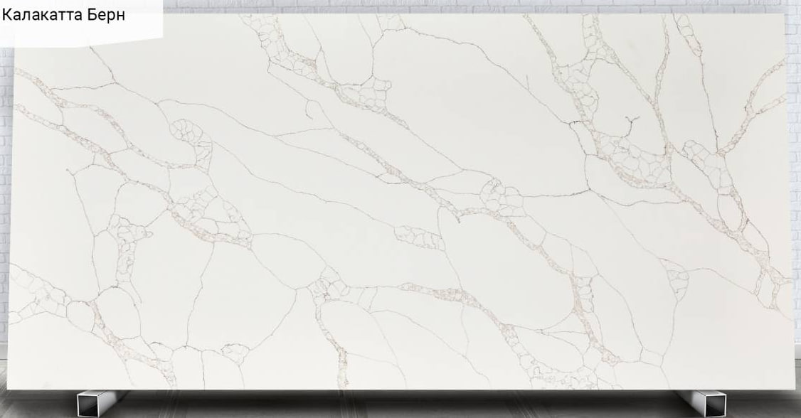
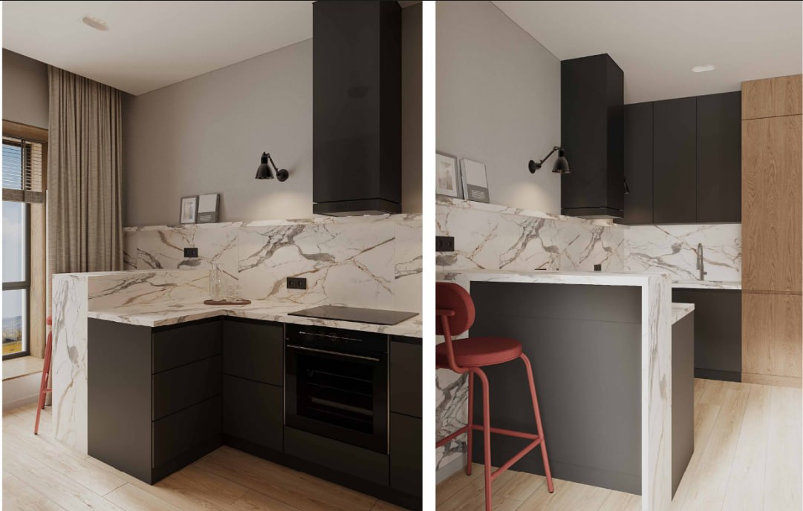
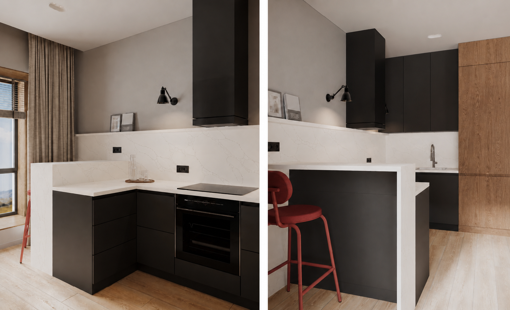
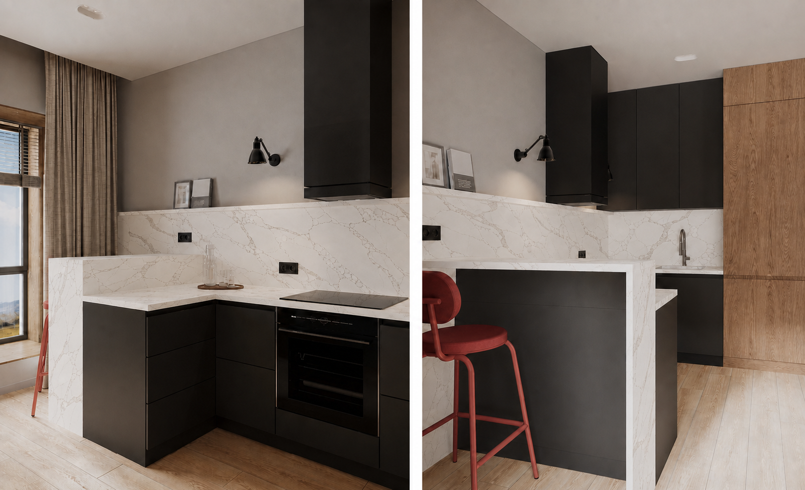
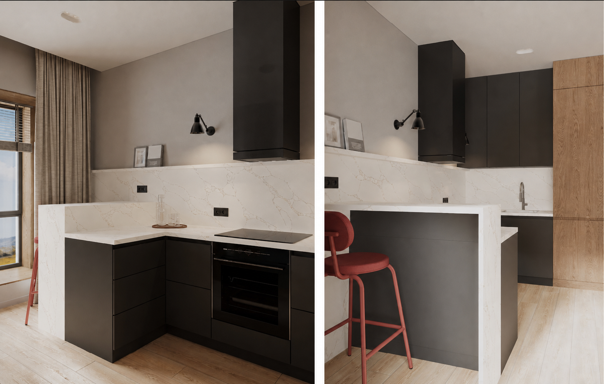

# Замена камня в интерьере кухни

Работа stone_08_2026. Набор от 22.08.2026; описание восстановлено и файлы проверены 13.09.2026. Направление: визуализация отделки интерьера по референсу.

## Первая постановка задачи

Реалистично заменить камень на выбранных поверхностях кухни материалом из предоставленного образца, сохранив форму интерьера и согласованность ракурсов.

Это краткая реконструкция по сохранённому промпту и карточке задачи, а не дословная цитата первого сообщения. Первоначальная переписка в этой папке не сохранена.

## Что сохранилось

Один референс камня «Калакатта Берн», один исходный JPEG с двумя ракурсами кухни и три выходных PNG с вариантами замены материала. На изображениях представлены столешницы, фартук и связанные вертикальные торцы барной части.

Размеры изделий и толщина камня в доступных материалах не указаны. Физический размер образца также не указан. Размеры файлов в пикселях приведены далее и не являются размерами изделий.

Три PNG описаны как варианты одного набора. Их порядок создания и окончательный выбор пользователя не установлены; номера ниже служат только для удобства ссылок. Наличие файлов подтверждено, приёмка конкретного варианта не подтверждена.

## Технология и повторное использование

Сохранённый подход: редактирование растрового изображения по референсу материала с текстовыми ограничениями. Промпт предназначен для запуска через Codex или ChatGPT; конкретная модель, инструмент и настройки исторической обработки не зафиксированы.

- Определить целевые поверхности по точному списку, объекту или группе материала. При неоднозначности уточнить границы.
- Применить рисунок референса с учётом перспективы, масштаба, освещения и переходов между связанными плоскостями.
- Сопоставить результат с исходником: форма, невыбранные поверхности, композиция и рисунок на разных ракурсах.
- Повторно использовать сохранённый промпт; для нового набора заново определить материалы и целевые поверхности. Обработку начинать после отдельной команды «Выполни».

Поисковые признаки: кухня, интерьер, замена материала, текстура камня, Калакатта Берн, столешница, фартук, барная стойка, вертикальный торец, несколько ракурсов, референс, JPEG, PNG.

<!-- pagebreak -->

## Входные данные

Референс материала: photo_2026-08-22_14-52-18.jpg, 1126 × 588 px. Название «Калакатта Берн» прочитано на изображении; это не проверка производителя или характеристик камня.

Исходный интерьер: photo_2026-08-22_14-53-25.jpg, 1081 × 689 px. Один файл уже содержит два ракурса, разделённые белой полосой. Исходный камень имеет более крупные и контрастные прожилки.

Входная папка: artifacts/20260822/in. Промпт: stone-texture-replacement.md. Дополнительные исторические текстовые уточнения в этом наборе не найдены.

<!-- pagebreak -->

## Сохранённые выходные изображения

Вариант 1: exec-29cf51cc-7daa-426e-9eb2-94448d66588d.png, 1608 × 978 px. Визуально наиболее слабо выраженные прожилки среди трёх файлов.

Вариант 2: exec-7135bd27-2604-4f4e-b290-d934f4bb87c3.png, 1608 × 978 px. Прожилки заметнее; рисунок выражен на фартуке и вертикальных торцах.

Вариант 3: exec-e6afec65-16ae-4948-92a6-6fba1a85694c.png, 1572 × 1001 px. Другой рисунок и композиция ракурсов; пропорции файла ближе к исходному JPEG.

Выходная папка: artifacts/20260822/out. Все три изображения сохраняют парное представление ракурсов. Это варианты, а не подтверждённые результаты трёх отдельных входных фотографий.

<!-- pagebreak -->

## Проверка и границы результата

Все пять изображений открыты, декодируются без ошибки и просмотрены. Их контрольные суммы проверены до и после создания описания: файлы не изменялись. Доступны основной промпт, инструкция запуска и описание структуры artifacts.

Сохранённый промпт требует неизменных разрешения, пропорций и композиции. Фактические PNG отличаются от исходного JPEG по разрешению; варианты 1 и 2 также заметно отличаются по пропорциям. При визуальном сравнении меняется кадрирование и видимость некоторых деталей. Поэтому полное соблюдение требования «изменить только материал» по этим файлам не подтверждено.

Точный перенос рисунка конкретной плиты, измерительная точность и физические размеры не проверены. DXF, STL и модель 3D в этой папке не найдены. Сохранились растровые визуализации для выбора отделки; изготовление деталей ими не описано.

Карточка 20260822 фиксирует создание промпта и исключает обработку изображений из своей первоначальной задачи. Файлы результатов сейчас присутствуют, но их происхождение, последовательность итераций и пользовательская приёмка в карточке не описаны. Эти сведения не восстановлены предположениями.

## Где искать подробности

- [Основной промпт](stone-texture-replacement.md)
- [Инструкция запуска](README.md)
- [Правила хранения входных и выходных материалов](artifacts/README.md)
- [Исходный референс](artifacts/20260822/in/photo_2026-08-22_14-52-18.jpg)
- [Исходный интерьер](artifacts/20260822/in/photo_2026-08-22_14-53-25.jpg)
- [Результат 1](artifacts/20260822/out/exec-29cf51cc-7daa-426e-9eb2-94448d66588d.png)
- [Результат 2](artifacts/20260822/out/exec-7135bd27-2604-4f4e-b290-d934f4bb87c3.png)
- [Результат 3](artifacts/20260822/out/exec-e6afec65-16ae-4948-92a6-6fba1a85694c.png)
- [Карточка работы](../../../Tasks/Items/General/TASK-20260822-001-save-stone-texture-prompt.md)

Папка работы: W:/obsidian/_parad/Prompts/Jenja/stone_08_2026.

Подробное описание: project_overview.md. PDF-обзор: project_overview.pdf в этой же папке. PDF подготовлен после описания и проверки материалов; все страницы просмотрены перед передачей.

В существующих правилах artifacts изображения считаются локальными временными материалами и исключены из Git. Для будущего каталога это нужно учитывать: ссылки зависят от сохранности файлов на диске.
