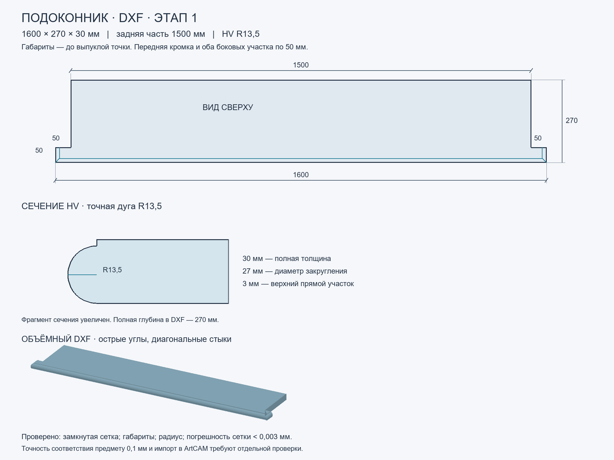

# Подоконник: чертёж и объёмная модель DXF

Проект `stone_project`. Первый этап подготовлен для пользовательской проверки в ArtCAM 2018. Дата: 12.09.2026.

## Задача и исходники

По фотографии предмета с размерами и схеме построить внешний контур и объёмную форму подоконника. Результат текущего этапа - DXF. Требуемая точность соответствия предмету - 0,1 мм.

Рабочая папка: `W:\obsidian\_parad\Prompts\Jenja\stone_project`.

Входящие файлы находятся в `artifacts/09122026/in1`:

- `photo_2026-09-12_13-39-54.jpg` - фотография подоконника с размерами и изображением профиля HV.
- `photo_2026-09-12_13-40-11.jpg` - схема вида сверху и спереди.

Геометрия построена по размерным надписям и уточнениям пользователя. Прожилки камня являются текстурой и в геометрию рельефа не переносились.

## Согласованная геометрия

| Параметр | Значение |
| --- | --- |
| Общая длина | 1600 мм |
| Ширина задней части | 1500 мм |
| Общая глубина | 270 мм |
| Толщина | 30 мм |
| Боковые выступы по ширине | по 50 мм |
| Глубина передних выступов | 50 мм |
| Кромка | HV, радиус 13,5 мм |
| Высота полукруглого участка | 27 мм |
| Верхний прямой участок | 3 мм |

Размеры 270 и 50 мм заданы до крайней выпуклой точки профиля. HV проходит по передней кромке и обоим боковым участкам глубиной 50 мм. Передние углы острые в плане; профили соединяются по диагональным стыкам. Эти три решения прямо подтверждены пользователем.

Плоская верхняя грань отступает на 13,5 мм от габаритной передней линии и профилированных боковых линий. Задние уступы сохраняют прямые грани. Сечение HV включает полукруг радиуса 13,5 мм и вертикальный участок от высоты 27 до 30 мм.

## Координаты и единицы

Во всех DXF заданы миллиметры. Чистый контур, отдельное сечение и объёмная модель построены 1:1. X идёт вдоль длины, Y - от передней габаритной линии к окну, Z - от нижней плоскости вверх. Начало координат - пересечение габаритных плоскостей X=0, Y=0, Z=0; из-за закругления эта точка не принадлежит поверхности детали.

Контур XY имеет вершины: (0;0), (1600;0), (1600;50), (1550;50), (1550;270), (50;270), (50;50), (0;50), затем замыкается. В отдельном DXF сечения горизонтальная ось означает глубину, вертикальная - высоту; это 2D-сечение в плоскости файла XY.

## Готовые файлы

Результаты находятся в `artifacts/09122026/out1`:

| Файл | Назначение |
| --- | --- |
| `sill_drawing_mm.dxf` | Размерный чертёж: вид сверху, спереди и сечение HV |
| `sill_contour_1600x270_mm.dxf` | Один замкнутый габаритный контур без размеров и подписей |
| `sill_section_HV_R13p5_mm.dxf` | Замкнутое сечение глубиной 270 мм и высотой 30 мм с точной дугой R13,5 |
| `sill_volume_3d_mm.dxf` | Замкнутая объёмная сетка, сущности 3DFACE |
| `sill_preview.png` | Быстрый обзор контура, профиля и объёмной формы |
| `sill_drawing.svg`, `sill_drawing.png` | Визуализация непосредственно из размерного DXF |
| `verification.json` | Результаты программных проверок и SHA-256 файлов DXF |

В размерном чертеже виды сверху и спереди построены 1:1, сечение показано увеличенным в 4 раза с размерными надписями в фактических миллиметрах. Для импорта геометрии использовать отдельные файлы контура, сечения или объёма. Размерный лист содержит вспомогательные линии и подписи.

Краткий PDF-обзор сохранён рядом с этим README как `project_overview.pdf`. Скрипт построения и проверок - `../work/build_sill.py` относительно этого README.

## Выполненные проверки

- Все четыре DXF повторно прочитаны библиотекой ezdxf: ошибок и автоматических исправлений не обнаружено. Формат - DXF R2000, единицы - мм.
- Проверены восемь вершин и замыкание внешнего контура. Площадь габаритной проекции - 410000 мм².
- Проверены радиус 13,5 мм и габарит сечения 270 × 30 мм. Дуги в сечении и виде спереди сохранены точно, без ломаной аппроксимации.
- Проверены габариты объёмной модели 1600 × 270 × 30 мм. Сетка содержит 784 вершины и 1564 треугольника, замкнута, каждое ребро принадлежит двум граням, ориентация граней согласована.
- Расчётная верхняя граница отклонения сетки от заданных цилиндрических поверхностей и диагональных стыков - 0,00256 мм. Это погрешность цифровой аппроксимации, а не точность изготовления.
- Объём сетки - 12100123,12 мм³; аналитический объём - 12100208,98 мм³. Относительное отличие - около 0,00071 %.
- Чертёж и обзор просмотрены после визуализации.

Точность соответствия реальному предмету 0,1 мм по двум предоставленным изображениям не подтверждена: для этого нужны контрольные измерения. Фактический импорт DXF в ArtCAM 2018 в этой сессии не выполнялся.

## Проверка в ArtCAM 2018

Для плоского контура импортировать `sill_contour_1600x270_mm.dxf` как векторы, выбрать миллиметры и проверить габарит 1600 × 270 мм. При необходимости сохранять слои исходного DXF. Порядок описан в [справке Autodesk по импорту векторов](https://help.autodesk.com/cloudhelp/2018/ENU/ARTC-ReferenceHelp/files/GUID-E1FE771F-21C8-443E-B431-DDCF5C00BD95.htm).

Файл `sill_volume_3d_mm.dxf` импортировать как 3D-модель, а не как векторы. Autodesk перечисляет DXF среди форматов треугольных моделей; доступность импорта зависит от лицензии. См. [справку Autodesk по импорту 3D](https://help.autodesk.com/cloudhelp/2018/ENU/ARTC-ReferenceHelp/files/GUID-8079B8A9-E4F3-4BD3-9574-75199C288B48.htm).

Полный профиль HV имеет нижнюю обратную часть: одной и той же точке XY на кромке соответствуют две высоты поверхности. Поэтому полная 3D-геометрия и рельеф с единственной высотой Z на каждую точку XY различаются. При преобразовании модели в такой рельеф необходимо проверить, какая часть кромки сохранена. На текущем этапе подготовлен полный объёмный DXF.

## Граница этапа и продолжение

Следующее действие - пользовательская проверка чертежа, формы профиля и импорта. До её результата не переходить к STL, управляющей программе .nc или постпроцессору для DSP RichAuto A11S.

По отдельному запросу пользователя подготовлен `../stage1_reusable_prompt.md` в родительской папке этапа. Для новых исходников он требует заново уточнить параметры и ответы; проверка импорта текущего проекта ещё не завершена.

Карточка работы: `Tasks/Items/stone_project/TASK-20260912-001.md`, статус после передачи результата - Review.

## Дополнение 23.09.2026 — STL и SOLIDWORKS 2016

По запросу для PARAD-002 повторно проверен [STL полной детали](sill_volume_mm.stl): один замкнутый компонент, 1600 × 270 × 30 мм. Существующий STL не изменён.

По согласованию вместо SLDPRT более новой версии подготовлен [STEP AP214 для переноса в SOLIDWORKS 2016](sill_1600x270x30_HV_SW2016.step). Одно твёрдое тело и совпадение геометрии проверены чтением, записью и повторным чтением в OpenCASCADE. STEP сохраняет мелкую гранёную аппроксимацию исходного STL, без параметрического дерева построения.

[Инструкция открытия и сохранения в SLDPRT](SOLIDWORKS_2016_README.md) · [Отчёт проверки](solidworks_exchange_verification.json).

SOLIDWORKS 2016 на этом компьютере не установлен; нативный файл 2016 не создан. Старый PDF относится к ранее выполненному этапу и не пересоздавался; сведения о новом STEP находятся в этом дополнении и отдельной инструкции.

25.09.2026 — Полный [комплект УП без резания PARAD-002](cnc/README.md) размещён в out1/cnc однотипно с PARAD-003. [Открыть PDF-обзор PARAD-002](cnc/project_overview.pdf). Исторический комплект и исходные скрипты сохранены.
