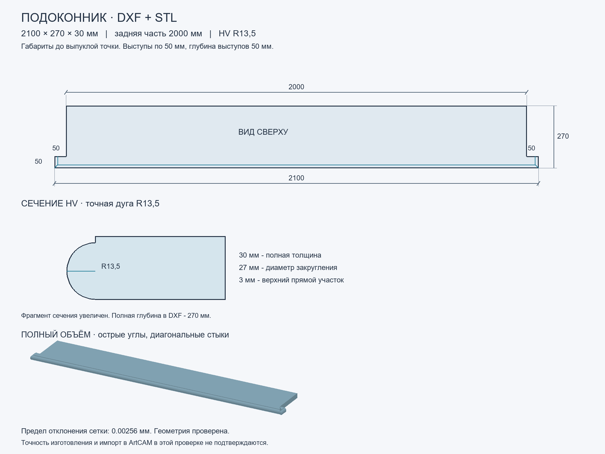

# Подоконник 2100 × 270 × 30 мм

Пакет DXF + STL по промпту «Podoconnik 1 step STL». Новый запуск от 12.09.2026. Геометрия и файлы проверены программно; результат передан на пользовательскую проверку. Импорт в ArtCAM 2018 не проверен.

## Заданные размеры и форма

| Параметр | Значение |
| --- | --- |
| Общая длина L | 2100 мм |
| Общая глубина D | 270 мм |
| Постоянная толщина H | 30 мм |
| Ширина задней части | 2000 мм |
| Боковые выступы | По 50 мм, глубина 50 мм |
| Кромка HV | Радиус 13,5 мм, высота дуги 27 мм |
| Верхний прямой участок | 3 мм |
| Профилированные участки | Передняя кромка и оба боковых участка по 50 мм |
| Передние углы | Острые, с диагональными стыками профилей |
| Точность цифровой формы | Требуемое отклонение не более 0,1 мм |

Размеры заданы до крайней выпуклой точки профиля. Верхняя плоская поверхность отступает от передней и профилированных боковых габаритных линий на 13,5 мм. Задние уступы и задняя кромка прямые. Деталь перестроена параметрически по L и D; фиксированные выступы и профиль не масштабировались.

## Геометрия и координаты

X направлена вдоль длины, Y - от передней габаритной линии к окну, Z - снизу вверх. Габаритная область: X=0…2100, Y=0…270, Z=0…30 мм. Начало координат задано пересечением габаритных плоскостей, а не вершиной закруглённой поверхности.

Вершины габаритного контура XY: (0;0), (2100;0), (2100;50), (2050;50), (2050;270), (50;270), (50;50), (0;50). Контур замкнут. В отдельном файле сечения горизонталь означает глубину, вертикаль - высоту.

## Созданные файлы

Все результаты данного запуска находятся в `out2`, рядом с прежней папкой `out`. Предыдущий пакет не изменён.

| Файл | Назначение |
| --- | --- |
| `podoconnik_drawing_mm.dxf` | Размерный чертёж: вид сверху, спереди и сечение |
| `podoconnik_contour_mm.dxf` | Один чистый замкнутый контур без подписей |
| `podoconnik_section_HV_mm.dxf` | Точное сечение 270 × 30 мм с дугой R13,5 |
| `podoconnik_volume_3d_mm.dxf` | Полная замкнутая объёмная сетка 3DFACE |
| `podoconnik_volume_mm.stl` | Один бинарный STL полной детали из объёмного DXF |
| `podoconnik_preview.png` | Обзор контура, профиля и объёма |
| `podoconnik_drawing.svg` | Векторная визуализация фактического DXF |
| `podoconnik_drawing.png` | Изображение фактического размерного DXF |
| `verification.json` | Измерения и проверки DXF, контрольные суммы |
| `work/stl_verification.json` | Проверки STL и сравнение с исходным DXF |
| `work/run_parameters.json` | Параметры текущего запуска |
| `work/build_podoconnik.py` | Параметрическое построение и проверки DXF |
| `work/convert_podoconnik_stl.py` | Конвертация объёмного DXF в STL с проверками |
| `work/build_project_pdf.py` | Формирование PDF после проверки полноты пакета |
| `work/requirements.txt` | Зависимости скриптов |
| `README.md`, `project_overview.pdf` | Описание этого запуска и его PDF-обзор |

## Результаты проверок

- Все четыре DXF повторно прочитаны без ошибок и автоматических исправлений. Формат DXF R2000, единицы - мм. Контур, отдельное сечение и объём построены 1:1.
- Габариты DXF и STL: 2100 × 270 × 30 мм; задняя ширина 2000 мм. Площадь габаритного контура 545000 мм². Радиус 13,5 мм и толщина 30 мм подтверждены по геометрии.
- Объёмная сетка содержит 784 вершины и 1564 треугольника. STL состоит из одного связного замкнутого компонента; каждое ребро принадлежит двум граням. Вырожденных треугольников нет, ориентация граней и нормали согласованы.
- Верхняя оценка погрешности триангуляции профиля и диагональных стыков - 0,002556 мм. Дополнительное максимальное отклонение вершины при записи STL - 0,000122 мм. Их сумма меньше 0,00268 мм и требуемых 0,1 мм.
- Объём сетки DXF: 16090736,391 мм³; объём STL: 16090736,393 мм³. Аналитический объём: 16090847,795 мм³. Относительное отличие сетки от аналитической формы около 0,000692 %.
- Чертёж и обзор просмотрены. Исходный объёмный DXF при конвертации в STL не изменён.

## Открытие и ограничения

В ArtCAM 2018 чистый контур импортируй как векторы, а объёмный DXF или STL - как 3D-модель. При импорте выбирай миллиметры; стандарт STL не хранит единицы в отдельном поле. Фактический импорт в ArtCAM в этой сессии не выполнялся.

Размерный лист содержит подписи и увеличенное сечение 4:1 с надписями в фактических миллиметрах. Для импорта рабочей геометрии используй отдельный контур, сечение или объём, а не весь размерный лист.

Полный HV имеет нижнюю обратную часть. При переводе в рельеф с единственной высотой на каждую точку XY необходимо проверить, какая часть профиля сохраняется. В объёмном DXF и STL сохранена полная деталь. Точность изготовления и соответствие физическому предмету этими цифровыми проверками не подтверждаются.

## Порядок сборки пакета

Сначала созданы и проверены DXF, STL, изображения, скрипты и отчёты; затем подготовлен этот окончательный README. PDF формируется последним, после проверки наличия и контрольных сумм остальных файлов по окончательным путям. После формирования PDF все страницы подлежат визуальной проверке. Изменение состава или содержания пакета требует повторного формирования PDF.

Следующий шаг - пользовательская проверка. Управляющая программа .nc и постпроцессор в этот запуск не входят.

