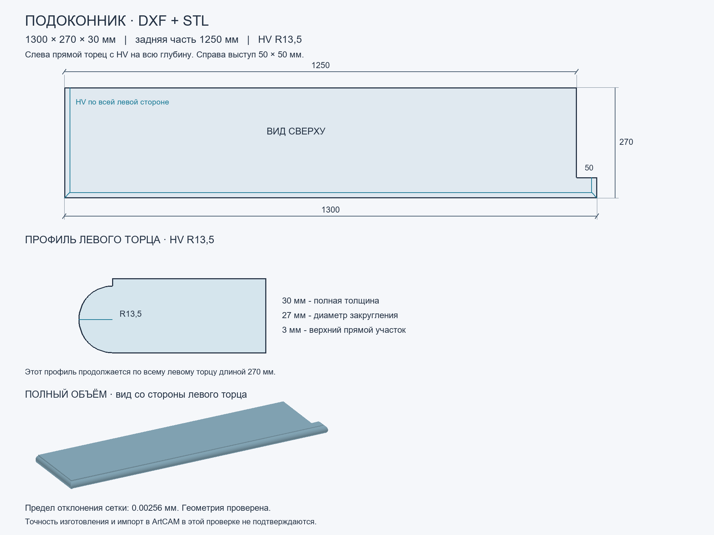

# Подоконник 1300 × 270 × 30 мм

Версия 3: прямой левый торец с HV на всю глубину. Пакет DXF + STL по промпту «Podoconnik 1 step STL - 3», запуск от 12.09.2026. Геометрия и файлы проверены программно; результат подготовлен для пользовательской проверки. Импорт в ArtCAM 2018 не проверен.

## Размеры и форма

| Параметр | Значение |
| --- | --- |
| Общие габариты L × D × H | 1300 × 270 × 30 мм |
| Ширина задней части | 1250 мм |
| Левый торец | Прямой, без выемки, HV на всей глубине 270 мм |
| Правый передний выступ | Ширина 50 мм, глубина 50 мм |
| Профиль HV | Радиус 13,5 мм; высота полукруга 27 мм |
| Верхний прямой участок | 3 мм |
| Участки с HV | Передняя кромка 1300 мм, весь левый торец 270 мм, правый участок 50 мм |
| Передние углы | Острые в плане, с диагональными стыками профилей |
| Задняя кромка и правый уступ | Прямые грани |
| Допуск цифровой формы | Не более 0,1 мм |

Лево и право определяются при взгляде с длинной передней профилированной стороны к окну. Размеры заданы до крайней выпуклой точки профиля. Верхняя плоскость отступает от профилированных габаритных линий на 13,5 мм. У задней кромки левый HV заканчивается сечением; на заднюю кромку он не переходит.

## Геометрия и координаты

X направлена слева направо вдоль длины, Y — от передней габаритной линии к окну, Z — снизу вверх. Габаритная область: X=0…1300, Y=0…270, Z=0…30 мм. Начало координат — пересечение габаритных плоскостей.

Замкнутый контур XY имеет шесть вершин: (0;0), (1300;0), (1300;50), (1250;50), (1250;270), (0;270). Левой ступеньки нет. В отдельном 2D-сечении горизонталь означает глубину, вертикаль — высоту.

## Состав пакета

Результаты сохранены в out3, рядом с out и out2, внутри W:/obsidian/_parad/Prompts/Jenja/stone_project/artifacts/09122026. Исходный промпт в out3 сохранён без изменений.

| Файл | Назначение |
| --- | --- |
| `podoconnik_drawing_mm.dxf` | Размерный чертёж: виды сверху, спереди и два сечения |
| `podoconnik_contour_mm.dxf` | Один чистый замкнутый габаритный контур |
| `podoconnik_section_HV_mm.dxf` | Точное сечение 270 × 30 мм с аналитической дугой R13,5 |
| `podoconnik_volume_3d_mm.dxf` | Полная замкнутая сетка из треугольников 3DFACE |
| `podoconnik_volume_mm.stl` | Один бинарный STL всей детали из сохранённого объёмного DXF |
| `podoconnik_preview.png` | Обзор формы, профиля и объёма |
| `podoconnik_drawing.svg` | Векторная визуализация фактического чертежа DXF |
| `podoconnik_drawing.png` | Растровая визуализация того же DXF |
| `verification.json` | Проверки DXF и геометрии, контрольные суммы |
| `work/stl_verification.json` | Проверки STL и сравнение с исходным DXF |
| `work/run_parameters.json` | Подтверждённые параметры запуска |
| `work/build_podoconnik3.py` | Параметрическое построение версии 3 и проверки |
| `work/convert_podoconnik_stl.py` | Конвертация объёмного DXF в STL с проверками |
| `work/build_project_pdf.py` | Сборка PDF после проверки остальных файлов |
| `work/requirements.txt` | Зависимости скриптов |
| `README.md` | Описание текущего запуска |
| `project_overview.pdf` | PDF-обзор по окончательному README |

## Результаты проверок

- Все четыре DXF повторно прочитаны без ошибок и автоматических исправлений. Формат R2000, единицы — миллиметры. Контур, отдельное сечение и объём имеют масштаб 1:1.
- Габариты DXF и STL — 1300 × 270 × 30 мм, задняя ширина — 1250 мм. Площадь габаритного контура — 340000 мм². Радиус 13,5 мм, дуга высотой 27 мм и верхний участок 3 мм проверены по геометрии.
- Левый профиль дополнительно проверен по пересечениям сохранённой сетки с плоскостями Y=72, 160 и 259 мм. Максимальное радиальное отклонение — 0,001771 мм. На чертеже показано сечение XZ при Y=160 мм: слева HV, справа прямая грань.
- Сетка содержит 588 вершин и 1172 треугольника. STL — один связный замкнутый компонент; каждое ребро принадлежит двум граням. Характеристика Эйлера — 2; вырожденных граней нет, ориентация граней и нормали согласованы.
- Верхняя оценка отклонения сетки от математической формы — 0,002556 мм. Дополнительное максимальное смещение вершины при записи STL — 0,0000588 мм. Суммарная оценка меньше 0,002615 мм и заданного допуска 0,1 мм.
- Объём сетки DXF — 10009625,000 мм³; STL — 10009624,998 мм³; аналитический объём — 10009706,769 мм³. Отличие сетки от аналитической формы около 0,000817 %, обусловлено триангуляцией дуги.
- STL создан без перестроения сетки. Исходный объёмный DXF при конвертации не изменён. Чертёж и обзор просмотрены.

## Импорт и ограничения

В ArtCAM 2018 чистый контур предназначен для импорта векторов, объёмный DXF и STL — для импорта 3D-модели. При импорте STL выбирай миллиметры: стандарт STL не содержит поля единиц. Фактический импорт в ArtCAM не проверен.

Размерный лист включает увеличенное сечение 4:1 с размерами в фактических миллиметрах. Для рабочей геометрии используй отдельный контур, сечение или объёмный файл.

В DXF и STL сохранён весь объём HV, включая нижнюю обратную часть. Рельеф с единственной высотой Z для каждой точки XY не может полностью представить такую форму. Точность изготовления и соответствие физическому изделию этими цифровыми проверками не подтверждаются.

## Воспроизведение и порядок сборки

Скрипт work/build_podoconnik3.py принимает --length 1300 --depth 270 --output с путём к новой папке. Затем work/convert_podoconnik_stl.py принимает последовательно путь объёмного DXF, путь STL, путь отчёта проверки, длину 1300 и глубину 270. Для другого запуска параметры нужно заново запросить у пользователя согласно сохранённому промпту.

Сначала сохранены и проверены DXF, STL, изображения, скрипты и отчёты; затем записан окончательный README. PDF создаётся последним по окончательным путям после проверки наличия файлов, габаритов и контрольных сумм. Скрипт PDF контролирует, что остальные файлы не изменились во время его создания. После сборки все страницы PDF проходят визуальную проверку. Любое изменение пакета требует повторного формирования PDF последним.

Результат ожидает пользовательской проверки. Управляющая программа .nc и постпроцессор в этот запуск не входят.
