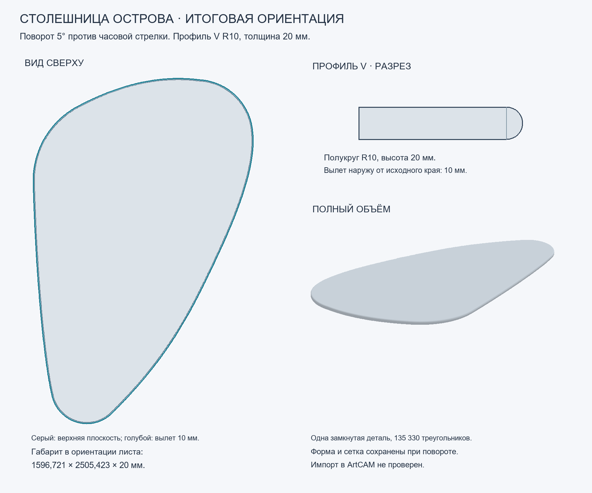
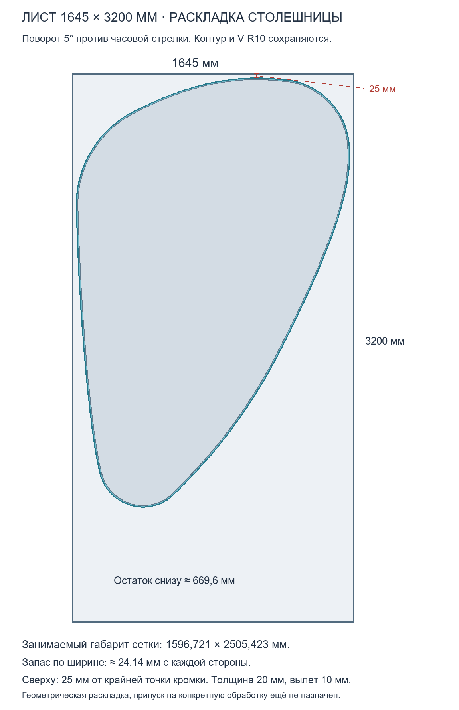

# Столешница острова

Итоговый комплект DXF + STL по заданию «Stol 1 step STL 4», 13.09.2026. Столешница повёрнута на 5° против часовой стрелки и размещена на имеющемся листе камня 1645 × 3200 мм. Фактический контур сохранён без масштабирования.

| Параметр | Итоговое значение |
| --- | --- |
| Толщина и профиль | 20 мм; V, полукруг R10 по всему периметру |
| Вылет кромки | 10 мм наружу от исходного края столешницы |
| Габарит исходного контура | 1627,612 × 2423,897 мм до добавления кромки |
| Габарит итоговой сетки в осях листа | 1596,721 × 2505,423 × 20 мм |
| Отступ сверху | 25 мм от крайней точки кромки |
| Отступы слева и справа | По 24,139 мм; деталь центрирована по ширине |
| Остаток снизу | 669,577 мм до крайней точки детали |

<!-- pagebreak -->

## Раскладка на имеющемся камне

Лист 1645 × 3200 мм вмещает деталь с кромкой. Все указанные зазоры измерены до наружного габарита, включая вылет 10 мм. Свободные полосы являются геометрическим запасом; припуск, инструмент, крепление и пригодность краёв камня для обработки отдельно не проверялись.

<!-- pagebreak -->

## Исходники и принятые решения

Рабочая папка результата: W:/obsidian/_parad/Prompts/Jenja/stone_project/artifacts/09122026/out4. Входящие файлы сохраняются в соседней in4.

Из общего файла «Белинского_48_13_06_26_Лист_23_Чертеж_кухонного_острова_М1_15.dxf» выделены три дуги и три сплайна внешнего контура. Фото photo_2026-09-13_00-21-13.jpg использовано для идентификации светло-серой столешницы; photo_2026-09-13_00-20-52.jpg задаёт профиль V высотой 20 мм и вылетом 10 мм. Отверстий в согласованной детали нет.

Надписи 1630 × 2420 мм в исходном листе расходятся с фактической геометрией. По подтверждению пользователя сохранён фактический контур 1627,611692 × 2423,897346 мм. Небольшие изломы на стыках исходных дуг и сплайнов сохранены; произвольное сглаживание формы не выполнялось.

Неповёрнутые объёмный DXF и STL ранее скопированы в in4. Именно эти файлы прочитаны и сверены перед формированием итогового комплекта; входные файлы остались неизменными. Сетка повёрнута и перенесена без перестроения. Итоговый STL получен повторным чтением итогового объёмного DXF.

Предварительный расчёт квадратного листа был заменён по уточнению пользователя раскладкой на имеющемся прямоугольном камне. Справочно: для исходной формы с кромкой геометрический минимум квадрата с подбором поворота составлял около 2150,603 мм, вариант с запасом - 2200 × 2200 мм. Эти размеры не являются требованием к имеющемуся листу: для него принята показанная раскладка 1645 × 3200 мм.

## Общая система координат

Начало O=(0;0;0) находится в нижнем левом углу листа на уровне нижней поверхности. X направлена вправо, Y вверх на виде сверху, Z по толщине. Камень занимает X=0…1645, Y=0…3200; столешница Z=0…20 мм.

К координатам входной объёмной модели применён поворот 5° против часовой стрелки вокруг Z, затем перенос X=150,886620901 мм, Y=645,523002129 мм, Z=0. Все итоговые контуры, объёмный DXF, STL и раскладка используют это преобразование. Локальное нормальное сечение профиля показано отдельно; его оси означают вылет и высоту, а не координаты листа.

Пределы итогового объёма: X=24,139338…1620,860662; Y=669,577087…3175; Z=0…20 мм. Геометрический расчёт гладкого наружного габарита даёт 1596,727 × 2505,425 мм, а фактически сохранённая сетка - 1596,721 × 2505,423 мм; разница менее 0,006 мм связана с аппроксимацией кривых. Раскладка и размерные подписи итоговой сетки согласованы между собой.

## Проверки и точность

- Все итоговые DXF повторно прочитаны без ошибок и автоматических исправлений. Формат R2000, единицы - миллиметры; рабочие контуры и объём 1:1.
- STL содержит 135330 треугольников и 67667 вершин, один связный замкнутый компонент. Каждое ребро принадлежит двум граням; нормали согласованы, вырожденных треугольников нет. Характеристика Эйлера равна 2.
- Объём DXF до и после поворота: 56638950,213 мм³. Объём итогового STL: 56638950,207 мм³. Независимое интегрирование сечений аппроксимированного контура даёт 56639366,454 мм³; отличие сетки около 0,000735 %.
- Оценка погрешности модели с учётом контура, профиля и стыков - 0,020955 мм. Максимальное дополнительное смещение вершины при записи итогового STL - 0,000137 мм. Суммарная оценка меньше 0,022 мм и заданного допуска цифровой формы 0,1 мм.
- Обратный поворот и перенос восстановили входную сетку с максимальной ошибкой менее 0,000000001 мм. Контрольные суммы подтверждают неизменность входных DXF и STL. Чертёж, объём и раскладка просмотрены.

<!-- pagebreak -->

## Файлы итогового комплекта

| Файл | Назначение |
| --- | --- |
| stol_drawing_mm.dxf | Размерный лист: раскладка, габариты, пояснения и сечение |
| stol_contour_mm.dxf | Чистый замкнутый наружный габарит с кромкой в координатах листа |
| stol_base_exact_mm.dxf | Точные дуги и сплайны границы верхней/нижней плоскости после поворота |
| stol_source_extracted_mm.dxf | Выделенный контур в итоговых координатах; совпадает с stol_base_exact_mm.dxf |
| stol_sections_mm.dxf | Локальное нормальное сечение V R10 в масштабе 1:1 |
| stol_volume_3d_mm.dxf | Полная замкнутая сетка 3DFACE, повёрнутая и размещённая на листе |
| stol_volume_mm.stl | Один бинарный STL полной детали в той же системе координат |
| stol_stock_layout_mm.dxf | Контур камня и столешницы на отдельных слоях |
| stol_preview.png | Обзор фактической модели и профиля |
| stol_drawing.svg | Векторная визуализация итогового размерного DXF |
| stol_drawing.png | Растровая визуализация того же DXF |
| stock_1645x3200_rotation5.png | Согласованная раскладка с верхним отступом 25 мм |
| verification.json | Проверки DXF, геометрии и преобразования |
| work/stl_verification.json | Проверки итогового STL и соответствия DXF |
| work/run_parameters.json | Параметры листа, поворота, переноса и отступов |
| work/source_manifest.json | Источники, исходные сущности, решения и контрольные суммы |
| work/package_manifest.json | Контрольные суммы файлов перед созданием PDF |
| README.md | Окончательное описание текущего запуска |
| project_overview.pdf | PDF по этому README, созданный последним |

В work также сохранены скрипты, зависимости, массивы модели и исходные вспомогательные данные для воспроизведения. Файл «Stol 1 step STL 4.md» в out4 сохранён как исходный промпт задания.

## Воспроизведение, импорт и порядок сборки

Скрипт work/finalize_stol.py принимает --input с путём к in4, --output с новой пустой папкой результата и --support с путём к work/source_support. Он проверяет исходные файлы и применяет согласованное преобразование. Затем work/convert_stol_stl.py получает пути итогового объёмного DXF, STL и отчёта, ширину 1596.7213240849414 и длину 2505.422912957953; work/render_stol_final.py получает папку результата. Зависимости перечислены в work/requirements.txt.

Для ArtCAM 2018 используйте отдельный чистый контур для векторов, объёмный DXF или STL для 3D-модели. Выбирайте миллиметры и сохраняйте заданное положение при импорте. STL не хранит единицы в отдельном поле. Импорт в ArtCAM не проверен. В полном профиле V есть нижняя обратная часть, которую нельзя полностью представить одной высотой Z на каждую точку XY. Точность изготовления этими проверками не подтверждается.

Сначала сохранены и проверены DXF, STL, изображения, скрипты и отчёты, затем записан окончательный README. PDF формируется последним после проверки состава и контрольных сумм файлов по окончательным путям; после сборки все страницы проходят визуальную проверку. При изменении пакета PDF необходимо сформировать заново последним.

Комплект передан на пользовательскую проверку. УП .nc, постпроцессор и операции на станке в этот этап не входят.
